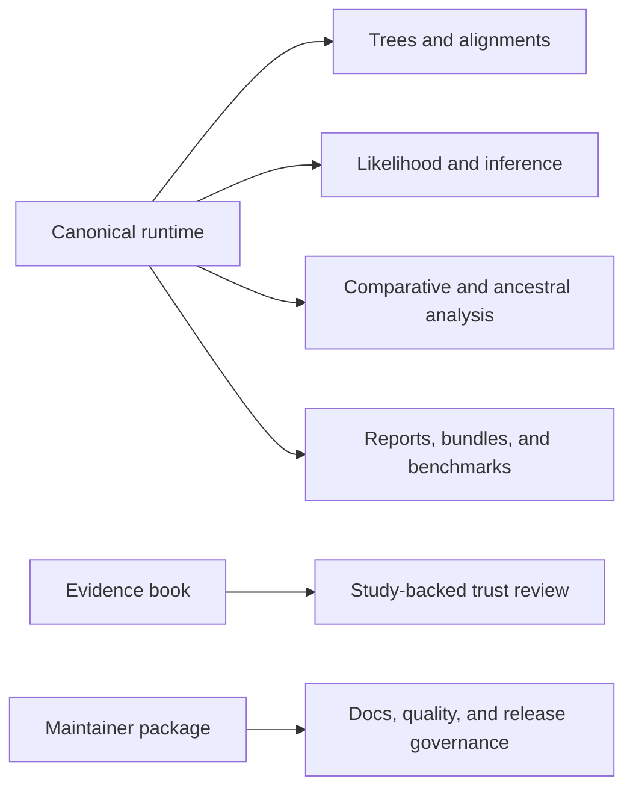

# bijux-phylogenetics

<!-- bijux-phylogenetics-badges:generated:start -->

<!-- bijux-phylogenetics-badges:generated:end -->

`bijux-phylogenetics` is a contract-first repository for phylogenetic runtime
engineering, comparative analysis, native inference, evidence-linked
reporting, and release-grade scientific documentation.

This repository is not a thin wrapper around a few shell commands. The
checked-in runtime already spans tree semantics, alignments, native
likelihood, maximum-likelihood inference, supported Bayesian workflows,
comparative and ancestral analysis, explicit parsimony, datasets, reporting,
benchmarks, and governed evidence.

## Start Here

- [Documentation home](https://bijux.io/bijux-phylogenetics/)
- [Phylogenetics product guide](https://bijux.io/bijux-phylogenetics/phylogenetics/)
- [Runtime architecture](https://bijux.io/bijux-phylogenetics/phylogenetics/architecture/)
- [Surface selection guide](https://bijux.io/bijux-phylogenetics/phylogenetics/interfaces/surface-selection/)
- [Artifact consumption guide](https://bijux.io/bijux-phylogenetics/phylogenetics/interfaces/artifact-consumption-guide/)
- [Validation lanes](https://bijux.io/bijux-phylogenetics/phylogenetics/quality/validation-lanes/)
- [Claim reading guide](https://bijux.io/bijux-phylogenetics/phylogenetics/foundation/claim-reading-guide/)
- [Native maximum-likelihood workflows](https://bijux.io/bijux-phylogenetics/phylogenetics/operations/native-maximum-likelihood-workflows/)
- [Native Bayesian workflows](https://bijux.io/bijux-phylogenetics/phylogenetics/operations/native-bayesian-workflows/)
- [Native benchmark review](https://bijux.io/bijux-phylogenetics/phylogenetics/operations/native-benchmark-review/)
- [Evidence Book](https://bijux.io/bijux-phylogenetics/phylogenetics-evidence-book/)
- [Maintainer handbook](https://bijux.io/bijux-phylogenetics/03-bijux-phylogenetics-maintain/)

## What This Repository Publishes

| Surface | Role |
| --- | --- |
| `bijux-phylogenetics` | Canonical runtime package and CLI |
| `phylogenetic` | Compatibility alias package with the same runtime story |
| `bijux-phylogenetics-dev` | Repository-owned maintainer tooling for docs, release, quality, and publication checks |
| `docs/` | Public handbook, evidence-book guide, and maintainer handbook |
| `evidence-book/` | Checked-in study dossiers, freshness reports, integrity reports, and governed bundle records |

## Runtime Depth At A Glance

The public surface should make the breadth visible instead of hiding it behind
generic toolkit language:

| Capability family | What is already here |
| --- | --- |
| Trees | validation, rootedness review, comparison, clade extraction, MRCA lookup, support normalization, tree-set inspection, rendering, and an owned `PhyloTree` runtime |
| Alignments | FASTA validation, trimming, coding checks, translation, partition-aware inputs, and packaged example resources |
| Native likelihood | finite-state likelihood foundations across nucleotide, protein, codon, and discrete Mk families |
| Native inference | native maximum-likelihood tree inference results, support summaries, search traces, and native Bayesian public inference entry points |
| Comparative analysis | PGLS, Brownian and OU modeling, phylogenetic signal, discrete-state evolution, regression review, and model-selection ledgers |
| Ancestral analysis | continuous and discrete ancestral reconstruction, uncertainty ledgers, state-transition review, and reviewer-facing output bundles |
| Parsimony | Fitch, Wagner, Sankoff, Dollo, Camin-Sokal, ACCTRAN, DELTRAN, bootstrap, jackknife, NNI, SPR, and ratchet-oriented owned scoring surfaces |
| Simulation and datasets | packaged example inputs, study datasets, benchmark corpora, and simulation families used by tests and review workflows |
| External-engine workflows | MAFFT, trimAl, IQ-TREE2, FastTree, MrBayes, and BEAST orchestration where wrapper ownership remains the honest product boundary |
| Reports and bundles | HTML reports, TSV and JSON artifacts, manifests, evidence-linked bundles, benchmark outputs, and release-truth surfaces |

## Why This Is A Real Runtime

The public story is stronger than "we can call a few external tools":

- the repository owns a real tree runtime with explicit topology, support,
  rootedness, split, and distance semantics
- the workflow layer writes typed results and reviewable artifacts instead of
  burying scientific state in notebooks or shell output
- native maximum-likelihood and Bayesian surfaces now sit in the documented
  public contract alongside broader workflow entry points
- the evidence-book and maintainer package make release claims traceable rather
  than leaving them as marketing text

## Flagship Runtime Surfaces

Readers who want the fastest route to the most substantial owned work should
start here:

- tree, topology, and support review on the owned `PhyloTree` runtime
- native finite-state likelihood across nucleotide, protein, codon, and
  discrete Mk families
- native maximum-likelihood tree inference results with governed benchmark
  review
- native Bayesian public inference entry points for supported DNA workflows
- comparative and ancestral workflows that emit reviewer-facing artifacts
- evidence-book study families that keep course-derived comparative work
  inspectable and bounded

## What Exists Today

The runtime already supports all of the following broad capability groups:

- tree validation, inspection, comparison, rooting, rendering, and tree-set
  review
- alignment diagnostics, filtering, trimming, coding-sequence validation, and
  translation
- native finite-state likelihood foundations across nucleotide, protein,
  codon, and discrete Mk families
- native maximum-likelihood tree inference results with support evidence,
  benchmark metadata, and governed comparison surfaces
- native Bayesian public inference entry points for fixed-topology and
  joint-topology DNA workflows
- comparative trait analysis, ancestral-state workflows, discrete-state
  evolution analysis, diversification review, and simulation surfaces
- explicit parsimony scoring, ancestral reconstruction, and search families
- packaged datasets, benchmark corpora, and simulation surfaces that support
  both runtime examples and review workflows
- governed adapter surfaces for external tools such as MAFFT, trimAl,
  IQ-TREE2, FastTree, MrBayes, and BEAST
- evidence bundle creation, publication review, and artifact packaging

The root README still needs to say this carefully: native maximum-likelihood
tree inference results and native Bayesian public inference entry points now
exist, but that is not the same claim as saying every inference workflow in the
repository is equally mature or fully evidence-closed.

## How To Read The Breadth Honestly

This repository owns three related but different public stories:

- a runtime story about what users can run
- an evidence story about what has been checked on governed studies
- a release story about whether documentation, metadata, builds, and evidence
  still agree

That distinction matters because the code surface is broader than the currently
closed evidence surface. The public trust model lives in:

- [Validation lanes](https://bijux.io/bijux-phylogenetics/phylogenetics/quality/validation-lanes/)
- [Evidence honesty and limits](https://bijux.io/bijux-phylogenetics/phylogenetics/quality/evidence-honesty-and-limits/)
- [Evidence Book](https://bijux.io/bijux-phylogenetics/phylogenetics-evidence-book/)
- [Maintainer handbook](https://bijux.io/bijux-phylogenetics/03-bijux-phylogenetics-maintain/)

## Reader Entry Points

- Choose the [runtime package README](packages/bijux-phylogenetics/README.md)
  when you want install, workflow, and API guidance.
- Choose the [alias package README](packages/phylogenetic/README.md) when you
  want the shorter distribution name without a smaller runtime.
- Choose the [maintainer package README](packages/bijux-phylogenetics-dev/README.md)
  when the question is documentation alignment, release truth, or repository
  health.
- Choose the [product guide](docs/phylogenetics/index.md) when you want a
  structured handbook rather than a repository overview.

## Package Map

The `2` publishable runtime packages are:

| Package | Role | Links |
| --- | --- | --- |
| `bijux-phylogenetics` | Canonical runtime package for the full public Python and CLI surface |    |
| `phylogenetic` | Compatibility alias package for the same runtime behavior, benchmark, workflow, and reporting surfaces |    |

Repository-owned developer tooling lives in the
[maintainer package](packages/bijux-phylogenetics-dev/README.md).

## Common Commands

- `make help`
  List repository automation targets.
- `make install`
  Sync the editable environment from the tracked `uv.lock`.
- `make check`
  Run the main verification pass across lock checks, lint, tests, docs, and
  distribution verification.
- `make package-verify`
  Build wheels and sdists, validate them, install them into clean
  environments, and smoke-test packaged examples through the public runtime.
- `make docs-serve`
  Serve the docs locally at `http://127.0.0.1:8000/`.
- `make sync-badges`
  Render the shared badge catalog into managed `README` surfaces.

## Local Artifact Contract

- transient local outputs belong under `artifacts/`, not as ad hoc root-level
  cache or build directories
- curated checked-in comparative trust studies belong under `evidence-book/`
- the shared root environment lives at `artifacts/root/check-venv/`
- maintainer commands should prefer `artifacts/root/check-venv/` directly over
  depending on a root alias path
- root `.venv`, `.tox`, `.hypothesis`, and `.benchmarks` are disposable
  compatibility aliases into `artifacts/root/`; `make setup` may recreate them
  and `make clean-root-artifacts` may remove them
- the MkDocs site builds to `artifacts/root/docs/site/`

## Repository Layout

- `configs/`
  Repository-owned tool configuration.
- `docs/`
  The public handbook, evidence-book guide, and maintainer handbook.
- `makes/`
  Automation, orchestration, and governed execution surfaces.
- `evidence-book/`
  Checked-in comparative-study evidence and repository-wide trust reports.
- `packages/`
  Publishable package boundaries and maintainer tooling.
- `artifacts/`
  Transient local outputs such as built docs, package bundles, and test
  products.

## Documentation

Useful entry points:

- [Documentation home](docs/index.md)
- [Public phylogenetics guide](docs/phylogenetics/index.md)
- [Surface selection guide](docs/phylogenetics/interfaces/surface-selection.md)
- [Artifact consumption guide](docs/phylogenetics/interfaces/artifact-consumption-guide.md)
- [Validation lanes](docs/phylogenetics/quality/validation-lanes.md)
- [Claim reading guide](docs/phylogenetics/foundation/claim-reading-guide.md)
- [Evidence Book guide](docs/phylogenetics-evidence-book/index.md)
- [Maintainer handbook](docs/03-bijux-phylogenetics-maintain/index.md)
- [Runtime package README](packages/bijux-phylogenetics/README.md)
- [Alias package README](packages/phylogenetic/README.md)

## License

This repository is licensed under the Apache License 2.0. See
[`LICENSE`](LICENSE) and [`NOTICE`](NOTICE).
