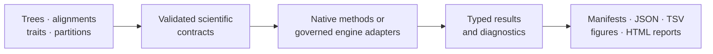

# bijux-phylogenetics

<!-- bijux-phylogenetics-badges:generated:start -->
[](https://pypi.org/project/bijux-phylogenetics/)
[](https://github.com/bijux/bijux-phylogenetics/blob/main/LICENSE)
[](https://github.com/bijux/bijux-phylogenetics/actions/workflows/verify.yml?query=branch%3Amain)
[](https://github.com/bijux/bijux-phylogenetics/actions/workflows/release-pypi.yml)
[](https://github.com/bijux/bijux-phylogenetics/actions/workflows/release-ghcr.yml)
[](https://github.com/bijux/bijux-phylogenetics/actions/workflows/release-github.yml)
[](https://github.com/bijux/bijux-phylogenetics/actions/workflows/deploy-docs.yml)
[](https://github.com/bijux/bijux-phylogenetics/releases)
[](https://github.com/bijux?tab=packages&repo_name=bijux-phylogenetics)
[](https://github.com/bijux/bijux-phylogenetics/tree/main/packages)

[](https://pypi.org/project/bijux-phylogenetics/)
[](https://pypi.org/project/phylogenetic/)

[](https://github.com/bijux/bijux-phylogenetics/pkgs/container/bijux-phylogenetics%2Fbijux-phylogenetics)
[](https://github.com/bijux/bijux-phylogenetics/pkgs/container/bijux-phylogenetics%2Fphylogenetic)

[](https://bijux.io/bijux-phylogenetics/01-bijux-phylogenetics/)
[](https://bijux.io/bijux-phylogenetics/01-bijux-phylogenetics/)
<!-- bijux-phylogenetics-badges:generated:end -->

`bijux-phylogenetics` is a Python runtime for phylogenetic inference,
comparative analysis, ancestral reconstruction, parsimony, simulation, and
reviewable scientific reporting. It combines owned numerical methods with
explicit adapters for established external engines and preserves the inputs,
diagnostics, and provenance needed to audit a run.



## Install

The canonical distribution supports Python 3.11 and newer:

```bash
python -m pip install bijux-phylogenetics
bijux-phylogenetics --help
```

The `phylogenetic` distribution provides shorter installation, import, and
command names for the same runtime:

```bash
python -m pip install phylogenetic
phylogenetic --help
```

Use `bijux-phylogenetics` in environments, papers, and support requests when
an unambiguous canonical name matters. The alias is not a reduced edition.

## What Is Implemented

| Domain | Runtime depth |
| --- | --- |
| trees | owned `PhyloTree` semantics; validation, rootedness, clades, MRCA, support normalization, topology comparison, tree sets, and rendering |
| alignments | FASTA validation, trimming, translation, coding diagnostics, identity review, and partition-aware inputs |
| likelihood | finite-state nucleotide, protein, codon, and discrete Mk foundations |
| inference | native maximum-likelihood result and search surfaces; supported native Bayesian DNA entry points |
| comparative methods | PGLS, Brownian and OU models, phylogenetic signal, discrete evolution, regression assessment, and model selection |
| ancestral methods | continuous and discrete reconstruction, uncertainty ledgers, stochastic mapping, and tree-set review |
| parsimony | Fitch, Wagner, Sankoff, Dollo, Camin–Sokal, ACCTRAN, DELTRAN, resampling, NNI, SPR, and ratchet-oriented search |
| scientific context | datasets, simulations, benchmarks, biogeography, phylogeography, diversification, and ecology review surfaces |
| publication | typed results, manifests, tables, figures, HTML reports, supplementary material, and evidence-linked bundles |

MAFFT, trimAl, IQ-TREE2, FastTree, MrBayes, and BEAST remain external
computational engines. Their adapters own input preparation, invocation,
failure capture, output parsing, and normalization; they do not relabel the
external algorithms as native code.

## Python Workflow API

Curated workflow entry points live under `bijux_phylogenetics.api`:

```python
from pathlib import Path

from bijux_phylogenetics.api import (
    render_report_workflow,
    run_comparative_model_workflow,
    run_sequence_to_tree_workflow,
)

run = run_sequence_to_tree_workflow(
    Path("dataset/sequences.fasta"),
    out_dir=Path("artifacts/sequence-to-tree"),
    sequence_type="dna",
)

model = run_comparative_model_workflow(
    Path("dataset/tree.nwk"),
    Path("dataset/traits.tsv"),
    response="response",
    predictors=["predictor"],
    lambda_value=1.0,
)

render_report_workflow(
    tree_path=run.output_paths["tree"],
    alignment_path=run.output_paths["trimmed_alignment"],
    traits_path=Path("dataset/traits.tsv"),
    metadata_path=Path("dataset/metadata.tsv"),
    out_path=Path("artifacts/sequence-to-tree/report.html"),
)

run.write_json(Path("artifacts/sequence-to-tree/workflow.json"))
model.write_tsv(Path("artifacts/comparative-model.tsv"))
```

Use Python for in-process composition and rich typed diagnostics. Use the CLI
for repeatable shell execution. Preserve machine-readable artifacts when the
result must outlive the process or be reviewed independently.

## Native Inference

Representative owned entry points include:

- `bijux_phylogenetics.phylo.likelihood.infer_nucleotide_maximum_likelihood_result(...)`
- `bijux_phylogenetics.phylo.likelihood.infer_nucleotide_maximum_likelihood_result_from_alignment(...)`
- `bijux_phylogenetics.phylo.likelihood.NucleotideMaximumLikelihoodResult`
- `bijux_phylogenetics.bayesian.run_bayesian_inference(...)`
- `bijux_phylogenetics.benchmark.benchmark_native_maximum_likelihood_suite(...)`

Native ownership identifies where the algorithm is implemented. It does not
claim that every model, dataset, or biological interpretation has equivalent
evidence. Numerical tests, benchmark corpora, and governed study records state
their own scope.

## Evidence Book

The checked-in [`evidence-book/`](evidence-book/README.md) contains five
course-derived comparative study families and their governed bundles:

- primate longevity, phylogenetic signal, and ancestral reconstruction;
- primate GLS, PGLS, tree transformation, and signal diagnostics;
- primate continuous and categorical comparative regression;
- cichlid Bayesian linear and phylogenetic mixed models;
- cichlid phylogenetic generalized linear mixed models.

Each bundle connects claim identifiers to source provenance, input manifests,
analysis code, checks, results, and reviewer verdicts. The cichlid posterior
workflows retain their external `MCMCglmm` boundary; nearby runtime capability
is not presented as a substitute.

## Trust Vocabulary

| Term | Meaning |
| --- | --- |
| implemented | executable code owns the stated behavior |
| tested | a named contract passes its fixtures |
| benchmarked | metrics were measured on a named corpus and configuration |
| evidence-backed | a governed bundle supports a bounded claim |
| released | packages, documentation, schemas, and declared evidence passed publication gates at a revision |

These terms are deliberately narrower than “scientifically appropriate for
every use.” Model choice, study design, diagnostics, and independent review
remain essential.

## Repository Map

| Path | Responsibility |
| --- | --- |
| `packages/bijux-phylogenetics/` | canonical runtime distribution |
| `packages/phylogenetic/` | compatibility distribution |
| `packages/bijux-phylogenetics-dev/` | repository verification and publication tooling |
| `docs/` | product, evidence, and maintainer website source |
| `evidence-book/` | governed study dossiers and review indexes |
| `apis/` | versioned OpenAPI contract |
| `configs/` and `makes/` | repository-owned automation configuration |
| `artifacts/` | transient local outputs |

## Documentation

- [Documentation home](https://bijux.io/bijux-phylogenetics/)
- [Product handbook](https://bijux.io/bijux-phylogenetics/01-bijux-phylogenetics/)
- [Runtime architecture](https://bijux.io/bijux-phylogenetics/01-bijux-phylogenetics/architecture/)
- [Surface selection](https://bijux.io/bijux-phylogenetics/01-bijux-phylogenetics/interfaces/surface-selection/)
- [Native maximum-likelihood workflow](https://bijux.io/bijux-phylogenetics/01-bijux-phylogenetics/operations/native-maximum-likelihood-workflows/)
- [Native Bayesian workflow](https://bijux.io/bijux-phylogenetics/01-bijux-phylogenetics/operations/native-bayesian-workflows/)
- [Validation lanes](https://bijux.io/bijux-phylogenetics/01-bijux-phylogenetics/quality/validation-lanes/)
- [Evidence Book](https://bijux.io/bijux-phylogenetics/02-bijux-phylogenetics-evidence-book/)
- [Maintainer handbook](https://bijux.io/bijux-phylogenetics/03-bijux-phylogenetics-maintain/)

## Development

```bash
make install
make check
make docs-serve
make package-verify
```

Local generated output belongs under `artifacts/`; the MkDocs site is built
under `artifacts/root/docs/`.

## License

Apache License 2.0. See [`LICENSE`](LICENSE) and [`NOTICE`](NOTICE).
