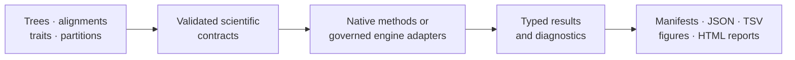
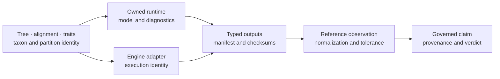
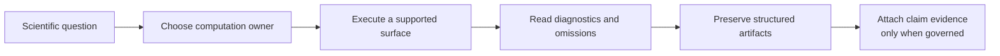

# bijux-phylogenetics

<!-- bijux-phylogenetics-badges:generated:start -->
[](https://pypi.org/project/bijux-phylogenetics/)
[](https://github.com/bijux/bijux-phylogenetics/blob/main/LICENSE)
[](https://github.com/bijux/bijux-phylogenetics/actions/workflows/verify.yml?query=branch%3Amain)
[](https://github.com/bijux/bijux-phylogenetics/actions/workflows/release-pypi.yml)
[](https://github.com/bijux/bijux-phylogenetics/actions/workflows/release-ghcr.yml)
[](https://github.com/bijux/bijux-phylogenetics/actions/workflows/release-github.yml)
[](https://github.com/bijux/bijux-phylogenetics/actions/workflows/deploy-docs.yml)
[](https://github.com/bijux/bijux-phylogenetics/releases)
[](https://github.com/bijux?tab=packages&repo_name=bijux-phylogenetics)
[](https://github.com/bijux/bijux-phylogenetics/tree/main/packages)

[](https://pypi.org/project/bijux-phylogenetics/)
[](https://pypi.org/project/phylogenetic/)

[](https://github.com/bijux/bijux-phylogenetics/pkgs/container/bijux-phylogenetics%2Fbijux-phylogenetics)
[](https://github.com/bijux/bijux-phylogenetics/pkgs/container/bijux-phylogenetics%2Fphylogenetic)

[](https://bijux.io/bijux-phylogenetics/01-bijux-phylogenetics/)
[](https://bijux.io/bijux-phylogenetics/01-bijux-phylogenetics/)
<!-- bijux-phylogenetics-badges:generated:end -->

`bijux-phylogenetics` is a Python runtime for phylogenetic inference,
comparative analysis, ancestral reconstruction, parsimony, simulation, and
reviewable scientific reporting. Its defining contract begins before a model
runs and continues after it finishes: identify the admitted data and tree,
attribute each computation, retain diagnostics and artifacts, and connect any
published statement to the evidence that actually supports it.

Owned numerical methods and explicit adapters for external engines share one
result discipline. Inputs, exclusions, configuration, diagnostics, failures,
and output identities remain connected instead of being reduced to a final
tree, coefficient, or figure.

In practical terms, the installed package lets you validate and transform
trees and alignments, fit native likelihood and comparative models, run
ancestral and parsimony analyses, orchestrate named external engines, and emit
machine-readable results with review artifacts. The repository adds benchmark,
parity, and Evidence Book records around selected questions; those assurance
records are not prerequisites for using every runtime capability and do not
automatically transfer to neighboring methods.



## What You Can Build

The runtime supports complete analytical records, not only isolated helper
functions:

| Starting scientific object | Analysis you can carry through | Durable result |
| --- | --- | --- |
| sequences and partitions | validate, align or trim through named engines, infer and support a tree | admitted sequence population, alignments, engine-native files, typed tree result, and manifest |
| tree and continuous traits | reconcile taxa, fit comparative covariance models, estimate signal, regressions, and ancestors | population/design identity, estimates, diagnostics, uncertainty, and tables |
| tree and discrete characters | fit transition or parsimony models, reconstruct states, and summarize branch changes | state/model identity, node probabilities or supported sets, branch observations, and opportunity denominators |
| candidate trees or tree populations | compare splits, support, consensus, instability, and downstream sensitivity | structurally keyed observations with rooting, taxa, and complete denominators |
| an accepted scientific result | render review packages and connect selected claims to governed evidence | machine source, report projections, inventory, and bounded claim record |

These routes can be composed through Python or executed through supported CLI
workflows. The output is intentionally richer than the headline estimate:
downstream review depends on knowing which population, model, computation
owner, diagnostic state, and artifacts produced it.

| If you need… | Use… | Preserve… |
| --- | --- | --- |
| an in-process scientific result | the curated Python API | typed result, admitted inputs, warnings, and diagnostics |
| a repeatable shell workflow | the CLI | structured output, manifest, terminal state, and output inventory |
| an established external algorithm | a named adapter for MAFFT, IQ-TREE2, BEAST, or another supported engine | executable identity, native files, parser record, and normalized child result |
| an auditable claim about correspondence | parity or an Evidence Book bundle | exact population, observations, rule, denominator, verdict, and limitations |

The first three rows are execution choices. The last is an evidence decision.
Keeping that distinction visible is the shortest route through this repository.

## Distinguish Capability, Ownership, And Evidence

Three labels answer different questions in this repository. They must not be
used as synonyms.

| Label | What it means | Required proof | What it does not imply |
| --- | --- | --- | --- |
| native capability | Bijux owns the numerical or structural computation | public contract, implementation, tests, typed result, and diagnostics | correspondence with another implementation or suitability for a study |
| governed integration | Bijux owns admission, invocation, capture, parsing, and normalization around another engine | adapter contract, engine identity, native outputs, parser state, and failure record | ownership of the external algorithm |
| parity evidence | two named implementations were compared under aligned assumptions | selected case, both observations, normalization, tolerance, and complete denominator | evidence for a broader scientific claim or untested model |
| study evidence | a bounded statement is adjudicated from governed source, execution, observation, and freshness records | Evidence Book claim, dependencies, checks, verdict, limitations, and current indexes | validation of every capability used nearby |

A method can be native without having a corresponding Evidence Book study. An
external workflow can be fully reproducible without becoming native. A parity
observation can be exact while the scientific claim that would consume it is
still incomplete. The relevant record must carry the label and scope.

## Choose A Starting Point

| You need to… | Start with… | Leave with… |
| --- | --- | --- |
| prove the installed package can produce linked artifacts | [the capability demo](#run-a-reviewable-example) | a manifest, structured reports, and an explicit demonstration boundary |
| compose an analysis in Python | [the workflow API](#python-workflow-api) | a typed result whose warnings and diagnostics remain available to the caller |
| choose a model or understand its assumptions | [Scientific domains](https://bijux.io/bijux-phylogenetics/02-bijux-phylogenetics-domains/) | the scientific object, estimand, failure modes, and required review record |
| compare behavior with APE, GEIGER, phytools, or an external engine | [parities and correspondence](https://bijux.io/bijux-phylogenetics/04-bijux-phylogenetics-parities/) | a named reference relationship, comparison denominator, and bounded outcome |
| determine what evidence supports a public claim | [the Evidence Book](https://bijux.io/bijux-phylogenetics/03-bijux-phylogenetics-evidence-book/) | a claim identifier, observation population, verdict, limitations, and freshness state |
| change or release the repository | [the maintainer handbook](https://bijux.io/bijux-phylogenetics/05-bijux-phylogenetics-maintain/) | the owning source, affected projections, focused checks, and release evidence |

These are different assurance levels. A successful demo establishes packaging
and artifact linkage, not numerical accuracy. A correct runtime result is not
automatically a cross-tool parity result. A nearby passing evidence bundle does
not support a claim that it does not name. Only a bounded statement linked to
its current governed bundle is described here as evidence-backed.

## Follow A Complete Study Guide

| Scientific journey | Guide | Boundary made explicit |
| --- | --- | --- |
| raw sequences to supported tree | [Sequence-to-tree study](https://bijux.io/bijux-phylogenetics/01-bijux-phylogenetics/operations/sequence-to-tree-study/) | Bijux orchestration versus MAFFT, trimAl, and IQ-TREE2 computation |
| tree and traits to regression and ancestral results | [Comparative and ancestral study](https://bijux.io/bijux-phylogenetics/01-bijux-phylogenetics/operations/comparative-and-ancestral-study/) | shared data lineage versus separate estimands and claims |
| two trees to a bounded structural comparison | [Topology comparison study](https://bijux.io/bijux-phylogenetics/01-bijux-phylogenetics/operations/topology-comparison-study/) | shared-taxon denominator, rooting, splits, and support separation |
| structured results to a human review view | [Analysis report handoff](https://bijux.io/bijux-phylogenetics/01-bijux-phylogenetics/operations/analysis-report-handoff/) | analytical owner versus report projection |
| failed or incomplete work to a safe consumer decision | [Result and refusal semantics](https://bijux.io/bijux-phylogenetics/01-bijux-phylogenetics/interfaces/result-and-refusal-semantics/) | interface outcome versus scientific state |
| evidence bundle to a citable statement | [Reading an evidence bundle](https://bijux.io/bijux-phylogenetics/03-bijux-phylogenetics-evidence-book/reading-an-evidence-bundle/) | bundle summary versus claim and observation records |

These guides begin with a scientific object and end with the record another
person needs to review. Use the command reference only after choosing the
study contract; command availability must not choose the scientific question.

## Install

The canonical distribution supports Python 3.11 and newer:

```bash
python -m pip install bijux-phylogenetics
bijux-phylogenetics --help
```

The `phylogenetic` distribution provides shorter installation, import, and
command names for the same runtime:

```bash
python -m pip install phylogenetic
phylogenetic --help
```

Use `bijux-phylogenetics` in environments, papers, and support requests when
an unambiguous canonical name matters. The alias is not a reduced edition.

## Run A Reviewable Example

The installed wheel includes a four-taxon tree, an alternative topology, an
alignment, traits, and metadata. The capability demo copies those inputs into
a writable run directory and produces tree, dataset, input-coherence, and
topology-comparison reports:

```bash
bijux-phylogenetics demo run \
  --out artifacts/capability-demo \
  --manifest artifacts/capability-demo/manifest.json \
  --json
```

Start review with `artifacts/capability-demo/manifest.json`, then inspect the
HTML files under `artifacts/capability-demo/reports/`. This demonstration
proves packaged-resource access, parsing, report construction, and artifact
linkage. Its small synthetic inputs do not establish inference accuracy or
biological validity.

### Read The Demo As A Connected Record

| Record | What to establish |
| --- | --- |
| `manifest.json` | exact command, runtime identity, input and output checksums, and declared output inventory |
| `capability-summary.md` | which capabilities ran and where their review artifacts were written |
| `reports/phylo-inputs-report.json` | whether tree, alignment, traits, and metadata form a coherent input set |
| `reports/tree-report.json` | structural tree facts behind the rendered tree report |
| `reports/dataset-report.json` | dataset linkage and coverage behind the rendered dataset report |
| `reports/comparison-report.html` | human review of the supplied alternative topology |

The JSON records own machine-readable facts; the HTML reports explain them.
If the manifest omits an expected file, treat the file as missing even when a
similarly named report exists elsewhere.

## What Is Implemented

| Domain | Runtime depth |
| --- | --- |
| trees | owned `PhyloTree` semantics; validation, rootedness, clades, MRCA, support normalization, topology comparison, tree sets, and rendering |
| alignments | FASTA validation, trimming, translation, coding diagnostics, identity review, and partition-aware inputs |
| likelihood | finite-state nucleotide, protein, codon, and discrete Mk foundations |
| inference | native maximum-likelihood result and search surfaces; supported native Bayesian DNA entry points |
| comparative methods | PGLS, Brownian and OU models, phylogenetic signal, discrete evolution, regression assessment, and model selection |
| ancestral methods | continuous and discrete reconstruction, uncertainty ledgers, stochastic mapping, and tree-set review |
| parsimony | Fitch, Wagner, Sankoff, Dollo, Camin–Sokal, ACCTRAN, DELTRAN, resampling, NNI, SPR, and ratchet-oriented search |
| datasets and study inputs | typed biological, recovery, stress, pathogen, and phylogenomic families; catalog discovery, portable exports, workflows, provenance, and taxon-table admission |
| spatial and ecological evolution | discrete biogeography, transition constraints, migration chronology, tree-set events, continuous phylogeography, host switching, niche evolution, and map ledgers |
| scientific assurance and publication | simulations, diagnostics, benchmarks, typed results, supplementary tables, tree/trait figures, methods text, manifests, package comparison, and revalidation |

MAFFT, trimAl, IQ-TREE2, FastTree, MrBayes, and BEAST remain external
computational engines. Their adapters own input preparation, invocation,
failure capture, output parsing, and normalization; they do not relabel the
external algorithms as native code.

## Choose A Scientific Route

Start from the scientific object and required result, not from a familiar tool
name. The route determines which assumptions and artifacts must survive:

| Starting object and question | Owning route | Result that carries the decision |
| --- | --- | --- |
| sequences needing a reviewable tree | alignment contract, then native or external inference | accepted alignment identity, model/search result, tree, diagnostics, manifest |
| fixed topology needing a likelihood | native finite-state likelihood | model, state order, branch parameters, site/component likelihoods, warnings |
| character matrix seeking a minimum-change explanation | native parsimony scoring and search | cost model, character scores, search trace, equal-best trees, support |
| tree and continuous traits testing association | comparative covariance and PGLS | reconciled population, design matrix, covariance, coefficients, residual diagnostics |
| tree and discrete states reconstructing history | Mk fitting, ancestral reconstruction, or stochastic mapping | rate model, node probabilities, branch events, uncertainty, exclusions |
| packaged or external study inputs needing an admitted population | dataset catalog and study-input contracts | source identity, schema, taxon linkage, transformations, exclusions, derived dataset identity |
| regions, coordinates, hosts, or niches reconstructing change | biogeography, phylogeography, or ecology review | state/coordinate model, nodes, branches, events, uncertainty, constraints, exclusions |
| candidate trees or methods needing sensitivity review | tree-set, benchmark, parity, and diagnostic surfaces | complete comparison population, observation rules, failures, denominator |
| structured results needing publication views | reporting, rendering, and publication-package review | row identity, visual encoding, manifest, inventory, audit and revalidation record |
| external native files needing review | named engine parser and artifact contract | engine/file identity, parser state, structured observations, checksums |
| result supporting a public scientific claim | governed Evidence Book bundle | claim identity, inputs, observations, checks, freshness, verdict |

Several routes may use the same tree or table without producing equivalent
evidence. Preserve the result owned by each route and link them through content
identity; do not substitute the final Newick, figure, or headline scalar for
the analytical record.

## Follow One Analysis From Data To Claim

The runtime, an external engine, and the Evidence Book can participate in one
analysis without sharing ownership. The record at each boundary says who made
the scientific decision and what survives for review.



| Boundary | Scientific decision | Authoritative record | Failure that must remain visible |
| --- | --- | --- | --- |
| input intake | which taxa, characters, traits, tree, and partitions are analyzed | validated object summaries and input checksums | duplicate or missing taxa, invalid states, incoherent dimensions |
| native computation | which likelihood, covariance, prior, search, or reconstruction is evaluated | typed result with model state and diagnostics | non-finite objective, boundary solution, incomplete search, sampler warning |
| external execution | which external executable and configuration produced the native files | engine manifest, version, command, streams, output checksums | unavailable binary, timeout, non-zero exit, stale or malformed output |
| comparison | which quantities are equivalent enough to compare | observation rows with identities, normalization, tolerance, and denominator | missing reference, convention mismatch, unexplained numerical difference |
| scientific claim | which bounded conclusion the retained observations support | Evidence Book claim, checks, freshness, and verdict | `mismatch_unexplained`, `not_comparable`, stale evidence, absent primary output |

A workflow can stop legitimately at any row. For example, an external-engine
run may produce a valid tree without participating in a reference comparison,
and a native result may be useful without a governed study claim. The stopping
point must be explicit; capability proximity is not inherited evidence.

## Select An Execution Contract

| Work | Execution owner | Record to preserve | Strongest claim available from that record |
| --- | --- | --- | --- |
| inspect or transform an in-memory scientific object | named runtime module | typed return value plus input identity | the documented operation completed under its preconditions |
| compose a repeatable analysis | `bijux_phylogenetics.api` workflow | workflow result and serialized output inventory | the declared stages completed with the retained diagnostics |
| infer with an owned numerical method | native likelihood, inference, Bayesian, or parsimony surface | model/search state, estimates, diagnostics, seed, and artifacts | Bijux performed the identified computation |
| invoke MAFFT, IQ-TREE2, BEAST, or another supported engine | adapter plus external executable | command, executable identity, native files, parser state, and normalized result | the named engine produced output accepted by the adapter contract |
| evaluate a governed scientific claim | Evidence Book bundle | claim, provenance, inputs, observations, checks, freshness, and verdict | the bundle verdict supports only its identified claim scope |

Choose the contract before choosing the command. A normalized adapter result
does not become a native result, and a completed workflow does not become
study evidence until a governed claim consumes it.



## Read A Result At The Right Layer

| Record | Question it answers | Question it cannot answer alone |
| --- | --- | --- |
| typed Python result | What did the method return, and which diagnostics qualify it? | Can another process reconstruct the run? |
| manifest and linked artifacts | Which inputs, configuration, versions, and outputs belong to this run? | Is the method accurate beyond this execution? |
| validation result | Did a named invariant or numerical rule hold? | Does the behavior generalize beyond the fixtures? |
| benchmark report | How did the method behave on a named corpus and environment? | Is it suitable for an untested study? |
| parity observation | Did Bijux and a named reference agree for the selected case? | Are the tools interchangeable outside the registry? |
| Evidence Book bundle | What verdict is supported for an identified scientific claim? | Does the verdict extend to neighboring claims or methods? |

Start from the most specific record that answers the question. Do not infer
study evidence from a successful run, package-wide equivalence from one parity
case, or biological adequacy from a numerical benchmark.

## Keep Reruns Scientifically Distinct

A rerun is the same analytical attempt only when every identity that can
change the result remains fixed and the owning contract explicitly permits
reuse. Otherwise it is a related execution with a new record.

| Change between executions | Required treatment |
| --- | --- |
| output directory or presentation format only | preserve the original result identity and record the new projection |
| runtime or external-engine version | create a new execution identity and compare results explicitly |
| input bytes, taxon population, alignment, tree, or partition | create a new analysis identity; do not describe the output as a replay |
| model, prior, transform, tolerance, search, sampler, seed policy, or thread policy | create a new method/configuration identity |
| parser or normalization code | retain the native parent output and create a new parsed projection |
| failed attempt followed by a successful attempt | retain both attempts and select the accepted one without erasing the failure denominator |

`resume` is narrower than rerun: it continues or reuses state only after the
producer verifies its parent inputs, configuration, executable, completion
state, and output inventory. A stable path or matching headline value is not
identity proof.

## Python Workflow API

Curated workflow entry points live under `bijux_phylogenetics.api`:

```python
from pathlib import Path

from bijux_phylogenetics.api import (
    render_report_workflow,
    run_comparative_model_workflow,
    run_sequence_to_tree_workflow,
)

run = run_sequence_to_tree_workflow(
    Path("dataset/sequences.fasta"),
    out_dir=Path("artifacts/sequence-to-tree"),
    sequence_type="dna",
)

model = run_comparative_model_workflow(
    Path("dataset/tree.nwk"),
    Path("dataset/traits.tsv"),
    response="response",
    predictors=["predictor"],
    lambda_value=1.0,
)

render_report_workflow(
    tree_path=run.output_paths["tree"],
    alignment_path=run.output_paths["trimmed_alignment"],
    traits_path=Path("dataset/traits.tsv"),
    metadata_path=Path("dataset/metadata.tsv"),
    out_path=Path("artifacts/sequence-to-tree/report.html"),
)

run.write_json(Path("artifacts/sequence-to-tree/workflow.json"))
model.write_tsv(Path("artifacts/comparative-model.tsv"))
```

Use Python for in-process composition and rich typed diagnostics. Use the CLI
for repeatable shell execution. Preserve machine-readable artifacts when the
result must outlive the process or be reviewed independently.

## Native Inference

Representative owned entry points include:

- `bijux_phylogenetics.phylo.likelihood.infer_nucleotide_maximum_likelihood_result(...)`
- `bijux_phylogenetics.phylo.likelihood.infer_nucleotide_maximum_likelihood_result_from_alignment(...)`
- `bijux_phylogenetics.phylo.likelihood.NucleotideMaximumLikelihoodResult`
- `bijux_phylogenetics.bayesian.run_bayesian_inference(...)`
- `bijux_phylogenetics.benchmark.benchmark_native_maximum_likelihood_suite(...)`

Native ownership identifies where the algorithm is implemented. It does not
claim that every model, dataset, or biological interpretation has equivalent
evidence. Numerical tests, benchmark corpora, and governed study records state
their own scope.

## Evidence Book

The checked-in [`evidence-book/`](evidence-book/README.md) contains five
course-derived comparative study families and their governed bundles:

- primate longevity, phylogenetic signal, and ancestral reconstruction;
- primate GLS, PGLS, tree transformation, and signal diagnostics;
- primate continuous and categorical comparative regression;
- cichlid Bayesian linear and phylogenetic mixed models;
- cichlid phylogenetic generalized linear mixed models.

Each bundle connects claim identifiers to source provenance, input manifests,
analysis code, checks, results, and reviewer verdicts. The cichlid posterior
workflows retain their external `MCMCglmm` boundary; nearby runtime capability
is not presented as a substitute.

## Repository Map

| Path | Responsibility |
| --- | --- |
| `packages/bijux-phylogenetics/` | canonical runtime distribution |
| `packages/phylogenetic/` | compatibility distribution |
| `packages/bijux-phylogenetics-dev/` | repository verification and publication tooling |
| `docs/` | product, domains, evidence, parity, and maintainer website source |
| `evidence-book/` | governed study dossiers and review indexes |
| `apis/` | versioned OpenAPI contract |
| `configs/` and `makes/` | repository-owned automation configuration |
| `artifacts/` | transient local outputs |

The source tree is not required for the capability demo. Repository-only
verification and evidence-governance commands are intentionally kept out of
the runtime distribution.

## Documentation

- [Documentation home](https://bijux.io/bijux-phylogenetics/)
- [Product handbook](https://bijux.io/bijux-phylogenetics/01-bijux-phylogenetics/)
- [Scientific domains](https://bijux.io/bijux-phylogenetics/02-bijux-phylogenetics-domains/)
- [Parities and correspondence](https://bijux.io/bijux-phylogenetics/04-bijux-phylogenetics-parities/)
- [Evidence Book](https://bijux.io/bijux-phylogenetics/03-bijux-phylogenetics-evidence-book/)
- [Maintainer handbook](https://bijux.io/bijux-phylogenetics/05-bijux-phylogenetics-maintain/)

The five handbook entrances own navigation. Domain, workflow, interface,
validation, and study pages are linked from those entrances so this README
does not become a second, inevitably stale site navigation tree.

## Development

```bash
make install
make check
make docs-serve
make package-verify
```

Repository execution follows one storage rule. All transient local outputs belong under `artifacts/`.
The root verification environment lives at `artifacts/root/check-venv/`.
The root `.venv`, `.tox`, `.hypothesis`, and `.benchmarks` paths are governed
aliases into the corresponding artifact locations.
The MkDocs site is built under `artifacts/root/docs/site/`.

Use `make clean-root-artifacts` to remove repository-level run products. This
command does not replace source-control review and must not be used to conceal
an output that was written to the wrong owner path.

## License

Apache License 2.0. See [`LICENSE`](LICENSE) and [`NOTICE`](NOTICE).
