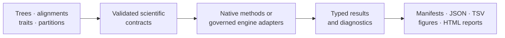
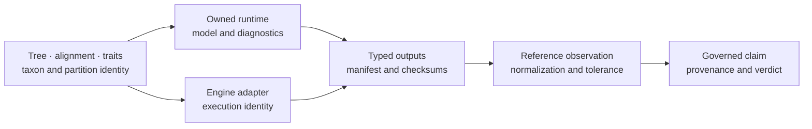
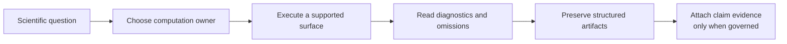

# bijux-phylogenetics

<!-- bijux-phylogenetics-badges:generated:start -->
[](https://pypi.org/project/bijux-phylogenetics/)
[](https://github.com/bijux/bijux-phylogenetics/blob/main/LICENSE)
[](https://github.com/bijux/bijux-phylogenetics/actions/workflows/verify.yml?query=branch%3Amain)
[](https://github.com/bijux/bijux-phylogenetics/actions/workflows/release-pypi.yml)
[](https://github.com/bijux/bijux-phylogenetics/actions/workflows/release-ghcr.yml)
[](https://github.com/bijux/bijux-phylogenetics/actions/workflows/release-github.yml)
[](https://github.com/bijux/bijux-phylogenetics/actions/workflows/deploy-docs.yml)
[](https://github.com/bijux/bijux-phylogenetics/releases)
[](https://github.com/bijux?tab=packages&repo_name=bijux-phylogenetics)
[](https://github.com/bijux/bijux-phylogenetics/tree/main/packages)

[](https://pypi.org/project/bijux-phylogenetics/)
[](https://pypi.org/project/phylogenetic/)

[](https://github.com/bijux/bijux-phylogenetics/pkgs/container/bijux-phylogenetics%2Fbijux-phylogenetics)
[](https://github.com/bijux/bijux-phylogenetics/pkgs/container/bijux-phylogenetics%2Fphylogenetic)

[](https://bijux.io/bijux-phylogenetics/01-bijux-phylogenetics/)
[](https://bijux.io/bijux-phylogenetics/01-bijux-phylogenetics/)
<!-- bijux-phylogenetics-badges:generated:end -->

`bijux-phylogenetics` is a Python runtime for phylogenetic inference,
comparative analysis, ancestral reconstruction, parsimony, simulation, and
reviewable scientific reporting. It combines owned numerical methods with
explicit adapters for established external engines and preserves the inputs,
diagnostics, and provenance needed to audit a run.



## Choose A Starting Point

| You need to… | Start with… |
| --- | --- |
| run a self-contained installed-package example | [the capability demo](#run-a-reviewable-example) |
| compose an analysis in Python | [the workflow API](#python-workflow-api) |
| find a model, assumption, or scientific output | [scientific domains](https://bijux.io/bijux-phylogenetics/02-bijux-phylogenetics-domains/) |
| compare behavior with APE, GEIGER, phytools, or an external engine | [parities and correspondence](https://bijux.io/bijux-phylogenetics/04-bijux-phylogenetics-parities/) |
| determine what evidence supports a claim | [the Evidence Book](https://bijux.io/bijux-phylogenetics/03-bijux-phylogenetics-evidence-book/) |
| change or release the repository | [the maintainer handbook](https://bijux.io/bijux-phylogenetics/05-bijux-phylogenetics-maintain/) |

## Install

The canonical distribution supports Python 3.11 and newer:

```bash
python -m pip install bijux-phylogenetics
bijux-phylogenetics --help
```

The `phylogenetic` distribution provides shorter installation, import, and
command names for the same runtime:

```bash
python -m pip install phylogenetic
phylogenetic --help
```

Use `bijux-phylogenetics` in environments, papers, and support requests when
an unambiguous canonical name matters. The alias is not a reduced edition.

## Run A Reviewable Example

The installed wheel includes a four-taxon tree, an alternative topology, an
alignment, traits, and metadata. The capability demo copies those inputs into
a writable run directory and produces tree, dataset, input-coherence, and
topology-comparison reports:

```bash
bijux-phylogenetics demo run \
  --out artifacts/capability-demo \
  --manifest artifacts/capability-demo/manifest.json \
  --json
```

Start review with `artifacts/capability-demo/manifest.json`, then inspect the
HTML files under `artifacts/capability-demo/reports/`. This demonstration
proves packaged-resource access, parsing, report construction, and artifact
linkage. Its small synthetic inputs do not establish inference accuracy or
biological validity.

### Read The Demo As A Connected Record

| Record | What to establish |
| --- | --- |
| `manifest.json` | exact command, runtime identity, input and output checksums, and declared output inventory |
| `capability-summary.md` | which capabilities ran and where their review artifacts were written |
| `reports/phylo-inputs-report.json` | whether tree, alignment, traits, and metadata form a coherent input set |
| `reports/tree-report.json` | structural tree facts behind the rendered tree report |
| `reports/dataset-report.json` | dataset linkage and coverage behind the rendered dataset report |
| `reports/comparison-report.html` | human review of the supplied alternative topology |

The JSON records own machine-readable facts; the HTML reports explain them.
If the manifest omits an expected file, treat the file as missing even when a
similarly named report exists elsewhere.

## What Is Implemented

| Domain | Runtime depth |
| --- | --- |
| trees | owned `PhyloTree` semantics; validation, rootedness, clades, MRCA, support normalization, topology comparison, tree sets, and rendering |
| alignments | FASTA validation, trimming, translation, coding diagnostics, identity review, and partition-aware inputs |
| likelihood | finite-state nucleotide, protein, codon, and discrete Mk foundations |
| inference | native maximum-likelihood result and search surfaces; supported native Bayesian DNA entry points |
| comparative methods | PGLS, Brownian and OU models, phylogenetic signal, discrete evolution, regression assessment, and model selection |
| ancestral methods | continuous and discrete reconstruction, uncertainty ledgers, stochastic mapping, and tree-set review |
| parsimony | Fitch, Wagner, Sankoff, Dollo, Camin–Sokal, ACCTRAN, DELTRAN, resampling, NNI, SPR, and ratchet-oriented search |
| scientific context | datasets, simulations, benchmarks, biogeography, phylogeography, diversification, and ecology review surfaces |
| publication | typed results, manifests, tables, figures, HTML reports, supplementary material, and evidence-linked bundles |

MAFFT, trimAl, IQ-TREE2, FastTree, MrBayes, and BEAST remain external
computational engines. Their adapters own input preparation, invocation,
failure capture, output parsing, and normalization; they do not relabel the
external algorithms as native code.

## Follow One Analysis From Data To Claim

The runtime, an external engine, and the Evidence Book can participate in one
analysis without sharing ownership. The record at each boundary says who made
the scientific decision and what survives for review.



| Boundary | Scientific decision | Authoritative record | Failure that must remain visible |
| --- | --- | --- | --- |
| input intake | which taxa, characters, traits, tree, and partitions are analyzed | validated object summaries and input checksums | duplicate or missing taxa, invalid states, incoherent dimensions |
| native computation | which likelihood, covariance, prior, search, or reconstruction is evaluated | typed result with model state and diagnostics | non-finite objective, boundary solution, incomplete search, sampler warning |
| external execution | which external executable and configuration produced the native files | engine manifest, version, command, streams, output checksums | unavailable binary, timeout, non-zero exit, stale or malformed output |
| comparison | which quantities are equivalent enough to compare | observation rows with identities, normalization, tolerance, and denominator | missing reference, convention mismatch, unexplained numerical difference |
| scientific claim | which bounded conclusion the retained observations support | Evidence Book claim, checks, freshness, and verdict | `mismatch_unexplained`, `not_comparable`, stale evidence, absent primary output |

A workflow can stop legitimately at any row. For example, an external-engine
run may produce a valid tree without participating in a reference comparison,
and a native result may be useful without a governed study claim. The stopping
point must be explicit; capability proximity is not inherited evidence.

## Select An Execution Contract

| Work | Execution owner | Record to preserve | Strongest claim available from that record |
| --- | --- | --- | --- |
| inspect or transform an in-memory scientific object | named runtime module | typed return value plus input identity | the documented operation completed under its preconditions |
| compose a repeatable analysis | `bijux_phylogenetics.api` workflow | workflow result and serialized output inventory | the declared stages completed with the retained diagnostics |
| infer with an owned numerical method | native likelihood, inference, Bayesian, or parsimony surface | model/search state, estimates, diagnostics, seed, and artifacts | Bijux performed the identified computation |
| invoke MAFFT, IQ-TREE2, BEAST, or another supported engine | adapter plus external executable | command, executable identity, native files, parser state, and normalized result | the named engine produced output accepted by the adapter contract |
| evaluate a governed scientific claim | Evidence Book bundle | claim, provenance, inputs, observations, checks, freshness, and verdict | the bundle verdict supports only its identified claim scope |

Choose the contract before choosing the command. A normalized adapter result
does not become a native result, and a completed workflow does not become
study evidence until a governed claim consumes it.



## Read A Result At The Right Layer

| Record | Question it answers | Question it cannot answer alone |
| --- | --- | --- |
| typed Python result | What did the method return, and which diagnostics qualify it? | Can another process reconstruct the run? |
| manifest and linked artifacts | Which inputs, configuration, versions, and outputs belong to this run? | Is the method accurate beyond this execution? |
| validation result | Did a named invariant or numerical rule hold? | Does the behavior generalize beyond the fixtures? |
| benchmark report | How did the method behave on a named corpus and environment? | Is it suitable for an untested study? |
| parity observation | Did Bijux and a named reference agree for the selected case? | Are the tools interchangeable outside the registry? |
| Evidence Book bundle | What verdict is supported for an identified scientific claim? | Does the verdict extend to neighboring claims or methods? |

Start from the most specific record that answers the question. Do not infer
study evidence from a successful run, package-wide equivalence from one parity
case, or biological adequacy from a numerical benchmark.

## Python Workflow API

Curated workflow entry points live under `bijux_phylogenetics.api`:

```python
from pathlib import Path

from bijux_phylogenetics.api import (
    render_report_workflow,
    run_comparative_model_workflow,
    run_sequence_to_tree_workflow,
)

run = run_sequence_to_tree_workflow(
    Path("dataset/sequences.fasta"),
    out_dir=Path("artifacts/sequence-to-tree"),
    sequence_type="dna",
)

model = run_comparative_model_workflow(
    Path("dataset/tree.nwk"),
    Path("dataset/traits.tsv"),
    response="response",
    predictors=["predictor"],
    lambda_value=1.0,
)

render_report_workflow(
    tree_path=run.output_paths["tree"],
    alignment_path=run.output_paths["trimmed_alignment"],
    traits_path=Path("dataset/traits.tsv"),
    metadata_path=Path("dataset/metadata.tsv"),
    out_path=Path("artifacts/sequence-to-tree/report.html"),
)

run.write_json(Path("artifacts/sequence-to-tree/workflow.json"))
model.write_tsv(Path("artifacts/comparative-model.tsv"))
```

Use Python for in-process composition and rich typed diagnostics. Use the CLI
for repeatable shell execution. Preserve machine-readable artifacts when the
result must outlive the process or be reviewed independently.

## Native Inference

Representative owned entry points include:

- `bijux_phylogenetics.phylo.likelihood.infer_nucleotide_maximum_likelihood_result(...)`
- `bijux_phylogenetics.phylo.likelihood.infer_nucleotide_maximum_likelihood_result_from_alignment(...)`
- `bijux_phylogenetics.phylo.likelihood.NucleotideMaximumLikelihoodResult`
- `bijux_phylogenetics.bayesian.run_bayesian_inference(...)`
- `bijux_phylogenetics.benchmark.benchmark_native_maximum_likelihood_suite(...)`

Native ownership identifies where the algorithm is implemented. It does not
claim that every model, dataset, or biological interpretation has equivalent
evidence. Numerical tests, benchmark corpora, and governed study records state
their own scope.

## Evidence Book

The checked-in [`evidence-book/`](evidence-book/README.md) contains five
course-derived comparative study families and their governed bundles:

- primate longevity, phylogenetic signal, and ancestral reconstruction;
- primate GLS, PGLS, tree transformation, and signal diagnostics;
- primate continuous and categorical comparative regression;
- cichlid Bayesian linear and phylogenetic mixed models;
- cichlid phylogenetic generalized linear mixed models.

Each bundle connects claim identifiers to source provenance, input manifests,
analysis code, checks, results, and reviewer verdicts. The cichlid posterior
workflows retain their external `MCMCglmm` boundary; nearby runtime capability
is not presented as a substitute.

## Trust Vocabulary

| Term | Meaning |
| --- | --- |
| implemented | executable code owns the stated behavior |
| tested | a named contract passes its fixtures |
| benchmarked | metrics were measured on a named corpus and configuration |
| evidence-backed | a governed bundle supports a bounded claim |
| released | packages, documentation, schemas, and declared evidence passed publication gates at a revision |

These terms are deliberately narrower than “scientifically appropriate for
every use.” Model choice, study design, diagnostics, and independent review
remain essential.

## Repository Map

| Path | Responsibility |
| --- | --- |
| `packages/bijux-phylogenetics/` | canonical runtime distribution |
| `packages/phylogenetic/` | compatibility distribution |
| `packages/bijux-phylogenetics-dev/` | repository verification and publication tooling |
| `docs/` | product, domains, evidence, parity, and maintainer website source |
| `evidence-book/` | governed study dossiers and review indexes |
| `apis/` | versioned OpenAPI contract |
| `configs/` and `makes/` | repository-owned automation configuration |
| `artifacts/` | transient local outputs |

The source tree is not required for the capability demo. Repository-only
verification and evidence-governance commands are intentionally kept out of
the runtime distribution.

## Documentation

- [Documentation home](https://bijux.io/bijux-phylogenetics/)
- [Product handbook](https://bijux.io/bijux-phylogenetics/01-bijux-phylogenetics/)
- [Scientific domains](https://bijux.io/bijux-phylogenetics/02-bijux-phylogenetics-domains/)
- [Parities and correspondence](https://bijux.io/bijux-phylogenetics/04-bijux-phylogenetics-parities/)
- [Runtime architecture](https://bijux.io/bijux-phylogenetics/01-bijux-phylogenetics/architecture/)
- [Surface selection](https://bijux.io/bijux-phylogenetics/01-bijux-phylogenetics/interfaces/surface-selection/)
- [Native maximum-likelihood workflow](https://bijux.io/bijux-phylogenetics/01-bijux-phylogenetics/operations/native-maximum-likelihood-workflows/)
- [Native Bayesian workflow](https://bijux.io/bijux-phylogenetics/01-bijux-phylogenetics/operations/native-bayesian-workflows/)
- [Validation lanes](https://bijux.io/bijux-phylogenetics/01-bijux-phylogenetics/quality/validation-lanes/)
- [Evidence Book](https://bijux.io/bijux-phylogenetics/03-bijux-phylogenetics-evidence-book/)
- [Maintainer handbook](https://bijux.io/bijux-phylogenetics/05-bijux-phylogenetics-maintain/)

## Development

```bash
make install
make check
make docs-serve
make package-verify
```

Local generated output belongs under `artifacts/`; the MkDocs site is built
under `artifacts/root/docs/`.

## License

Apache License 2.0. See [`LICENSE`](LICENSE) and [`NOTICE`](NOTICE).
