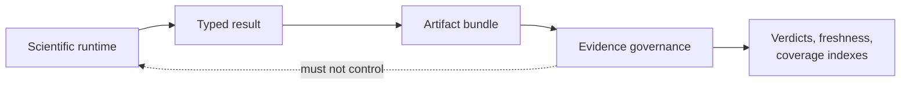

# Evidence Consumer Boundary

Evidence governance is a downstream consumer of runtime artifacts. Ordinary
analysis must not require a study dossier, claim registry, or evidence index;
Evidence Book workflows may depend on stable runtime and artifact contracts to
evaluate named claims.

## Dependency Rule

The runtime owns scientific objects, computation, typed diagnostics, and
serialization. Evidence governance owns source mapping, claim identifiers,
check definitions, acceptance rules, verdicts, and freshness. A dependency in
the opposite direction would make ordinary execution depend on a selected
study and would blur computation success with claim adjudication.

## Consumption Contract

| Evidence consumer needs | Runtime or artifact provider supplies |
| --- | --- |
| stable operation identity | documented method, workflow, engine, and version |
| reproducible input scope | input hashes, taxa, reconciliation, partitions, transformations |
| comparable configuration | model, priors, costs, search/sampling policy, seeds |
| observation source | typed result fields and machine-readable ledgers |
| diagnostic qualification | convergence, support, uncertainty, warnings, exclusions |
| output integrity | manifest, schema version, inventory, checksums where governed |

Evidence tooling should reject or mark unresolved any claim whose required
runtime field, artifact, source, or comparison owner is missing. It must not
reconstruct critical scientific values by scraping prose or figures.

## Material Changes And Freshness

A change to a consumed method, parameterization, input, dataset, external
reference, parser, schema, or acceptance rule can invalidate the relationship
between an old artifact and its claim. Freshness evaluation records that
dependency change. It does not rewrite the historical result; it prevents the
old verdict from being presented as current.

## Valid Independence

- Runtime capability can exceed Evidence Book coverage.
- A complete runtime bundle can have no claim mapping.
- A governed claim can remain `not_comparable` while its bundle is structurally
  valid and current.
- Evidence indexes can be regenerated without changing runtime behavior.
- Runtime tests and benchmarks can support bounded assurance without becoming
  study verdicts.

See the [runtime and evidence boundary](../foundation/evidence-boundary.md) for
promotion requirements and the
[artifact consumption guide](../interfaces/artifact-consumption-guide.md) for
reviewing a persisted run before claim adjudication.
