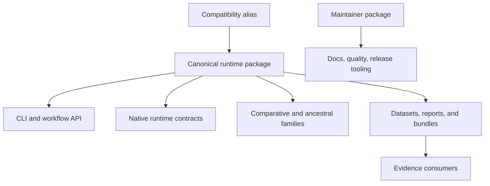

# Runtime Architecture

This section explains how the runtime is organized so capability claims stay
readable and package ownership stays explicit.

It should help a reader understand that the repository is not one flat module
tree. It contains distinct scientific and runtime families with separate
responsibilities, packaging roles, and trust relationships.

## Design Priorities

- one canonical runtime package
- one thin compatibility distribution
- a clear split between runtime, evidence, and maintainer tooling
- capability families grouped by durable responsibility rather than by delivery
  history
- governed artifacts instead of ad hoc local output layouts

## Architectural Promise

The architecture is organized so public capability claims remain traceable:

- package roles stay explicit instead of hiding runtime, evidence, and
  maintainer concerns in one surface
- capability families group by durable scientific responsibility rather than
  by temporary delivery history
- evidence consumers read governed outputs from the runtime without turning the
  evidence-book into a shadow runtime layer

## Runtime Shape At A Glance

| Runtime area | Representative families that already exist |
| --- | --- |
| Core tree runtime | `phylo`, `trees`, `compare`, `distance`, `render` |
| Native inference runtime | `phylo.likelihood`, `bayesian`, `benchmark.likelihood_tree_inference` |
| Comparative runtime | `comparative`, `ancestral`, `parsimony`, `simulation` |
| Workflow and command surfaces | `api`, `command_line`, `engines`, `reports` |
| Data and evidence surfaces | `datasets`, `resources`, `evidence`, `benchmark`, `validation` |

## Why This Matters Publicly

If the docs flatten these areas into one generic "workflow toolkit" story,
readers miss the actual product shape:

- the runtime package owns lower-level scientific contracts
- the alias package is only a naming bridge, not a second implementation
- the maintainer package owns truth-preserving infrastructure, not runtime
  semantics
- the evidence book consumes outputs from the runtime but does not replace the
  runtime as the user-facing product

## Questions This Section Answers

- which package should I install or depend on
- which runtime family owns a capability
- where native ownership ends and wrapper orchestration begins
- how the evidence book consumes runtime outputs without becoming the runtime
  itself

## Read Next

- [Runtime system map](runtime-system-map.md)
- [Package map](package-map.md)
- [Evidence consumer boundary](evidence-consumer-boundary.md)
