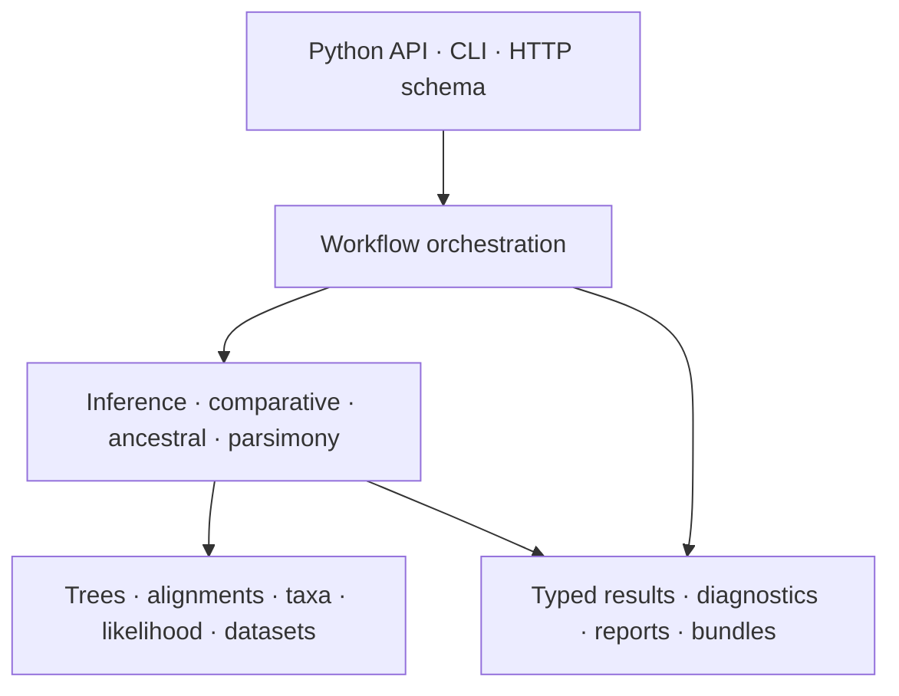
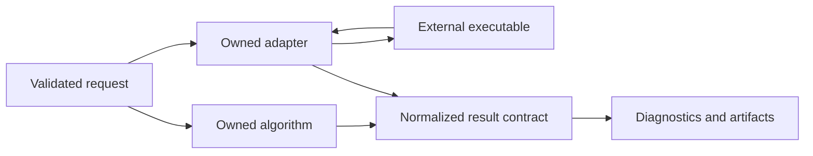

# Runtime Architecture

The architecture separates scientific meaning, analytical methods, execution,
and presentation. A workflow may cross all four, but no layer should silently
redefine the contracts owned below it.

## Architectural Commitments

- **One scientific meaning.** Tree, taxon, alignment, and model semantics do
  not change according to entry point.
- **Explicit computation ownership.** Native methods and external-engine
  adapters remain distinguishable in code, diagnostics, and documentation.
- **Results before presentation.** Computation returns structured state;
  renderers and report writers consume it.
- **Review is designed in.** Important workflows preserve configuration,
  provenance, diagnostics, and manifests, not only headline estimates.
- **Failure stays attributable.** Input validation, runtime computation,
  external process execution, parsing, and artifact writing have different
  failure meanings.

## Read This Section By Need

| Need | Page |
| --- | --- |
| understand the end-to-end execution and review path | [Runtime system map](runtime-system-map.md) |
| decide which installed distribution owns a concern | [Package map](package-map.md) |
| understand why evidence is a consumer, not runtime state | [Evidence consumer boundary](evidence-consumer-boundary.md) |

## Native And Adapter Paths

Normalization gives consumers a coherent review surface. It does not erase
provenance: adapter results must still identify the external engine,
configuration, and captured outputs needed to explain the run.

## Dependency Direction

Scientific foundations should not import command-line policy or report
templates. Methods consume foundation contracts. Workflows compose methods.
Interfaces translate user intent into workflow calls. Presentation consumes
results. Evidence tooling consumes persisted artifacts and source records
outside the runtime execution path.

This direction keeps a numerical method usable without the CLI and prevents a
report format from becoming the hidden owner of scientific state.

## Architectural Risks

| Risk | Warning sign | Required response |
| --- | --- | --- |
| interface leakage | a method needs CLI option objects | move translation to the interface boundary |
| provenance loss | a report cannot identify inputs or engine | preserve configuration and source records |
| wrapper ambiguity | docs call an external computation native | name the adapter and engine explicitly |
| result flattening | only a scalar estimate survives | retain diagnostics and structured results |
| evidence coupling | runtime success depends on a study dossier | keep evidence as a downstream reviewer |

## Code Navigation

The canonical source root is
`packages/bijux-phylogenetics/src/bijux_phylogenetics/`. Domain directories
such as `phylo`, `comparative`, `ancestral`, `parsimony`, `simulation`, and
`reports` carry enduring scientific ownership. `command_line` owns CLI
translation. `engines` owns common execution and artifact concerns.
`evidence` connects runtime outputs to governed study records without making
those records prerequisites for ordinary analysis.
