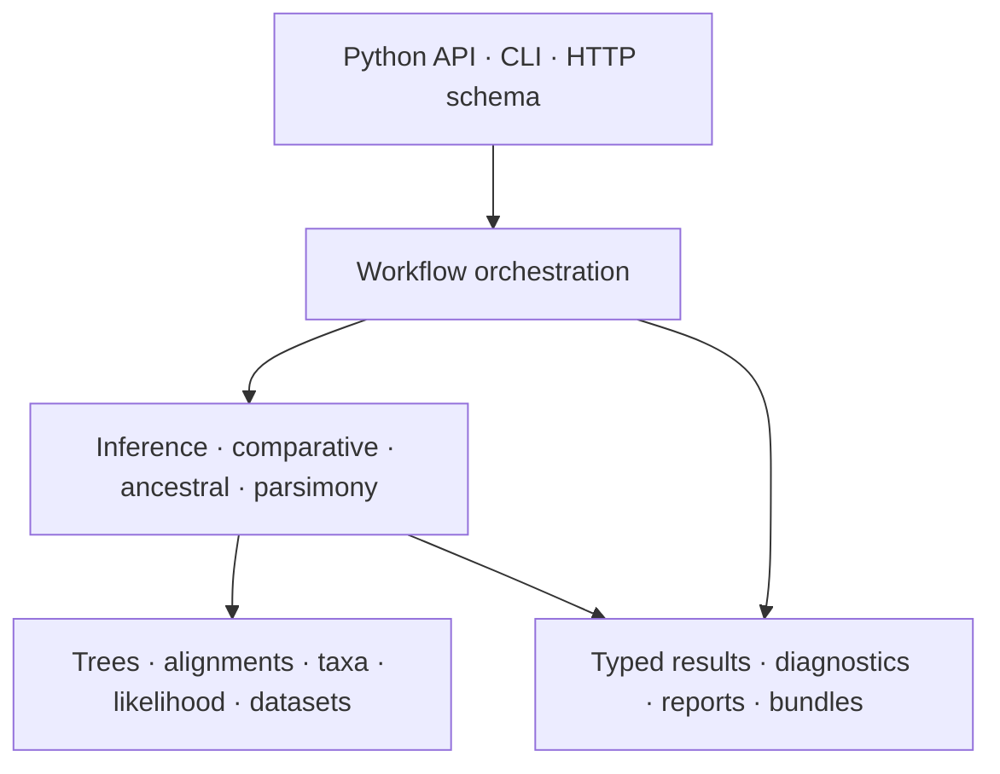
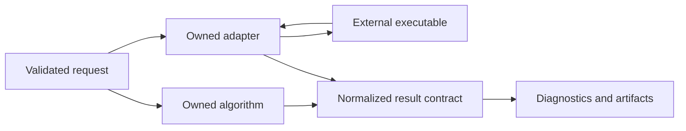
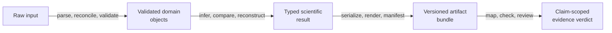

# Runtime Architecture

The architecture separates scientific meaning, analytical methods, execution,
and presentation. A workflow may cross all four, but no layer should silently
redefine the contracts owned below it.

## Architectural Commitments

- **One scientific meaning.** Tree, taxon, alignment, and model semantics do
  not change according to entry point.
- **Explicit computation ownership.** Native methods and external-engine
  adapters remain distinguishable in code, diagnostics, and documentation.
- **Results before presentation.** Computation returns structured state;
  renderers and report writers consume it.
- **Review is designed in.** Important workflows preserve configuration,
  provenance, diagnostics, and manifests, not only headline estimates.
- **Failure stays attributable.** Input validation, runtime computation,
  external process execution, parsing, and artifact writing have different
  failure meanings.

## Read This Section By Need

| Need | Page |
| --- | --- |
| understand the end-to-end execution and review path | [Runtime system map](runtime-system-map.md) |
| decide which installed distribution owns a concern | [Package map](package-map.md) |
| understand why evidence is a consumer, not runtime state | [Evidence consumer boundary](evidence-consumer-boundary.md) |

## Native And Adapter Paths

Normalization gives consumers a coherent review surface. It does not erase
provenance: adapter results must still identify the external engine,
configuration, and captured outputs needed to explain the run.

## Dependency Direction

Scientific foundations should not import command-line policy or report
templates. Methods consume foundation contracts. Workflows compose methods.
Interfaces translate user intent into workflow calls. Presentation consumes
results. Evidence tooling consumes persisted artifacts and source records
outside the runtime execution path.

This direction keeps a numerical method usable without the CLI and prevents a
report format from becoming the hidden owner of scientific state.

## Layer Contracts

| Layer | Accepts | Produces | Must not own |
| --- | --- | --- | --- |
| scientific foundations | files, identifiers, explicit scientific definitions | validated trees, alignments, tables, models, datasets | CLI policy or report layout |
| analytical methods | validated domain objects and method configuration | typed estimates, trees, histories, diagnostics | filesystem presentation or study verdicts |
| workflows | method requests, execution policy, output destination | coordinated results and artifact inventory | new scientific semantics hidden from methods |
| interfaces | user/application input | validated workflow requests and serialized responses | duplicate numerical implementations |
| presentation | typed results and linked ledgers | tables, figures, HTML, Markdown | values absent from structured results |
| evidence governance | persisted results, sources, claims, checks | claim-scoped verdicts and indexes | runtime success or method implementation |

Cross-layer convenience is acceptable only when ownership remains traceable.
A workflow may call validation and rendering, but it cannot redefine a taxon,
likelihood, support statistic, or verdict inside orchestration code.

## Audit Every Representation Boundary

The same scientific state can appear as an object, command payload, JSON
record, table row, or report element. A boundary is correct only when the
target representation either preserves every interpretation-critical field or
declares what was omitted.

| Boundary | State that must remain invariant | Typical semantic loss |
| --- | --- | --- |
| parser → domain object | source identity, ordering, units, missing values, exclusions, and repairs | normalized labels hide the original taxa or states |
| domain object → method request | analytical population, model parameterization, transformations, and constraints | a workflow default silently chooses the method |
| method → typed result | computation owner, status, objective/estimand, uncertainty, diagnostics, and absent components | a scalar return discards search or sampler state |
| typed result → artifact | schema version, units, identifiers, warnings, denominator, and parent identity | serialization converts unknown or partial state to success |
| artifact → presentation | structured value owner, display transform, omissions, and caption scope | figure labels imply a stronger method or verdict |
| artifact → evidence | exact result identity, observation rule, scope, freshness, and claim identifier | proximity to a study substitutes for governed consumption |

Representation equality is weaker than semantic preservation. Two JSON
objects can have the same keys while using different units, status meanings,
taxon orders, or denominators. Test and review those meanings at the boundary
that performs the projection.

## Runtime Ownership Map

| Responsibility | Owning runtime families | Boundary to preserve |
| --- | --- | --- |
| trees and topology | `trees`, `phylo`, `compare`, `distance` | stable taxon, node, clade, split, rooting, and branch-length meaning |
| sequence and character intake | `io`, `validation`, `datasets` | alphabet, alignment shape, partition, missing-state, and exclusion identity |
| numerical methods | `phylo`, `bayesian`, `comparative`, `ancestral`, `parsimony` | model parameterization, estimator, search or sampler, and diagnostics |
| ecological history | `biogeography`, `phylogeography`, `ecology` | geography, host, niche, transition, and tree identity |
| controlled evaluation | `simulation`, `benchmark`, `parity` | truth or reference owner, denominator, seed, tolerance, and outcome |
| external execution | `engines` | executable discovery, invocation, native files, parser state, and provenance |
| user composition | `api`, `command_line` | translation and orchestration without duplicate scientific semantics |
| review output | `reports`, `render`, `evidence` | structured values before presentation and claim-scoped promotion |

These are ownership families, not a promise that every symbol beneath a module
is public. Curated exports, registered commands, and documented artifact
contracts define the installed surface.

## Scientific State Transformations

Each transformation adds context; none may silently discard upstream identity.
The evidence verdict refers back to the exact persisted result, which refers
back to method configuration and validated inputs.

## Architectural Risks

| Risk | Warning sign | Required response |
| --- | --- | --- |
| interface leakage | a method needs CLI option objects | move translation to the interface boundary |
| provenance loss | a report cannot identify inputs or engine | preserve configuration and source records |
| wrapper ambiguity | docs call an external computation native | name the adapter and engine explicitly |
| result flattening | only a scalar estimate survives | retain diagnostics and structured results |
| evidence coupling | runtime success depends on a study dossier | keep evidence as a downstream reviewer |
| hidden mutation | taxon order or model configuration changes inside presentation | make transformations explicit and retain the before/after identity |
| partial success flattening | incomplete support or failed replicates become `ok` | preserve component status and denominator in the result |

## Code Navigation

The canonical source root is
`packages/bijux-phylogenetics/src/bijux_phylogenetics/`. Domain directories
such as `phylo`, `comparative`, `ancestral`, `parsimony`, `simulation`, and
`reports` carry enduring scientific ownership. `command_line` owns CLI
translation. `engines` owns common execution and artifact concerns.
`evidence` connects runtime outputs to governed study records without making
those records prerequisites for ordinary analysis.

When tracing a defect, begin at the layer that first owns the incorrect state.
A wrong likelihood value belongs below rendering; a missing output path belongs
at persistence; an overstated scientific conclusion belongs in evidence or
documentation. Correcting only the visible downstream projection preserves the
underlying contradiction.
