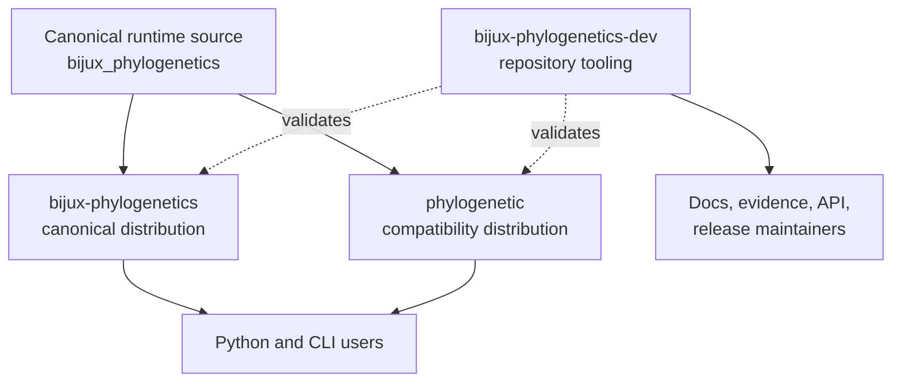

# Distribution And Package Map

The repository publishes two runtime distributions and keeps its maintainer
automation in a third package. The split is about naming and responsibility,
not separate scientific editions.

## Distribution Contracts

| Distribution | Import or command role | Intended consumer | Ownership boundary |
| --- | --- | --- | --- |
| `bijux-phylogenetics` | canonical `bijux_phylogenetics` runtime and CLI | analysts, library users, workflow authors | scientific runtime and public execution surfaces |
| `phylogenetic` | shorter compatibility installation and command story | users choosing the concise distribution name | same runtime behavior; no reduced feature tier |
| `bijux-phylogenetics-dev` | repository checks and generation utilities | maintainers and CI | documentation, evidence, schema, packaging, and release truth |

## Choice Rules

Install `bijux-phylogenetics` when you want the canonical name in an
environment specification, publication method, or support request. Install
`phylogenetic` when compatibility with the shorter distribution name is the
primary concern. Do not install both expecting independent runtimes.

The development package is not required for normal scientific use. Its
commands protect repository integrity; they are not an alternate analysis API.

## Source Ownership

The runtime implementation lives under
`packages/bijux-phylogenetics/src/bijux_phylogenetics/`. The alias package is a
distribution boundary around the canonical runtime contract. The development
package lives under `packages/bijux-phylogenetics-dev/` and may inspect runtime
metadata or artifacts without becoming their scientific owner.

## Compatibility Meaning

Compatibility requires more than both distributions installing successfully.
Their advertised imports, commands, version story, metadata, package data, and
documented behavior must remain aligned. Release checks should fail when the
alias silently exposes a smaller or stale contract.

## Where To Report A Problem

| Symptom | Likely owner |
| --- | --- |
| numerical result or runtime behavior | canonical runtime package |
| alias install/import/command mismatch | compatibility package boundary |
| generated docs, evidence index, or schema drift | maintainer package |
| external executable missing or incompatible | adapter plus the named engine environment |

Always include the installed distribution name and version. For adapter
failures, include the external executable version and captured diagnostic
without removing the provenance needed to reproduce the failure.
