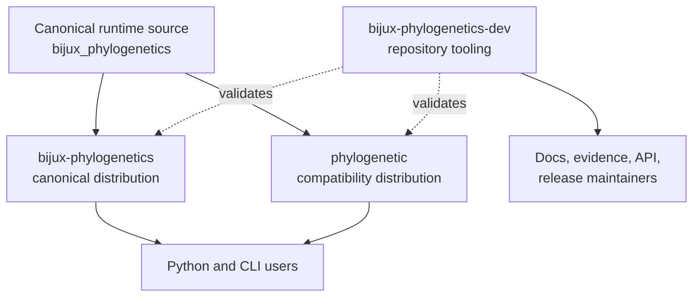
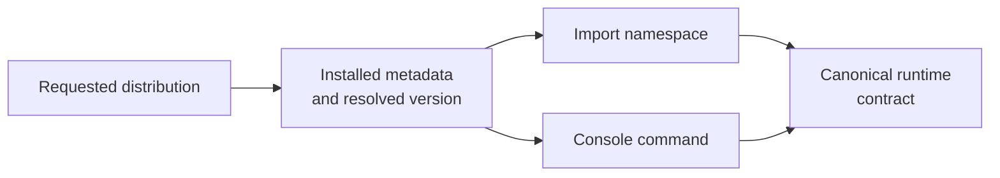
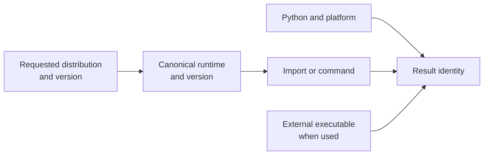
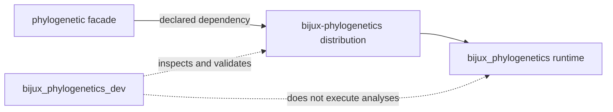

# Distribution And Package Map

The repository publishes two runtime distributions and keeps its maintainer
automation in a third package. The split is about naming and responsibility,
not separate scientific editions.

## Choose The Distribution From The Record You Need

| Need | Install | Identity to retain |
| --- | --- | --- |
| canonical scientific runtime for analysis or publication | `bijux-phylogenetics` | canonical distribution, import namespace, command, and runtime version |
| compatibility with the shorter package or command name | `phylogenetic` | facade version **and** resolved canonical runtime version |
| repository documentation, evidence, API, or release verification | `bijux-phylogenetics-dev` in a repository checkout | maintainer package version and repository revision |

The compatibility distribution is not a second implementation, and the
maintainer distribution is not an analysis extension. Installing all three
does not create three independent scientific owners; it creates one runtime,
one forwarding facade, and one repository-governance surface.



## Distribution Contracts

| Distribution | Import or command role | Intended consumer | Ownership boundary |
| --- | --- | --- | --- |
| `bijux-phylogenetics` | canonical `bijux_phylogenetics` runtime and CLI | analysts, library users, workflow authors | scientific runtime and public execution surfaces |
| `phylogenetic` | shorter compatibility installation and command story | users choosing the concise distribution name | same runtime behavior; no reduced feature tier |
| `bijux-phylogenetics-dev` | repository checks and generation utilities | maintainers and CI | documentation, evidence, schema, packaging, and release truth |

## Installed Identity Chain



| Requested distribution | Import | Command | Runtime owner |
| --- | --- | --- | --- |
| `bijux-phylogenetics` | `bijux_phylogenetics` | `bijux-phylogenetics` | `bijux_phylogenetics` modules in the canonical wheel |
| `phylogenetic` | `phylogenetic` facade, including `phylogenetic.api` | `phylogenetic` | the installed `bijux-phylogenetics` dependency reached through the facade |
| `bijux-phylogenetics-dev` | `bijux_phylogenetics_dev` | repository Make targets and maintainer modules | repository verification and release policy, never scientific execution |

For the alias, record both distribution versions. The requested
`phylogenetic` version identifies the facade artifact; the resolved
`bijux-phylogenetics` version identifies the computation it delegates to.

## Inspect Installed Identity

Canonical installation:

```bash
python -c "from importlib.metadata import version; print(version('bijux-phylogenetics'))"
python -c "import bijux_phylogenetics as p; print(p.__version__, p.__name__)"
bijux-phylogenetics --version
```

Compatibility installation:

```bash
python -c "from importlib.metadata import version; print(version('phylogenetic')); print(version('bijux-phylogenetics'))"
python -c "import phylogenetic as p; print(p.__version__, p.__name__)"
phylogenetic --version
```

The two metadata values in the alias environment answer different questions:
which facade was requested and which canonical runtime performed the work.
Retain both in a reproducibility record.

## Choice Rules

Install `bijux-phylogenetics` when you want the canonical name in an
environment specification, publication method, or support request. Install
`phylogenetic` when compatibility with the shorter distribution name is the
primary concern. Do not install both expecting independent runtimes.

The development package is not required for normal scientific use. Its
commands protect repository integrity; they are not an alternate analysis API.

## What Ships In Each Distribution

| Distribution | Included contract | Deliberately outside the wheel |
| --- | --- | --- |
| `bijux-phylogenetics` | `bijux_phylogenetics` modules, public CLI, packaged datasets/resources, package README and changelog | repository tests, Evidence Book dossiers, MkDocs source, local artifacts, maintainer commands |
| `phylogenetic` | `phylogenetic` facade, alias CLI, package README and changelog, dependency on the canonical runtime | duplicated scientific implementation, evidence tooling, a second copy of canonical datasets |
| `bijux-phylogenetics-dev` | `bijux_phylogenetics_dev` documentation, evidence, API, package and release validators | scientific runtime facade, analysis commands, study outputs, generated site |

This split prevents a repository checkout from becoming an undeclared runtime
dependency. Installed-wheel examples must work with packaged resources; study
validation and release governance intentionally require the repository.

## Reconstruct Distribution Identity

For a canonical run, retain the `bijux-phylogenetics` distribution version,
`bijux_phylogenetics.__version__`, Python version, platform, and the command or
import surface used. For an alias run, add the `phylogenetic` facade version.
For an adapter run, add the external executable path and native version.



This is more precise than recording `pip freeze` alone. An environment list
can show installed packages without revealing which facade, command, model,
resource, or external binary produced the result.

## Source Ownership

The runtime implementation lives under
`packages/bijux-phylogenetics/src/bijux_phylogenetics/`. The alias package is a
distribution boundary around the canonical runtime contract. The development
package lives under `packages/bijux-phylogenetics-dev/` and may inspect runtime
metadata or artifacts without becoming their scientific owner.



The facade forwards curated top-level attributes and resolves compatible
submodules to the canonical runtime. Its local code owns alias import and
command behavior only; scientific modules remain owned by
`bijux_phylogenetics`.

## Compatibility Meaning

Compatibility requires more than both distributions installing successfully.
Their advertised imports, commands, version story, metadata, package data, and
documented behavior must remain aligned. Release checks should fail when the
alias silently exposes a smaller or stale contract.

Compatibility is evaluated at observable boundaries: import resolution,
public attribute discovery, parser construction, command dispatch, resource
access, structured serialization, and failure behavior. Matching a single
headline value is not an alias compatibility test.

## Where To Report A Problem

| Symptom | Likely owner |
| --- | --- |
| numerical result or runtime behavior | canonical runtime package |
| alias install/import/command mismatch | compatibility package boundary |
| generated docs, evidence index, or schema drift | maintainer package |
| external executable missing or incompatible | adapter plus the named engine environment |

Always include the installed distribution name and version. For adapter
failures, include the external executable version and captured diagnostic
without removing the provenance needed to reproduce the failure.

## Diagnose Boundary Failures

| Observation | Establish first | Likely corrective boundary |
| --- | --- | --- |
| `phylogenetic` imports but an advertised attribute is absent | facade and canonical versions plus resolved module | alias forwarding or version constraint |
| canonical command and alias command disagree | parser inventory, command result schema, both versions | compatibility command boundary |
| packaged demo cannot locate a fixture | wheel contents and resource locator | canonical packaging contract |
| repository evidence command is missing after runtime install | whether the dev distribution was intentionally installed | maintainer-tooling boundary, not runtime defect |
| package metadata links disagree with the published site | built wheel metadata and release manifest | publication alignment |
| local checkout works but installed wheel fails | undeclared repository path or omitted package data | build inclusion and installed-wheel verification |

Repair the owner of the failed boundary. Do not copy canonical implementation
into the alias or expose repository-only tooling through the runtime to make a
single environment appear complete.

## Package Boundary Invariants

- scientific runtime modules do not depend on the maintainer package;
- the alias depends on and delegates to the canonical runtime;
- the maintainer package may validate public runtime locators without
  exporting repository-only evidence helpers through the runtime;
- wheels and source distributions contain their declared package data and do
  not absorb repository docs, tests, evidence records, or local artifacts;
- package versions, command identity, and public links remain consistent at
  release time.
