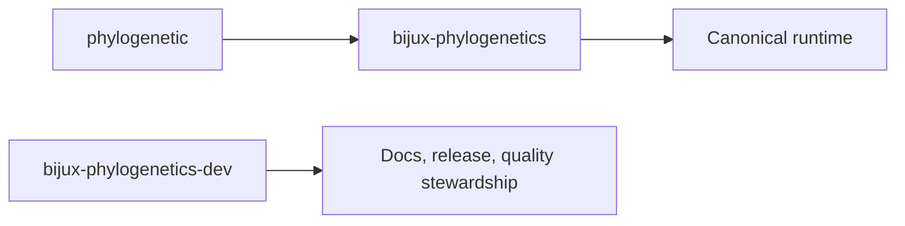

# Package Map

The repository exposes three package roles. They are related, but they are not
three equivalent public products.

`bijux-phylogenetics` is the public center of gravity.
`phylogenetic` is the shorter compatibility install surface.
`bijux-phylogenetics-dev` is repository-owned maintainer tooling.

## Package Roles

| Package | Role | When to use it | When not to use it |
| --- | --- | --- | --- |
| `bijux-phylogenetics` | Canonical runtime package | Normal runtime use, public docs, canonical CLI and Python surface | Not when you only need maintainer tooling |
| `phylogenetic` | Compatibility alias package | You need the shorter distribution and CLI name with the same runtime story | Not as a separate capability or documentation surface |
| `bijux-phylogenetics-dev` | Maintainer tooling package | Docs checks, release support, repository quality tooling | Not as an end-user scientific runtime |

## What Each Package Signals Publicly

- `bijux-phylogenetics` signals the full runtime identity, the full public
  documentation story, and the canonical CLI and Python imports
- `phylogenetic` signals compatibility and convenience, not a distinct product
  line
- `bijux-phylogenetics-dev` signals repository stewardship, not scientific
  runtime consumption

## Choice Rule

- Install `bijux-phylogenetics` for normal product use.
- Install `phylogenetic` only when the shorter compatibility name is the real
  requirement.
- Use `bijux-phylogenetics-dev` only when maintaining this repository.

That split keeps the public story stable instead of letting package names drift
into overlapping meanings.
