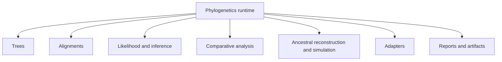

# Runtime System Map

The runtime is organized by capability family, not by the order in which code
was added.

## Core Runtime Families

- trees
  Validation, inspection, rooting, comparison, rendering, tree-set review, and
  the owned `PhyloTree` runtime.
- alignments
  FASTA validation, trimming, coding diagnostics, translation, identity
  review, and durable loaded-alignment surfaces.
- likelihood and inference
  Native finite-state likelihood, native maximum-likelihood inference,
  supported native Bayesian DNA workflows, and governed benchmark families.
- comparative analysis
  Signal, model fitting, PGLS, discrete Mk fitting, and dataset-backed
  comparative review.
- ancestral reconstruction and simulation
  Continuous and discrete ancestral-state inference, stochastic mapping, and
  governed simulation surfaces.
- adapters
  Governed orchestration for external tools such as MAFFT, trimAl, IQ-TREE2,
  FastTree, MrBayes, and BEAST where wrapper ownership remains the honest
  boundary.
- reports and artifacts
  Reviewer-facing bundles, figures, manifests, benchmark outputs, and
  evidence-linked reporting.

## How The Families Fit Together

The runtime is deeper than one flat list of commands:

- tree and alignment families provide the structural substrate
- likelihood and inference families add model-driven analytical depth
- comparative and ancestral families turn those foundations into biological
  workflows
- adapter families keep external-engine orchestration explicit where native
  ownership is not the honest boundary
- report and artifact families make the results reviewable instead of leaving
  them trapped inside ad hoc execution state

## How To Read This Map

Some families are primarily native implementation surfaces. Others are public
workflow surfaces around external engines. The architectural rule is to keep
those responsibilities explicit instead of collapsing them into one vague
runtime claim.

The clearest examples are native maximum-likelihood and native Bayesian DNA workflows as owned runtime surfaces, while external-engine orchestration remains a wrapper-owned surface.
