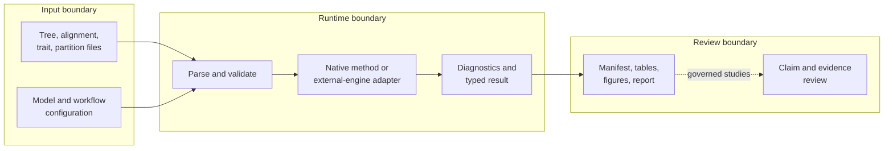
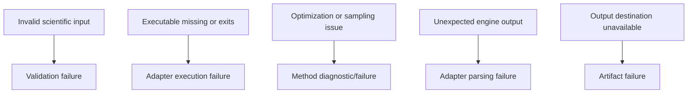

# Runtime System Map

The system is easiest to understand as a flow of scientific state. Inputs gain
stronger contracts as they move through validation, computation, diagnostics,
and publication-oriented output. Evidence review is downstream of that flow.

## Input Boundary

Input handling establishes syntax and scientific identity before expensive
work starts. Relevant checks include readable formats, unique and reconcilable
taxon labels, compatible character or sequence shapes, rootedness where a
method requires it, and explicit partition or model configuration.

Validation cannot decide whether a research question is well designed. It can
prevent avoidable ambiguity from entering the computation.

## Computation Boundary

The runtime offers two attributable paths:

- **native:** the repository owns the algorithm, numerical implementation,
  result type, and diagnostics;
- **adapter:** the repository owns preparation, invocation, capture, parsing,
  and normalization while a named external executable owns the computation.

Both paths should converge on structured outputs, but their installation,
failure, provenance, and support obligations differ.

## Result Boundary

A result should carry enough state to answer more than “what number did the
run return?” Depending on the method, that may include convergence or search
state, likelihood values, support summaries, parameter estimates, uncertainty,
warnings, and links to intermediate artifacts.

Code that needs only the computation consumes the typed result. Reports and
bundles are projections of that result for humans and downstream systems.

## State Retained Across Boundaries

| State | Validation | Computation | Persistence | Evidence review |
| --- | :---: | :---: | :---: | :---: |
| input identity and taxon reconciliation | creates | consumes | retains | verifies |
| model, partition, search, sampler, and seed configuration | validates | consumes | retains | checks scope |
| native or external computation owner | identifies | executes | retains | qualifies claim |
| estimate, topology, history, or comparison | — | creates | retains | observes |
| warnings, convergence, support, uncertainty, exclusions | may create | creates | retains | applies acceptance rule |
| artifact schema, checksums, and inventory | — | declares outputs | creates | verifies |
| source provenance, claim ID, tolerance, verdict, freshness | — | — | may link | creates and governs |

A dash means the layer does not own that state, not that the state is
irrelevant. Evidence review still depends on input and computation identity
created upstream.

## Review Boundary

Persisted outputs make a run inspectable after process memory is gone:

| Artifact | Review purpose |
| --- | --- |
| manifest | identifies inputs, configuration, versions, and output inventory |
| machine-readable result | supports deterministic downstream inspection |
| tables | exposes estimates, comparisons, or diagnostics without scraping prose |
| figures | communicates topology, support, traits, or uncertainty visually |
| narrative report | explains interpretation and limits in context |

An evidence bundle adds claim identifiers, provenance, checks, and verdicts
for a governed study. Ordinary runtime output does not become evidence merely
because it was persisted.

## Artifact Acceptance Gates

| Gate | Accept when | Refuse when |
| --- | --- | --- |
| identity | operation, input, configuration, package, and computation owner are explicit | a result cannot be tied to the inputs or executable that produced it |
| execution | completion state and required diagnostics are present | file presence is the only evidence that a process ran |
| structure | required outputs parse under their declared formats or schemas | a stale or malformed output is found at an expected path |
| inventory | expected, present, missing, failed, and skipped components reconcile | only successful outputs remain in the denominator |
| interpretation | units, scales, model conventions, uncertainty, and warnings travel with values | normalized output hides a materially different engine or model convention |
| integrity | governed hashes and source identities agree where required | a retained artifact has drifted from the manifest that names it |

Passing an earlier gate cannot compensate for failing a later one. For
example, a process can execute successfully while producing an incomplete
bundle, and a structurally complete bundle can still contain a scientifically
non-comparable result.

## Failure Attribution

These categories should remain distinct. Retrying an unwritable destination is
reasonable; treating a convergence warning as an I/O problem is not.

## Partial And Refused Runs

A workflow can emit diagnostic artifacts without producing a usable
scientific estimate. Its manifest should distinguish complete, partial,
refused, failed, and skipped components and record the expected versus present
output inventory. Consumers must evaluate status before assuming that a path
listed in a directory is valid output.

For batched work, aggregate status retains denominators: selected cases,
executed cases, successful cases, failed cases, skipped cases, and missing
artifacts. Reporting only the successful subset changes the meaning of the
run.

A partial run can remain useful when its status and denominator are explicit:
preflight diagnostics may explain a refusal, completed independent cases may
remain valid, and native engine output may support parser diagnosis. Preserve
that evidence without promoting the aggregate run to complete.

## Cross-Cutting Families

Datasets and simulation provide controlled inputs. Benchmarking observes
behavior across named corpora. Reporting projects results. Validation checks
contracts at several layers. None of these should secretly become an
alternative scientific method owner.

## Review Questions

Before trusting a run, ask:

1. Were taxon, tree, alignment, and model assumptions validated?
2. Was computation native or delegated to a named engine?
3. Which diagnostics qualify the headline result?
4. Can the persisted artifacts reconstruct inputs and configuration?
5. Does any broader claim stay within its benchmark or evidence scope?

If any answer cannot be reconstructed from typed state and declared artifacts,
the run is incomplete as a reviewable system output even when the process
returned zero.
