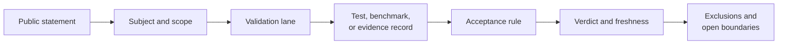

# Claim Reading Guide

Read a public claim from the noun outward. Identify exactly which method,
workflow, study, corpus, or release is being described before evaluating the
confidence word attached to it.

## Decode The Vocabulary

| Word | Minimum meaning in these docs | Look for |
| --- | --- | --- |
| implemented | executable code owns the stated behavior | source and public contract |
| tested | a declared contract passes fixtures | test identity and invariant |
| benchmarked | metrics were collected on a named corpus | environment, configuration, metric, threshold |
| parity | declared outputs agree under stated conventions and tolerance | reference, compared fields, tolerance, verdict |
| evidence-backed | a governed bundle supports a bounded claim | claim ID, provenance, checks, freshness |
| released | published artifacts passed release gates | version, revision, package and docs alignment |

None of these words means “appropriate for every scientific question.”

## Trace A Claim

1. Extract the subject and quantifier: one method, all datasets, a named study?
2. Identify the proof lane actually cited.
3. Open the primary record rather than relying on summary prose.
4. Confirm compared inputs, versions, configuration, metric, and tolerance.
5. Check the verdict and whether the record remains fresh.
6. Carry exclusions and limitations into your own use of the claim.

## Reconstruct The Claim As A Contract

A reviewable claim is the product of six bounded fields:

> **subject × population × method × observation × acceptance rule × revision**

Removing any field changes the statement. “PGLS agrees” does not identify the
traits, taxa, covariance convention, compared coefficient, tolerance, or
software revision. A green verdict cannot restore information that the claim
never declared.

For example, a bounded PCM2 claim can be read as follows:

| Field | Bounded meaning |
| --- | --- |
| subject | the registered PGLS covariance observation |
| population | the retained mammal taxa after named reconciliation and exclusions |
| method | the declared Brownian covariance construction and regression parameterization |
| observation | the registered matrix entries or derived coefficient named by the check |
| acceptance rule | the stored structural rule and numerical tolerance |
| revision | the runtime, reference, input, and bundle identities recorded by the evidence manifest |

The contract supports only the intersection of those fields. It does not imply
that every PGLS model, taxon set, covariance convention, or output agrees.

## Qualifiers That Change Meaning

| Qualifier | Question it must answer |
| --- | --- |
| native | Which repository-owned implementation performs the computation? |
| external or adapter-backed | Which executable owns the algorithm, and what does Bijux orchestrate? |
| checked fixture | Which frozen reference values and versions were retained? |
| live parity | Were both implementations executed in the governed run? |
| matched with tolerance | Which observations, absolute/relative rules, and boundary conventions matched? |
| current | Which material dependencies were checked for freshness? |
| complete | Which required cases and artifacts were included, and how were failures counted? |

Adjectives cannot carry scope by themselves. “Current parity” remains
incomplete without the named reference, registered cases, compared fields,
tolerances, and freshness basis.

## Example

“Native maximum-likelihood inference is benchmarked” is incomplete. A usable
version says which native entry point, corpus, model/search configuration,
comparison metric, environment, and acceptance threshold were measured. If a
study claim relies on that benchmark, the evidence bundle must make the link
explicit.

A stronger claim need not be longer. It must use nouns that resolve to owned
records and qualifiers whose exact meaning is declared.

## Scope Traps

- Evidence for a nucleotide model does not transfer to protein or codon models.
- Agreement on one tree or dataset does not establish corpus-wide parity.
- A normalized adapter result does not make the external algorithm native.
- A fresh release does not automatically refresh an old evidence bundle.
- A successful workflow does not resolve weak convergence or model fit.
- A study-family summary does not make every bundle pass.

## Combining Proofs

Proofs can support one claim together only when their subjects and assumptions
align. A parser contract, numerical known answer, workflow integration test,
and study comparison may form a strong chain for one method and configuration.
They cannot be combined by counting unrelated green checks.

When combining records, preserve:

- the narrowest shared method and input scope;
- every material configuration difference;
- the weakest current verdict or missing link;
- separate ownership for native and external computation;
- the revision or version to which the chain applies.

## Strongest Available Proof

Use source and API contracts to verify ownership. Use tests for interface and
numerical invariants. Use benchmarks for named comparative behavior. Use the
Evidence Book for study claims. Use release gates for current publication
alignment. Do not cite a broader but weaker surface when a narrower primary
record exists.

## Apply The Counterevidence Test

A trustworthy claim states what observation would weaken it. Before accepting
the wording, identify the failure record, contradictory result, dependency
change, or excluded case that would force the claim to be narrowed.

| Claim form | Counterevidence that must change the claim |
| --- | --- |
| implementation contract | a supported input violates the documented result or refusal invariant |
| numerical result | an independent known answer falls outside the registered tolerance |
| parity | any required case is missing, not executed, differently parameterized, or outside tolerance |
| benchmark | the registered environment or workload no longer satisfies the acceptance rule |
| evidence-backed study claim | a material dependency is stale, provenance breaks, or a required observation is contradictory |
| released surface | package, schema, docs, or artifact identity does not resolve to the admitted revision |

Do not repair a contradicted claim by deleting the case, changing the
denominator, widening tolerance after observation, or replacing the primary
record with summary prose. Register a new claim or comparison when the subject
or acceptance rule genuinely changes; preserve the earlier verdict as part of
the evidence history.

## When Evidence Is Missing

Downgrade the wording, not the standard. Say “implemented,” “available,” or
“not yet evaluated under this study contract” according to the facts. Record
the missing comparison or closure criterion. Absence of evidence is not a
failure to market aggressively; it is a boundary a reader deserves to see.

If a claim cannot be traced, do not infer its proof from repository size,
coverage percentage, publication status, or neighboring examples. Treat it as
an undocumented or unsupported claim until the owning record is identified.

Continue with [validation lanes](../quality/validation-lanes.md) and the
[Evidence Book](../../03-bijux-phylogenetics-evidence-book/index.md).
