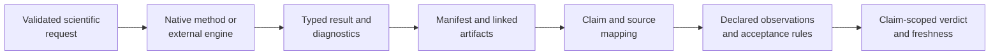
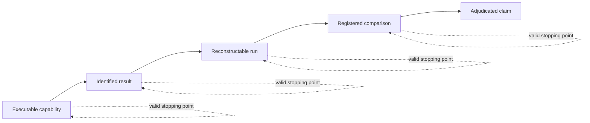
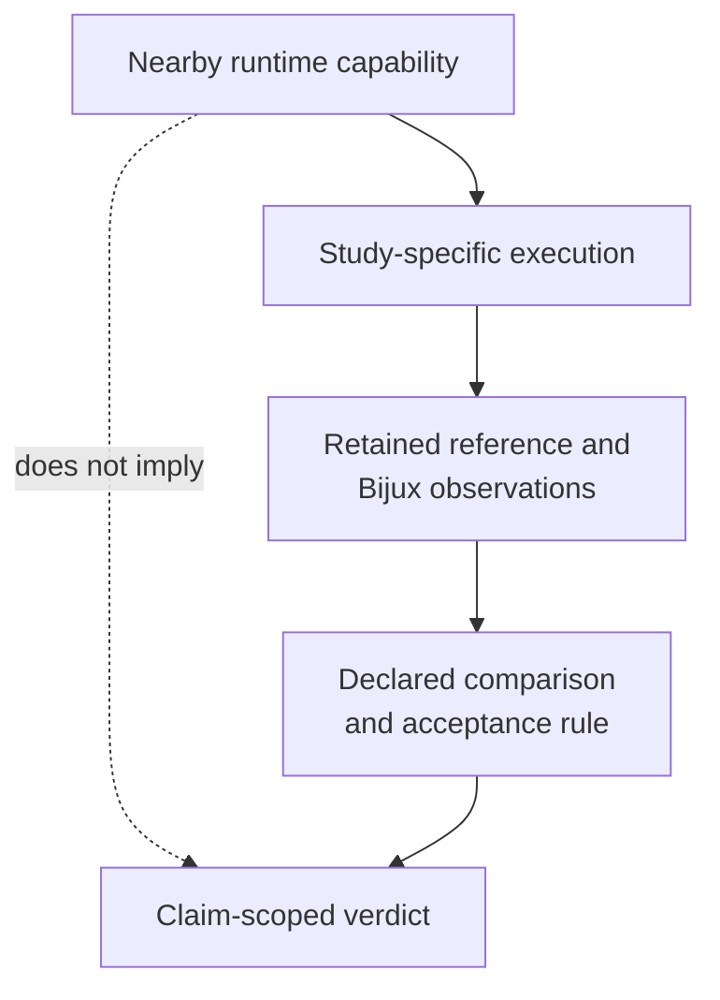

# Runtime And Evidence Boundary

Runtime output becomes governed evidence only through an explicit claim
contract. Executing a method can produce a complete, reproducible result
without establishing a study claim; an Evidence Book bundle adds the source,
claim identity, checks, acceptance rules, freshness, and verdict required for
adjudication.

## Runtime Result Contract

A runtime result identifies the method owner, inputs, configuration, status,
diagnostics, and outputs. It answers whether the requested computation
executed under its declared operational contract. It may also carry numerical
or integration-test support, but it does not inherit a scientific claim that
was never mapped to it.

## Evidence Claim Contract

An evidence claim binds a scientific statement to source provenance,
identified inputs, an executable or externally bounded reference,
observation-level checks, acceptance rules, artifacts, a verdict, and material
dependency freshness. The claim is no broader than that binding.

## Promotion Requirements

| Requirement | Runtime output alone | Governed evidence claim |
| --- | :---: | :---: |
| method and software identity | required | required |
| input and configuration identity | required | required |
| diagnostics and output inventory | required | required |
| stable claim identifier | optional | required |
| scientific source provenance | optional | required |
| reference or closure boundary | optional | required |
| declared observations and tolerances | optional | required |
| claim-scoped verdict and freshness | no | required |

Copying a report into the Evidence Book does not satisfy these requirements.
Promotion requires a registered bundle whose machine-readable records connect
the claim to the exact runtime or external computation.

## Stop At The Strongest Record Actually Owned

Evidence accumulates by adding specific records. It does not advance merely
because a neighboring capability exists.

Each stop is useful when described honestly:

| Strongest retained record | Defensible statement | Statement still unavailable |
| --- | --- | --- |
| executable capability | the method or adapter is available under its public contract | this study result was reproduced |
| identified result | the named inputs and configuration produced this result and diagnostic state | an independent implementation agrees |
| reconstructable run | the computation can be reconstructed from retained identities and artifacts | the scientific claim passes |
| registered comparison | named observations were compared under a declared rule | neighboring outputs or parameterizations agree |
| adjudicated claim | the bounded claim has the recorded verdict and freshness state | broader scientific validity or independent replication |

A missing higher layer is neither erased by a lower-layer success nor evidence
that the lower layer failed. It determines the strongest language the public
record can support.

## Evidence Record Anatomy

A governed bundle separates facts that are often collapsed into one narrative:

| Record | Owns | Review question |
| --- | --- | --- |
| `manifest.json` | bundle identity, ownership, summary, limitations, freshness, and verdict | What is the current bounded conclusion? |
| `claims.json` | stable claim identifiers, source fragments, tags, and claim verdicts | Which statement is being adjudicated? |
| `inputs.manifest.json` | exact input files, objects, roles, and checksums | Which analytical population and tree were used? |
| `provenance.json` | source origin, retrieval or derivation, and reference identity | Where did the comparison basis come from? |
| `checks.json` | required artifacts, primary outputs, comparison mode, and validation rules | What must exist before the verdict is reviewable? |
| `results/` | governed observations, tables, summaries, and their inventory | What values and structural facts were actually retained? |
| `report.md` | human interpretation of the same bounded record | Does the prose preserve the machine-readable status and limitations? |

No single file substitutes for the bundle. A result table without input
identity is ambiguous; a claim without primary outputs is unsupported; a
report whose wording exceeds the manifest verdict is inconsistent.

## Do Not Promote By Proximity

An implemented PGLS surface does not close a PGLS lecture claim until the
study-specific design matrix, taxa, covariance, outputs, and checks are
retained. A BEAST parser does not close an `MCMCglmm` posterior claim. A parity
case for one parameterization does not transfer to another model carrying the
same family name.

## Changes That Reopen A Claim

A previously favorable verdict requires freshness review when a material
dependency changes:

- the scientific algorithm, model parameterization, optimizer, or sampler;
- parsing, normalization, tolerance, or comparison semantics;
- datasets, tree topology, branch lengths, exclusions, or source provenance;
- result schemas, serialization, or governed primary-output paths;
- the reference executable, package version, or external-engine contract;
- claim wording broad enough to exceed the retained observations.

Presentation-only edits need not invalidate numerical evidence, but they must
still preserve exact values, verdict vocabulary, and limitations. Freshness is
an explicit dependency decision, not an assumption based on a recent file
timestamp.

## Valid Boundary States

- A native method can be implemented and tested without a study bundle.
- An adapter can be fully operational while the external algorithm remains the
  computational owner.
- A bundle can be structurally valid and current while its verdict is
  `not_comparable`.
- A matched study observation does not grant parity to neighboring models,
  datasets, or package surfaces.
- A released runtime does not make stale evidence current.

Use the [claim reading guide](claim-reading-guide.md) to qualify public
statements, [validation lanes](../quality/validation-lanes.md) to identify the
proof family, and the
[Evidence Book](../../03-bijux-phylogenetics-evidence-book/index.md) to inspect
governed study verdicts.
