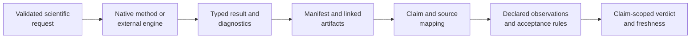

# Runtime And Evidence Boundary

Runtime output becomes governed evidence only through an explicit claim
contract. Executing a method can produce a complete, reproducible result
without establishing a study claim; an Evidence Book bundle adds the source,
claim identity, checks, acceptance rules, freshness, and verdict required for
adjudication.

## Runtime Result Contract

A runtime result identifies the method owner, inputs, configuration, status,
diagnostics, and outputs. It answers whether the requested computation
executed under its declared operational contract. It may also carry numerical
or integration-test support, but it does not inherit a scientific claim that
was never mapped to it.

## Evidence Claim Contract

An evidence claim binds a scientific statement to source provenance,
identified inputs, an executable or externally bounded reference,
observation-level checks, acceptance rules, artifacts, a verdict, and material
dependency freshness. The claim is no broader than that binding.

## Promotion Requirements

| Requirement | Runtime output alone | Governed evidence claim |
| --- | :---: | :---: |
| method and software identity | required | required |
| input and configuration identity | required | required |
| diagnostics and output inventory | required | required |
| stable claim identifier | optional | required |
| scientific source provenance | optional | required |
| reference or closure boundary | optional | required |
| declared observations and tolerances | optional | required |
| claim-scoped verdict and freshness | no | required |

Copying a report into the Evidence Book does not satisfy these requirements.
Promotion requires a registered bundle whose machine-readable records connect
the claim to the exact runtime or external computation.

## Valid Boundary States

- A native method can be implemented and tested without a study bundle.
- An adapter can be fully operational while the external algorithm remains the
  computational owner.
- A bundle can be structurally valid and current while its verdict is
  `not_comparable`.
- A matched study observation does not grant parity to neighboring models,
  datasets, or package surfaces.
- A released runtime does not make stale evidence current.

Use the [claim reading guide](claim-reading-guide.md) to qualify public
statements, [validation lanes](../quality/validation-lanes.md) to identify the
proof family, and the
[Evidence Book](../../03-bijux-phylogenetics-evidence-book/index.md) to inspect
governed study verdicts.
