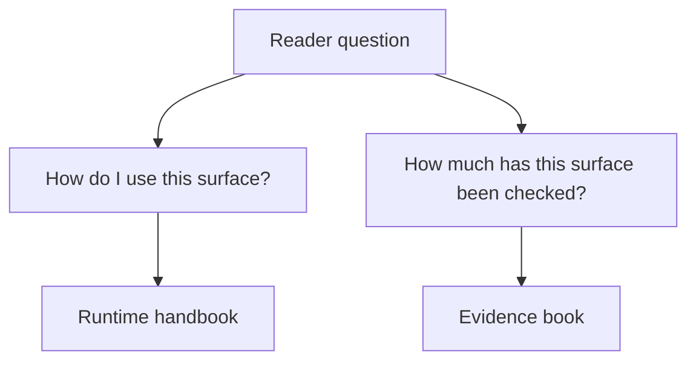

# Runtime And Evidence Boundary

The runtime handbook and the evidence book answer different questions. Keeping
them separate preserves the meaning and scope of each claim.

## The Runtime Handbook Answers

- what the product surface is
- how to run it
- which commands, imports, and artifact families matter
- where native ownership and wrapper orchestration differ
- what operational limits apply

## The Evidence Book Answers

- which course-derived study slices have governed evidence
- where trust is bounded, partial, or still open
- how repository behavior compares against explicit study or parity references

## Why The Boundary Matters

- a published feature can be usable before every scientific claim around it is
  closed
- a wrapper-backed workflow can be documented honestly without being disguised
  as native
- a narrower evidence surface does not make the runtime docs false, as long as
  the narrower trust boundary stays explicit

## Reading Rule

If your question is "how do I use this feature?", stay in the runtime
handbook. If your question is "how much has this feature been checked on named
studies?", move to the evidence book.

Use the claim reading guide when you need the fuller vocabulary for runtime,
native, wrapper, evidence, and release claims.

## Boundary Examples

- a native maximum-likelihood workflow belongs in the runtime handbook because
  that is where usage, inputs, and outputs are documented
- a PCM study parity bundle belongs in the evidence book because that is where
  bounded trust, freshness, and study scope are documented
- a benchmark difference belongs in quality guidance because it answers a
  review question, not a basic usage question
