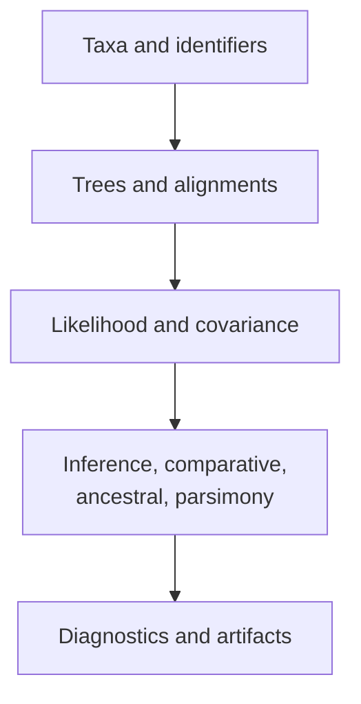
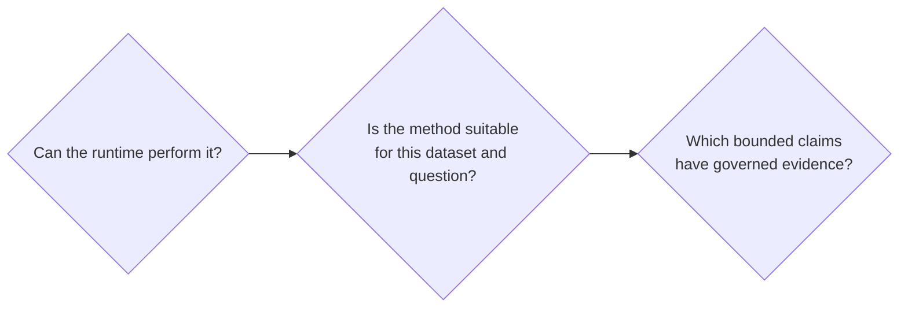

# Scientific Runtime Foundation

`bijux-phylogenetics` turns trees, alignments, traits, models, and analysis
configuration into typed results and durable review artifacts. Its scientific
foundation is a set of explicit contracts: taxon identity, topology,
rootedness, branch length, character state, likelihood, covariance, and
uncertainty retain consistent meanings across Python, CLI, and reporting
surfaces.

## Scientific Responsibilities

| Foundation | Responsibility |
| --- | --- |
| taxon identity | reconcile labels before tree, alignment, and trait data are combined |
| tree semantics | preserve topology, rootedness, branch lengths, support, clades, and splits |
| alignment semantics | validate alphabet, shape, coding assumptions, translation, trimming, and partitions |
| model semantics | make state space, rate model, covariance, parameters, and transformations explicit |
| result semantics | retain estimates, diagnostics, uncertainty, warnings, and method provenance |
| artifact semantics | preserve run identity, configuration, outputs, and integrity relationships |

## Contract Propagation

| Upstream fact | Downstream dependency | Failure if lost |
| --- | --- | --- |
| stable taxon identity and ordering | matrices, alignments, traits, random effects, node ledgers | values are assigned to the wrong biological entities |
| topology, rooting, and branch-length meaning | likelihood, covariance, time, reconstruction, search | the method evaluates a different scientific object |
| state alphabet and partition definition | rate matrices, likelihood vectors, ancestral states | probabilities and parameters lose their declared state space |
| model parameterization and bounds | optimization, sampling, comparison, reporting | estimates with similar labels become incomparable |
| search, sampler, and seed policy | convergence, support, posterior summaries, replay | the reported solution cannot be qualified or reconstructed |
| runtime and engine provenance | diagnostics, artifacts, parity, evidence | ownership and version-dependent behavior become ambiguous |

These facts cross interface boundaries unchanged. A CLI serializer may change
representation, but it may not change taxon order, parameter meaning, support
scale, or result status.

## Analytical Reach

The runtime includes native finite-state likelihood, maximum-likelihood tree
inference, supported Bayesian DNA inference, comparative regression,
phylogenetic signal, Brownian and OU modeling, discrete-state evolution,
ancestral reconstruction, explicit parsimony families, simulations, datasets,
and publication-oriented reporting.

External engines extend this reach where a mature independent implementation
is intentionally used. Adapters for MAFFT, trimAl, IQ-TREE2, FastTree,
MrBayes, and BEAST preserve engine identity and captured outputs while
normalizing execution into reviewable workflows.

## Three Separate Questions

An implemented method answers the first question. Assumption checks, model
criticism, and diagnostics address the second. Benchmarks and study bundles
address parts of the third. No answer automatically supplies the next one.

## Determinism And Uncertainty

Deterministic parsing, validation, and serialization improve reproducibility.
Optimization and sampling may require seeds, repetition, convergence review,
or sensitivity analysis. Reproducing identical bytes is not the same as
quantifying scientific uncertainty, and uncertainty is not an execution error
to be hidden.

## Refusal Is Part Of The Contract

The runtime should refuse or clearly mark a result when required taxa cannot
be reconciled, model assumptions are undefined for the input, an external
engine is unavailable, optimization or sampling fails its declared completion
policy, required output is incomplete, or persistence cannot preserve the
result contract. A partial diagnostic record may still be valuable, but it
must not be promoted to a complete scientific result.

## Product Boundaries

- Public interfaces are documented imports, commands, schemas, and artifact
  contracts—not every importable helper.
- Native ownership applies only where this repository implements the
  computation.
- Adapter ownership covers orchestration and normalization, not the external
  algorithm.
- Evidence verdicts apply to named claims, inputs, versions, and tolerances.
- Repository automation supports the product but is not part of the analysis
  runtime.

## Foundation References

- [Repository scope and limits](repository-scope-and-limits.md)
- [Product surface and ownership](product-surface-and-ownership.md)
- [Runtime and evidence boundary](evidence-boundary.md)
- [Claim reading guide](claim-reading-guide.md)
- [Runtime architecture](../architecture/index.md)
