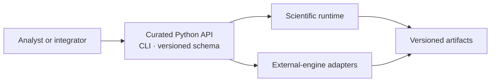

# Product Surface And Ownership

Public ownership is defined by a supported entry point and a documented
contract. Source code may contain additional helpers, intermediate types, and
repository automation that are intentionally outside that boundary.

## Published Distributions

| Distribution | Public responsibility |
| --- | --- |
| `bijux-phylogenetics` | canonical runtime, Python API, CLI, package data, and scientific result contracts |
| `phylogenetic` | compatibility names for the same runtime behavior |
| `bijux-phylogenetics-dev` | maintainer and CI verification; not an analysis dependency |

## Supported Interface Families

- curated workflow functions under `bijux_phylogenetics.api`;
- documented domain entry points for native likelihood, inference, Bayesian,
  comparative, ancestral, parsimony, benchmark, and report contracts;
- `bijux-phylogenetics` and `phylogenetic` commands and their documented
  arguments, exit behavior, and outputs;
- the pinned OpenAPI schema under `apis/bijux-phylogenetics/v1/`;
- declared JSON, TSV, manifest, figure, and report artifacts.

An internal module path is not stable merely because Python can import it.
Human-readable report layout is not a machine contract when a structured
artifact exists.

## Ownership Matrix

| Surface | Repository owns | Separate owner or decision |
| --- | --- | --- |
| native method | algorithm, implementation, result, diagnostics | suitability for a particular study |
| engine adapter | preparation, invocation, capture, parsing, normalization | external executable and algorithm |
| workflow | composition, validation order, artifact production | user's scientific question and inputs |
| benchmark | harness, corpus identity, metrics, threshold evaluation | inference beyond the measured scope |
| evidence bundle | provenance, claims, checks, recorded verdict | claims not registered by the bundle |
| report | faithful projection of results and limits | independent scientific interpretation |

## Compatibility Commitments

The alias distribution must preserve advertised imports, commands, runtime
behavior, package data, version alignment, and documentation links. It is not
an independent fork. Artifact compatibility depends on declared schema and
semantic version rules rather than incidental formatting or key order.

## Change Impact

A public method change may affect its Python signature, CLI translation,
schema, result serialization, report projection, examples, package README,
benchmarks, and evidence freshness. These surfaces form one compatibility
chain even though they have different owners in the source tree.

## Private And Maintainer Surfaces

Repository make fragments, generation utilities, release checks, evidence
index builders, and uncurated implementation helpers may change without the
same user compatibility promise. They must still preserve governed outputs and
must not silently alter a public scientific contract.
