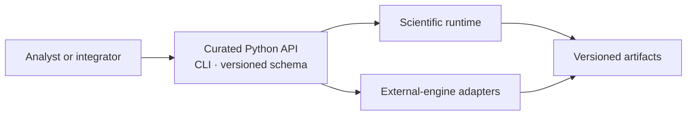
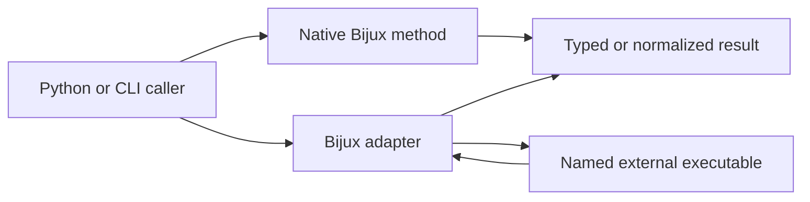

# Product Surface And Ownership

Public ownership is defined by a supported entry point and a documented
contract. Source code may contain additional helpers, intermediate types, and
repository automation that are intentionally outside that boundary.

## Published Distributions

| Distribution | Public responsibility |
| --- | --- |
| `bijux-phylogenetics` | canonical runtime, Python API, CLI, package data, and scientific result contracts |
| `phylogenetic` | compatibility names for the same runtime behavior |
| `bijux-phylogenetics-dev` | maintainer and CI verification; not an analysis dependency |

## Supported Interface Families

- curated workflow functions under `bijux_phylogenetics.api`;
- documented domain entry points for native likelihood, inference, Bayesian,
  comparative, ancestral, parsimony, benchmark, and report contracts;
- `bijux-phylogenetics` and `phylogenetic` commands and their documented
  arguments, exit behavior, and outputs;
- the pinned OpenAPI schema under `apis/bijux-phylogenetics/v1/`;
- declared JSON, TSV, manifest, figure, and report artifacts.

An internal module path is not stable merely because Python can import it.
Human-readable report layout is not a machine contract when a structured
artifact exists.

## How To Recognize A Supported Surface

A public surface must be discoverable from an installed distribution and have
an owned behavior contract. Use these signals together:

| Signal | What it establishes | What it does not establish |
| --- | --- | --- |
| curated export or registered command | intended invocation path | scientific suitability |
| documented arguments and return contract | supported input and result semantics | success for every valid-size input |
| contract and failure tests | behavior under named fixtures | numerical parity outside those fixtures |
| declared serialization or schema | machine-consumption boundary | stability of report layout |
| deprecation and version policy | compatibility expectation | permanent support for private helpers |

An import found by searching the source tree is not sufficient. Neither is a
CLI example that depends on repository fixtures absent from the wheel.

## Find The Owner From The Disputed Decision

When a result is challenged, start with the decision in dispute rather than
the file in which the symptom appeared. The same failed run can cross several
surfaces, but each decision has one primary owner.

| Disputed decision | Owning surface | Evidence needed to resolve it |
| --- | --- | --- |
| why a taxon was excluded | input reconciliation contract | normalized identities, exclusion reason, and admitted population |
| why a numerical value differs | native method or named external engine | method identity, configuration, diagnostics, and primary values |
| why external output was rejected | adapter parser | raw engine files, parser contract, version, and parse error |
| why a JSON consumer failed | versioned schema or serializer | schema revision, payload, validation result, and compatibility rule |
| why HTML and JSON disagree | report projection | source artifact identities and the rendering rule |
| why study prose is broader than its result | Evidence Book claim record | claim ID, observation checks, verdict, limitations, and freshness |

This routing prevents two common category errors: assigning an external
algorithm's numerical behavior to the adapter, and treating a presentation
defect as if it changed the underlying scientific result.

## Ownership Matrix

| Surface | Repository owns | Separate owner or decision |
| --- | --- | --- |
| native method | algorithm, implementation, result, diagnostics | suitability for a particular study |
| engine adapter | preparation, invocation, capture, parsing, normalization | external executable and algorithm |
| workflow | composition, validation order, artifact production | user's scientific question and inputs |
| benchmark | harness, corpus identity, metrics, threshold evaluation | inference beyond the measured scope |
| evidence bundle | provenance, claims, checks, recorded verdict | claims not registered by the bundle |
| report | faithful projection of results and limits | independent scientific interpretation |

## Preserve The Computation Owner

The two paths may produce similarly shaped results, but their provenance is
different. A native record names the Bijux method and runtime version. An
adapter record additionally names executable discovery, engine version,
invocation, exit status, native engine files, and parser outcome. Normalization
never transfers algorithm ownership from the engine to the adapter.

## Compatibility Commitments

The alias distribution must preserve advertised imports, commands, runtime
behavior, package data, version alignment, and documentation links. It is not
an independent fork. Artifact compatibility depends on declared schema and
semantic version rules rather than incidental formatting or key order.

The alias must expose failures honestly as well as successes. If the facade
cannot resolve the canonical dependency, dispatch its command, access package
data, or preserve a documented result, that is a compatibility defect—not a
smaller supported edition.

## Change Impact

A public method change may affect its Python signature, CLI translation,
schema, result serialization, report projection, examples, package README,
benchmarks, and evidence freshness. These surfaces form one compatibility
chain even though they have different owners in the source tree.

## Private And Maintainer Surfaces

Repository make fragments, generation utilities, release checks, evidence
index builders, and uncurated implementation helpers may change without the
same user compatibility promise. They must still preserve governed outputs and
must not silently alter a public scientific contract.
