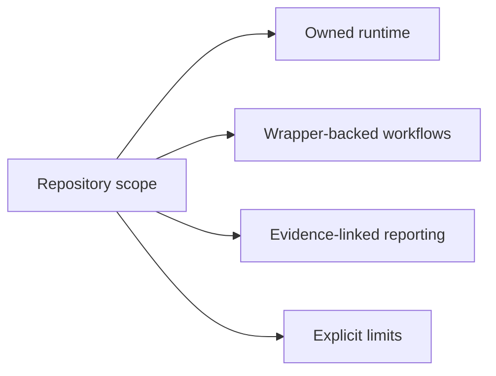

# Repository Scope and Limits

This repository owns a serious phylogenetics runtime, but it still has clear
limits. Those limits matter because the public docs should explain what the
repository can support today without borrowing credibility from future work.

## In Scope

- deterministic tree and alignment workflows
- native finite-state likelihood and supported native inference contracts
- comparative and ancestral analysis over governed inputs
- adapter surfaces that orchestrate external engines honestly
- evidence-linked reporting and publication-style artifact packaging

## Out Of Scope

- claiming broader scientific validation than the evidence-book proves
- treating every wrapper-backed workflow as if it had already been
  reimplemented locally
- describing narrow native inference ownership as if it already covered every
  model family and every phylogenetic workflow in the repository
- hiding unresolved runtime or evidence limits behind marketing language

## What The Limits Protect

These limits protect three parts of the public story:

- users can still see substantial runtime depth without being misled about
  closure
- reviewers can tell which surfaces are owned, wrapped, benchmarked, or
  study-backed
- releases can stay credible because the docs avoid implying a larger
  scientific claim than the evidence-book supports

## Why This Matters

Phylogenetics is a domain where people will naturally overread polished output.
This repository has to resist that. Public documentation is part of the trust
contract, not just an introduction layer.
