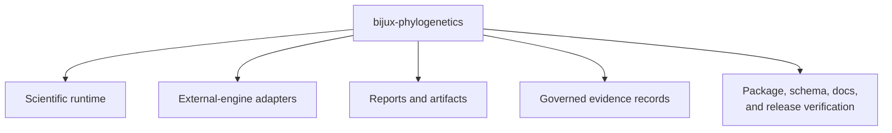

# Repository Scope And Limits

The repository owns a substantial runtime and the infrastructure required to
publish and review it. Its boundaries distinguish computation from
orchestration, reproducibility from scientific validity, and available methods
from study-backed claims.

## In Scope

- tree, alignment, likelihood, comparative, ancestral, parsimony, simulation,
  dataset, and reporting contracts;
- owned maximum-likelihood and supported Bayesian inference entry points;
- explicit orchestration of selected external scientific engines;
- typed results, diagnostics, manifests, tables, figures, and reports;
- benchmark corpora and governed evidence for named comparisons and studies;
- compatibility distribution, API schema, packaging, documentation, and
  release verification.

## Where The Repository's Depth Lives

The repository is more than a collection of callable methods. Its depth comes
from keeping distinct scientific and publication responsibilities connected
without pretending that one can substitute for another.

| Responsibility | Repository-owned depth | Explicit boundary |
| --- | --- | --- |
| scientific objects | validated trees, alignments, traits, partitions, identities, exclusions, and typed state | validation does not establish representativeness |
| native analysis | maintained likelihood, inference, comparative, ancestral, parsimony, simulation, and diagnostic contracts | implementation does not select the right model for a study |
| governed integration | executable discovery, preparation, invocation, capture, parsing, normalization, and provenance | orchestration does not transfer ownership of the external algorithm |
| durable review | manifests, structured results, tables, figures, diagnostics, and reconstructable identities | artifact completeness does not establish scientific validity |
| scientific assurance | contract tests, known answers, invariants, parity cases, benchmarks, and claim-scoped evidence | each assurance lane keeps its own denominator |
| publication integrity | package, command, schema, documentation, evidence, and release alignment | publication gates do not replace independent review or replication |

Depth in one row does not promote another row. A richly instrumented adapter
remains an adapter; a complete artifact packet can retain a negative or
`not_comparable` verdict; extensive method coverage can coexist with five
narrowly governed study families.

## Scientific Non-Goals

- Replacing every established phylogenetics program with a local implementation.
- Recommending a model solely because the runtime implements it.
- Treating a successful execution as evidence of convergence, fit, or valid
  biological interpretation.
- Generalizing a benchmark beyond its corpus, configuration, environment, and
  metric.
- Generalizing a study verdict beyond its registered claim and inputs.
- Concealing unresolved posterior, reference, provenance, or coverage
  dependencies.

## Boundaries By Decision

| Decision | Repository contribution | Decision that remains outside the runtime |
| --- | --- | --- |
| admit taxa and observations | reconciliation, validation, exclusions, and identity ledgers | whether the sampling design represents the target population |
| choose a model | explicit supported model contracts and diagnostics | whether the model is biologically adequate for the research question |
| choose a computation owner | native methods and governed external adapters | institutional or study preference among scientifically defensible tools |
| accept a result | completion state, uncertainty, support, convergence, and artifact integrity | substantive interpretation and causal meaning |
| compare implementations | registered fixtures, conventions, tolerances, and observations | interchangeability beyond the selected denominator |
| publish a claim | governed evidence and release consistency checks | independent peer review or replication |

The runtime can make a decision inspectable without making the decision on the
analyst's behalf.

## Native And External Computation

Native methods are maintained and tested in this source tree. External-engine
workflows delegate computation to a named executable while retaining local
responsibility for preparation, invocation, capture, parsing, normalized
results, and artifacts.

That distinction affects installation and failure diagnosis. A missing
executable is an adapter-environment failure. A parser mismatch is an adapter
compatibility failure. A convergence warning belongs to the method result. A
taxon mismatch belongs to input validation.

## Responsibility At Failure Boundaries

| Failure | Responsible surface | Required retained state |
| --- | --- | --- |
| invalid or ambiguous tree, alignment, trait, or partition | input contract | offending identity, validation rule, exclusion or refusal status |
| native numerical termination or instability | owned method | configuration, diagnostic state, termination reason, partial result policy |
| missing executable or non-zero engine exit | adapter execution | discovery result, command, version when known, stdout, stderr, exit status |
| unexpected external output | adapter parser | raw files, expected contract, parser error, engine identity |
| incomplete manifest or unwritable destination | artifact producer | declared inventory, successful writes, missing or failed outputs |
| stale or unsupported scientific claim | Evidence Book governance | claim ID, material dependency, freshness or verdict boundary |

Responsibility identifies where the failure is diagnosed and repaired. It does
not imply that downstream surfaces may suppress it. Reports, manifests, and
release records must preserve the status that the owning surface produced.

## Evidence Coverage

The Evidence Book currently concentrates on five comparative teaching-study
families. It is not a coverage map of every runtime module. Native likelihood,
inference, parsimony, simulation, and other domains have their own tests and
benchmarks; study evidence exists only where an explicit claim mapping and
bundle record say so.

The cichlid PCM4 and PCM5 collections currently preserve study structure,
inputs, reference code, and claim boundaries without governed primary
posterior outputs. Their `not_comparable` verdicts are therefore informative
closure states for the current records, not evidence that the posterior
quantities were reproduced. Stronger language requires retained model outputs,
diagnostic identity, claim-level observations, and new adjudication.

## Capability And Assurance Are Independent Axes

| State | Correct public interpretation |
| --- | --- |
| implemented, contract-tested, no reference comparison | executable capability with bounded interface evidence |
| implemented and numerically checked on known answers | bounded numerical assurance, not study-wide validity |
| adapter integration tested | governed execution of an external owner, not native implementation |
| parity matched for registered cases | agreement for named operations, inputs, conventions, and tolerances |
| study bundle current but `not_comparable` | governed scope and provenance with an unresolved comparison boundary |
| release gates passed | packages and declared public surfaces align at one revision |

No row is a hidden synonym for another. A broad runtime can legitimately have
narrow study evidence, and a well-governed study can truthfully remain
non-comparable.

## Supported Parts Do Not Imply A Supported Composition

Two individually supported operations do not automatically form a supported
workflow. Their boundary must preserve identity, units, rooting, branch-length
meaning, state space, uncertainty, and failure status. Composition is
supported only when the handoff contract is documented and exercised as a
whole.

| Composition claim | What must exist | Otherwise |
| --- | --- | --- |
| parser output feeds inference | an admitted-object contract with preserved order and exclusions | validate and transform explicitly; do not imply workflow support |
| inferred tree feeds comparative analysis | a declared policy for topology and branch-length uncertainty | report the analysis as conditional on the selected tree |
| adapter output feeds a native method | a semantic mapping for fields, units, missing values, and status | retain the external artifact without promoting it to a native input |
| simulation validates inference | a registered parameter-recovery design with independent truth | call it an example or execution check, not validation |
| parity result supports a study claim | an explicit material dependency in the governed evidence bundle | keep runtime parity and study evidence separate |

This rule also applies within one package. Sharing Python types, serializers,
or a command group demonstrates mechanical compatibility; it does not prove
that the combined scientific assumptions are coherent.

## Operational Limits

External engines must be installed independently. Computational cost depends
on taxa, characters, model complexity, search, sampling, and hardware. Some
methods are stochastic. Persist exact versions, input identities,
configuration, seed policy, diagnostics, and output manifests for governed
work.

Resource feasibility is part of planning, not a hidden runtime guarantee.
Taxon count alone does not determine cost: alignment length, state space,
partition count, topology search, posterior sampling, replicate count, and
artifact volume can dominate. Use named benchmark records to estimate a
specific workload and preserve the hardware and configuration denominator.

## Interpretation Limit

The runtime can enforce contracts and expose diagnostics. It cannot choose a
research design, establish causal meaning, eliminate sampling bias, or replace
domain review. A polished report is a structured presentation of evidence—not
an independent scientific verdict.
