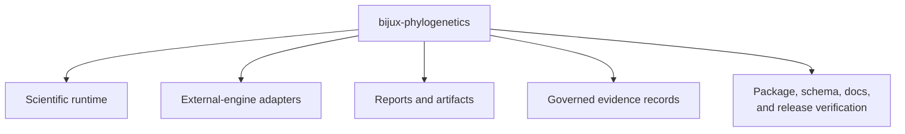

# Repository Scope And Limits

The repository owns a substantial runtime and the infrastructure required to
publish and review it. Its boundaries distinguish computation from
orchestration, reproducibility from scientific validity, and available methods
from study-backed claims.

## In Scope

- tree, alignment, likelihood, comparative, ancestral, parsimony, simulation,
  dataset, and reporting contracts;
- owned maximum-likelihood and supported Bayesian inference entry points;
- explicit orchestration of selected external scientific engines;
- typed results, diagnostics, manifests, tables, figures, and reports;
- benchmark corpora and governed evidence for named comparisons and studies;
- compatibility distribution, API schema, packaging, documentation, and
  release verification.

## Scientific Non-Goals

- Replacing every established phylogenetics program with a local implementation.
- Recommending a model solely because the runtime implements it.
- Treating a successful execution as evidence of convergence, fit, or valid
  biological interpretation.
- Generalizing a benchmark beyond its corpus, configuration, environment, and
  metric.
- Generalizing a study verdict beyond its registered claim and inputs.
- Concealing unresolved posterior, reference, provenance, or coverage
  dependencies.

## Native And External Computation

Native methods are maintained and tested in this source tree. External-engine
workflows delegate computation to a named executable while retaining local
responsibility for preparation, invocation, capture, parsing, normalized
results, and artifacts.

That distinction affects installation and failure diagnosis. A missing
executable is an adapter-environment failure. A parser mismatch is an adapter
compatibility failure. A convergence warning belongs to the method result. A
taxon mismatch belongs to input validation.

## Evidence Coverage

The Evidence Book currently concentrates on five comparative teaching-study
families. It is not a coverage map of every runtime module. Native likelihood,
inference, parsimony, simulation, and other domains have their own tests and
benchmarks; study evidence exists only where an explicit claim mapping and
bundle record say so.

## Operational Limits

External engines must be installed independently. Computational cost depends
on taxa, characters, model complexity, search, sampling, and hardware. Some
methods are stochastic. Persist exact versions, input identities,
configuration, seed policy, diagnostics, and output manifests for governed
work.

## Interpretation Limit

The runtime can enforce contracts and expose diagnostics. It cannot choose a
research design, establish causal meaning, eliminate sampling bias, or replace
domain review. A polished report is a structured presentation of evidence—not
an independent scientific verdict.
