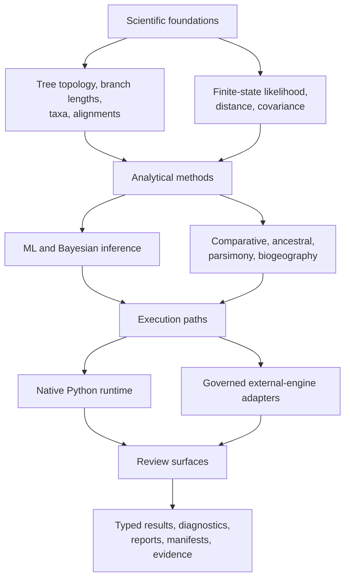
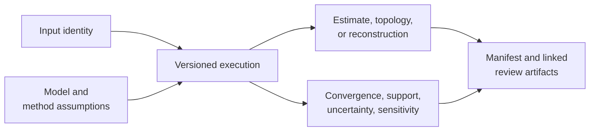

# Phylogenetics Product Handbook

`bijux-phylogenetics` is a Python runtime for building, running, and reviewing
phylogenetic analyses. Its public contract includes native analytical code,
explicit integrations with external engines, typed results, and durable output
bundles. The distinction between those surfaces is part of the product.

## Product Areas

| Area | Coverage |
| --- | --- |
| What belongs to the runtime, and how does data move through it? | [Architecture](architecture/index.md) |
| Should I use Python, the CLI, or an output bundle? | [Public interfaces](interfaces/index.md) |
| How do I install, execute, and review a workflow? | [Runtime operations](operations/index.md) |
| What does a passing check or evidence record establish? | [Quality and limits](quality/index.md) |

## Select An Analysis Route

| Starting material and question | Primary route | First review checkpoint |
| --- | --- | --- |
| a tree that needs structural or branch-length review | `inspect`, `validate`, `diagnose`, or the tree Python surface | rootedness, branch lengths, tip identity, support scale |
| sequences that need alignment, trimming, and tree inference | sequence-to-tree workflow or explicit alignment and engine commands | sequence type, retained sites, model, engine ownership |
| a tree plus continuous or categorical traits | comparative workflow and domain-specific model commands | taxon reconciliation, design matrix, covariance model |
| ancestral values or histories | ancestral and discrete-evolution surfaces | state space, transition model, node identity, uncertainty |
| character-cost or topology-search analysis | parsimony surfaces | coding, cost matrix, search coverage, equal-best trees |
| controlled recovery or stress analysis | simulation and dataset workflows | known truth, independence, seed policy, acceptance rule |
| a claim that must be cited or released | Evidence Book review path | claim identifier, source, inputs, checks, freshness, verdict |

The [scientific domain map](../02-bijux-phylogenetics-domains/index.md) defines
the assumptions behind these routes. The [surface selection guide](interfaces/surface-selection.md)
then distinguishes Python composition, repeatable CLI execution, and durable
artifact consumption.

## Analytical Capability Map

This is not a maturity diagram: capability families have different validation
depth. Consult [validation lanes](quality/validation-lanes.md) before turning
runtime breadth into a scientific assurance claim.

## What Is Native

The repository owns the semantics and implementation of its tree runtime,
alignment diagnostics, finite-state likelihood foundations, supported native
maximum-likelihood and Bayesian paths, comparative models, ancestral methods,
parsimony families, simulations, datasets, and output contracts.

“Native” does not mean “universally preferred” or “validated for every
dataset.” It identifies implementation ownership. Suitability is a separate
question answered through model assumptions, diagnostics, benchmarks, and
study evidence.

## What Is Integrated

Adapters make established engines usable inside governed workflows. They own
input preparation, invocation, failure reporting, output parsing, and artifact
packaging. They do not own the scientific algorithms inside the external
executable. This boundary matters for installation, reproducibility, licensing,
and claim language.

## A Typical Analysis

1. Validate taxon identities, tree shape, alignment content, and model inputs.
2. Select an owned native method or an explicit external-engine adapter.
3. Execute through Python for composition or the CLI for repeatable operation.
4. Inspect typed diagnostics before interpreting parameter estimates.
5. Persist the report, manifest, tables, and figures needed for review.
6. Use evidence records only when making claims covered by those records.

The runtime is designed so that the scientific result is not the only output.
Inputs, configuration, diagnostics, and provenance remain available to a
reviewer.

## A Complete Result Is More Than An Estimate

An estimate without input identity cannot be reproduced. An estimate without
diagnostics cannot be interpreted safely. A report without structured results
cannot be consumed reliably. The workflow is complete when all three
relationships remain inspectable.

## Ownership Boundaries

| Surface | Owns | Does not imply |
| --- | --- | --- |
| runtime method | computation and result contract | evidence closure for every use |
| engine adapter | orchestration and normalized artifacts | native ownership of the engine |
| benchmark | behavior on a named corpus and configuration | universal performance ranking |
| evidence bundle | provenance and verdicts for named claims | validation beyond its study scope |
| published handbook | supported behavior, assumptions, and navigation | proof without executable checks |

## Locate The Owning Contract

| Disputed subject | Canonical record | Reader-facing interpretation |
| --- | --- | --- |
| function, signature, or default | curated public source and contract tests | Python and API guides |
| command, option, or exit behavior | command registry and CLI tests | generated CLI reference and workflow guides |
| service request or response | pinned OpenAPI schema and server tests | API surface guide |
| artifact field or omission | versioned result/manifest schema and producer tests | artifact contracts and consumption guide |
| numerical or topological behavior | named validation or benchmark record | quality and domain guides |
| parity case outcome | parity registry, observation rows, and failure artifacts | parity handbook |
| scientific claim verdict | governed Evidence Book bundle and indexes | study guide |

The public handbook explains these contracts but cannot override them. When a
guide and a structured record disagree, use the owning contract to identify the
stale projection and preserve the disagreement until it is corrected.

## Recommended Reading Paths

**Scientific capability:** [domain map](../02-bijux-phylogenetics-domains/index.md)
→ [trees, alignments, and taxa](../02-bijux-phylogenetics-domains/data-and-structure/trees-alignments-and-taxa.md)
→ [likelihood and inference](../02-bijux-phylogenetics-domains/inference/likelihood-and-inference.md).

**Reference correspondence:** [parities and correspondence](../04-bijux-phylogenetics-parities/index.md)
→ [R ecosystem](../04-bijux-phylogenetics-parities/r-ecosystem/index.md)
→ [interpreting correspondence](../04-bijux-phylogenetics-parities/correspondence/index.md).

**First analysis:** [installation](operations/installation-and-setup.md) →
[surface selection](interfaces/surface-selection.md) →
[common workflows](operations/common-workflows.md) →
[artifact consumption](interfaces/artifact-consumption-guide.md).

**Technical review:** [runtime system map](architecture/runtime-system-map.md) →
[Python surface](interfaces/python-surface.md) →
[artifact contracts](interfaces/artifact-contracts.md) →
[test strategy](quality/test-strategy.md).

**Scientific claim review:** [claim reading guide](foundation/claim-reading-guide.md)
→ [evidence boundary](foundation/evidence-boundary.md) →
[Evidence book](../03-bijux-phylogenetics-evidence-book/index.md).

## Product Limits

- The available command or function is not a recommendation to use its model.
- A deterministic bundle is reproducible only with its declared inputs and
  execution assumptions.
- Numerical agreement needs stated tolerances and comparable conventions.
- External engines remain separate software with their own support constraints.
- Open evidence verdicts are visible product information, not documentation
  defects to be worded away.
