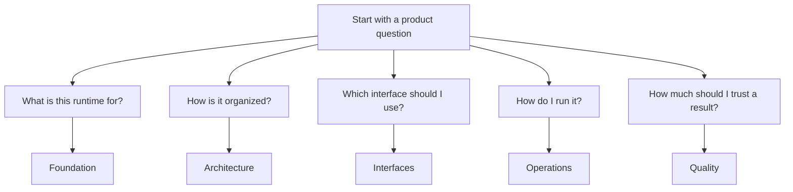
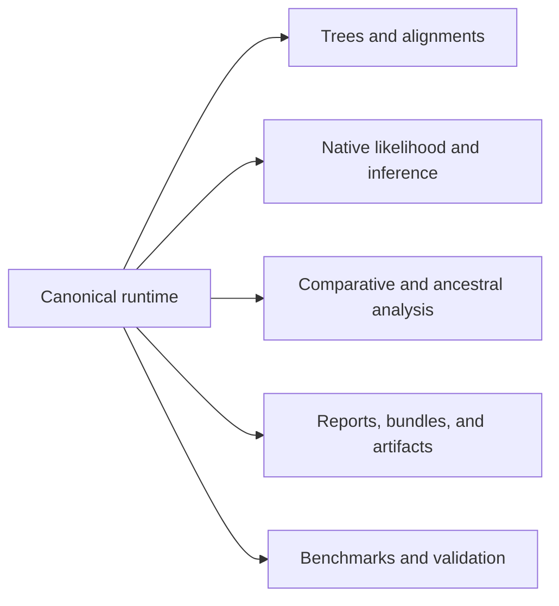

# Bijux Phylogenetics Product Guide

This handbook explains the public runtime in product terms: what the
repository owns, how the capability families fit together, which interfaces
are stable, how to operate them, and how to read their quality boundaries
without flattening everything into one vague claim.

Use it when you want the product answer first without losing the source-tree
depth behind that answer.

  <a class="md-button md-button--primary" href="../../index.md">Documentation home</a>
  <a class="md-button" href="foundation/">Runtime purpose and scope</a>
  <a class="md-button" href="architecture/">Architecture and package roles</a>
  <a class="md-button" href="interfaces/">Public interfaces</a>
  <a class="md-button" href="operations/">Installation and workflows</a>
  <a class="md-button" href="quality/">Quality and release limits</a>

## What The Runtime Already Makes Possible

The checked-in runtime already spans:

- tree inspection, comparison, support handling, rootedness review, and
  rendering
- alignment validation, trimming, translation, and dataset preparation
- native finite-state likelihood plus native maximum-likelihood and supported
  native Bayesian public surfaces
- comparative regression, phylogenetic signal, discrete evolution,
  diversification, and ancestral reconstruction
- explicit parsimony, simulation, datasets, benchmark corpora, and
  review-facing report generation

## Runtime Capability Atlas

| Capability family | What this handbook should help a reader discover |
| --- | --- |
| Tree and alignment runtime | owned semantics, validation paths, comparison surfaces, and reportable artifacts |
| Native inference runtime | locally owned likelihood and inference contracts rather than only wrapped executables |
| Comparative runtime | PGLS, signal, regression, ancestral, discrete-evolution, and diversification families |
| Workflow runtime | CLI and typed Python routes that emit durable artifacts |
| Trust runtime | benchmarks, validation lanes, evidence links, and release-facing quality reading |

## Why This Is Not A Small Wrapper Layer

The runtime is larger than a "FASTA to tree" wrapper story. It owns a real
tree runtime, lower-level likelihood contracts, benchmark surfaces, typed
workflow results, and substantial comparative-analysis families. This
handbook keeps that depth visible while also keeping evidence limits visible.

## Read By Question

- What is this repository trying to do, and what is it refusing to claim?
  Start with [Foundation](foundation/index.md).
- Which package or capability family owns a surface?
  Start with [Architecture](architecture/index.md).
- Which entry point should I use for my task?
  Start with [Interfaces](interfaces/index.md).
- How do I install the runtime and run practical workflows?
  Start with [Operations](operations/index.md).
- How do I judge trust, release posture, and limits?
  Start with [Quality](quality/index.md).

## Flagship Guides

- [Surface selection guide](interfaces/surface-selection.md)
- [Native maximum-likelihood workflows](operations/native-maximum-likelihood-workflows.md)
- [Native Bayesian workflows](operations/native-bayesian-workflows.md)
- [Native benchmark review](operations/native-benchmark-review.md)
- [Validation lanes](quality/validation-lanes.md)
- [Claim reading guide](foundation/claim-reading-guide.md)

## Read This Handbook Like A Map

1. Start with [Foundation](foundation/index.md) to understand what the runtime
   is claiming and refusing to claim.
2. Continue to [Architecture](architecture/index.md) to understand which
   package and capability family owns what.
3. Use [Interfaces](interfaces/index.md) to choose the right public surface.
4. Use [Operations](operations/index.md) to run the package in the right mode.
5. Finish with [Quality](quality/index.md) to understand how strong the proof
   surface really is.

## Related Reading

- Use the [Evidence book](../02-bijux-phylogenetics-evidence-book/index.md) when the
  question is study evidence, parity, freshness, or coverage gaps.
- Use the [Maintainer handbook](../03-bijux-phylogenetics-maintain/index.md)
  when the question is release stewardship, documentation alignment, or
  repository health.
