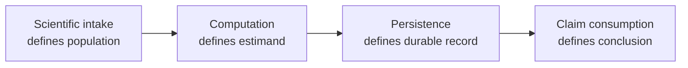
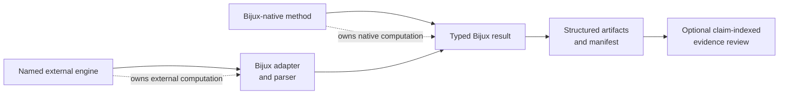
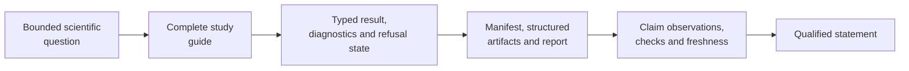
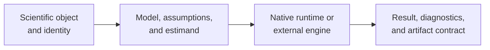
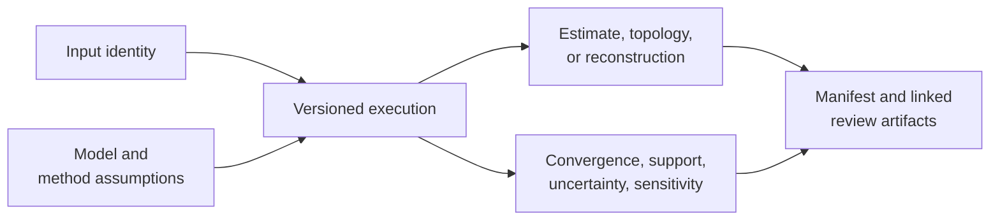

# Phylogenetics Product Handbook

`bijux-phylogenetics` is a Python runtime for building, running, and reviewing
phylogenetic analyses. Its public contract includes native analytical code,
explicit integrations with external engines, typed results, and durable output
bundles. The distinction between those surfaces is part of the product.

The runtime is designed around scientific decisions rather than file
conversion alone. It determines which observations enter an analysis, which
model or algorithm evaluates them, what diagnostic state qualifies the
result, and which structured record survives for another person to review.
Python, CLI, and adapter interfaces are projections of those decisions; they
do not define different scientific truths.

| Product responsibility | Reader-visible consequence |
| --- | --- |
| scientific objects | trees, taxa, alignments, traits, states, and partitions retain explicit identity |
| analytical ownership | native calculations and external-engine calculations remain distinguishable in every result |
| result semantics | estimates travel with model state, warnings, exclusions, uncertainty, and refusal conditions |
| durable handoff | manifests and structured artifacts own facts later rendered in tables, figures, and reports |
| bounded evidence | parity and Evidence Book records qualify only the claims and populations they actually evaluate |

## Understand The Product As Four Connected Contracts

The runtime is not just a collection of algorithms. Every supported route
connects four contracts, and each contract can stop independently.

| Contract | Decision it owns | Evidence of completion |
| --- | --- | --- |
| scientific intake | which taxa, characters, traits, trees, partitions, and units are admitted | validated objects plus retained exclusions and transformations |
| computation | which model, algorithm, engine, search, sampler, or reconstruction was evaluated | typed result with method identity, status, diagnostics, and warnings |
| persistence | which execution state survives outside the process | manifest and structured artifacts with schema, checksums, and complete inventory |
| claim consumption | which bounded statement may use the result | explicit comparison or Evidence Book record with observations, rules, verdict, and limitations |

A route that ends after persistence can be complete and useful without making
a governed study claim. Conversely, a claim cannot skip directly from input
files to a favorable conclusion: the computation and durable result identities
must remain inspectable.

## Computation Ownership Survives Every Projection

Bijux can own an entire result contract without owning every algorithm that
contributed to it. Ownership stays attached through normalization, reporting,
comparison, and citation.

| Surface | Bijux owns | Ownership that remains elsewhere |
| --- | --- | --- |
| native method | algorithm, numerical contract, diagnostics, and result | scientific choice and downstream interpretation remain with the study |
| external-engine route | input admission, invocation, capture, parsing, normalization, and artifacts | the external engine owns its algorithm and native output semantics |
| report or figure | projection contract, source linkage, and rendering identity | the analytical result still owns the values |
| Evidence Book claim | dependency graph, comparison rule, verdict, limitations, and freshness | source studies and reference implementations retain their identities |

Normalization makes results reviewable under shared interfaces; it never
rewrites computation provenance. Evidence review consumes those identities
and can qualify or refuse a claim without changing who performed the method.

## Select An Analysis Route

| Starting material and question | Primary route | First review checkpoint |
| --- | --- | --- |
| a tree that needs structural or branch-length review | `inspect`, `validate`, `diagnose`, or the tree Python surface | rootedness, branch lengths, tip identity, support scale |
| sequences that need alignment, trimming, and tree inference | sequence-to-tree workflow or explicit alignment and engine commands | sequence type, retained sites, model, engine ownership |
| a tree plus continuous or categorical traits | comparative workflow and domain-specific model commands | taxon reconciliation, design matrix, covariance model |
| ancestral values or histories | ancestral and discrete-evolution surfaces | state space, transition model, node identity, uncertainty |
| character-cost or topology-search analysis | parsimony surfaces | coding, cost matrix, search coverage, equal-best trees |
| controlled recovery or stress analysis | simulation and dataset workflows | known truth, independence, seed policy, acceptance rule |
| packaged dataset or external study table | dataset catalog, loaders, exports, and study-input linkage | provenance, schema, taxon population, units, transformations, exclusions |
| region, coordinate, host, or niche history | biogeography, phylogeography, and ecology surfaces | state/spatial model, nodes, branches, constraints, uncertainty, event denominator |
| scientific result requiring tables, figures, or a review package | reports, rendering, and publication artifact surfaces | structured source, row/mark identity, manifest, inventory, audit and revalidation |
| a claim that must be cited or released | Evidence Book review path | claim identifier, source, inputs, checks, freshness, verdict |

The [scientific domain map](../02-bijux-phylogenetics-domains/index.md) defines
the assumptions behind these routes. The [surface selection guide](interfaces/surface-selection.md)
then distinguishes Python composition, repeatable CLI execution, and durable
artifact consumption.

## Move From Question To Citation

Use the route that matches the work:

- [sequence-to-tree study](operations/sequence-to-tree-study.md) for admitted
  FASTA through external alignment, trimming, inference, and support;
- [comparative and ancestral study](operations/comparative-and-ancestral-study.md)
  for a shared tree–trait population with separate model claims;
- [topology comparison study](operations/topology-comparison-study.md) for
  rooted or unrooted split correspondence under an explicit taxon denominator;
- [analysis report handoff](operations/analysis-report-handoff.md) for linked
  machine and human review artifacts;
- [result and refusal semantics](interfaces/result-and-refusal-semantics.md)
  when execution does not reach an accepted scientific state;
- [reading an evidence bundle](../03-bijux-phylogenetics-evidence-book/reading-an-evidence-bundle.md)
  when a result is used to support a public statement.

Evidence is not an automatic final stage for every analysis. Stop at the
structured result when no governed claim consumes it, and describe that scope
honestly. When a claim does consume the result, the bundle—not proximity to a
study guide—owns its verdict.

## Define Completion Before Running

An analysis route is ready only when its completion condition names both the
scientific result and the record needed to review that result. “The command
finished” is an execution observation, not a scientific completion rule.

| Route | Scientific completion condition | Review record that closes the route |
| --- | --- | --- |
| tree or alignment validation | every retained, excluded, and refused item has an explicit reason | structured result with the original input identity and complete denominator |
| likelihood or comparative fit | estimand, model, fitted population, objective convention, and diagnostics are resolved | typed result plus configuration, taxa/design identity, warnings, and persisted tables |
| topology search or ancestral reconstruction | selected solutions remain connected to search coverage or uncertainty | result plus candidates or samples, node/clade identity, and uncertainty diagnostics |
| external-engine workflow | engine execution and parsing both reach an accepted terminal state | engine command and version, native outputs, parser record, normalized result, and manifest |
| reference correspondence | the selected comparison case reaches a governed verdict | registry selection, raw observations, normalization, tolerance, and failure artifact when applicable |
| Evidence Book claim | every required claim dependency is present, current, and internally consistent | governed bundle with provenance, inputs, primary output, checks, freshness, and verdict |

A partial or refused result can be a complete record when the contract retains
why it stopped and what was not produced. It is not a completed scientific
analysis, and downstream consumers must preserve that distinction.

## Locate The Scientific Decision

The public interface starts a computation; the owning runtime module decides
its scientific meaning. Use the decision map to find assumptions and
diagnostics before treating a command name as a method description.

| Decision | Owning runtime surface | Identity that must accompany the result | First diagnostic boundary |
| --- | --- | --- | --- |
| tree structure and clade identity | `PhyloTree`, tree I/O, topology and validation modules | rooting, tip labels, branch lengths, support scale | duplicate taxa, invalid lengths, non-comparable tip sets |
| alignment and character interpretation | FASTA, coding, partition and alignment modules | alphabet, record order, genetic code, partitions, gap/missing policy | unequal length, invalid symbols, excluded coding records |
| finite-state likelihood | `phylo.likelihood` model and pruning surfaces | state space, rate model, frequencies, branch-length treatment | non-finite partials, invalid probabilities, objective failure |
| native maximum likelihood | nucleotide ML result and search surfaces | start tree, model, bounds, seed/search controls | convergence, evaluated candidates, boundary estimates |
| native Bayesian inference | `bayesian.run_bayesian_inference(...)` and typed posterior state | supported DNA model, priors, proposals, chain, seed, burn-in | acceptance, ESS, trace drift, retained samples |
| comparative regression | comparative PGLS and model-selection surfaces | taxa, response, design columns, covariance and likelihood convention | rank, residual behavior, covariance boundary, model identity |
| ancestral reconstruction | continuous/discrete ancestral modules | tree, node identity, trait/state space, transition model | uncertainty, infeasible states, sensitivity across trees/models |
| parsimony and topology search | parsimony scoring and search modules | character encoding, cost matrix, rooting, move set | equal-best solutions, search coverage, ambiguity handling |
| external engine execution | `engines` and Bayesian adapter surfaces | executable, version, command, native files, parser contract | unavailable engine, timeout, incomplete or stale bundle |

The [runtime system map](architecture/runtime-system-map.md) follows these
decisions through implementation layers. The [domain map](../02-bijux-phylogenetics-domains/index.md)
explains when each decision is scientifically appropriate.

## Make Four Decisions Before Execution

1. **Object identity:** decide which trees, taxa, alignments, traits, states,
   and partitions belong to the analysis.
2. **Scientific contract:** name the model family, transformation, costs,
   priors, search or sampler, and quantity to interpret.
3. **Computation owner:** choose an owned native implementation or a named
   external engine before selecting its interface.
4. **Review contract:** decide which diagnostics, omissions, tables,
   manifests, and visualizations must survive execution.

This order prevents an available command from silently deciding the model or
the evidence standard.

## A Complete Result Is More Than An Estimate

An estimate without input identity cannot be reproduced. An estimate without
diagnostics cannot be interpreted safely. A report without structured results
cannot be consumed reliably. The workflow is complete when all three
relationships remain inspectable.

## Locate The Owning Contract

| Disputed subject | Canonical record | Reader-facing interpretation |
| --- | --- | --- |
| function, signature, or default | curated public source and contract tests | Python and API guides |
| command, option, or exit behavior | command registry and CLI tests | generated CLI reference and workflow guides |
| service request or response | pinned OpenAPI schema and server tests | API surface guide |
| artifact field or omission | versioned result/manifest schema and producer tests | artifact contracts and consumption guide |
| numerical or topological behavior | named validation or benchmark record | quality and domain guides |
| parity case outcome | parity registry, observation rows, and failure artifacts | parity handbook |
| scientific claim verdict | governed Evidence Book bundle and indexes | study guide |

The public handbook explains these contracts but cannot override them. When a
guide and a structured record disagree, use the owning contract to identify the
stale projection and preserve the disagreement until it is corrected.

## Continue By Concern

| Concern | Continue with | Finish with |
| --- | --- | --- |
| first analysis | [installation](operations/installation-and-setup.md) and [surface selection](interfaces/surface-selection.md) | [artifact consumption](interfaces/artifact-consumption-guide.md) |
| scientific capability | [domain map](../02-bijux-phylogenetics-domains/index.md) | the model-specific result and diagnostic guide |
| tree-set, selection, or support review | [inference](../02-bijux-phylogenetics-domains/inference/index.md) | [diagnostics and sensitivity](../02-bijux-phylogenetics-domains/scientific-assurance/diagnostics-and-sensitivity.md) |
| Spatial and ecological evolution | [evolutionary analysis](../02-bijux-phylogenetics-domains/evolutionary-analysis/index.md) | the biogeography, phylogeography, host, or niche ledger |
| Publication review | [reporting and rendering](../02-bijux-phylogenetics-domains/scientific-assurance/reporting-and-rendering.md) | [publication artifact review](../02-bijux-phylogenetics-domains/scientific-assurance/publication-artifact-review.md) |
| reference correspondence | [parities and correspondence](../04-bijux-phylogenetics-parities/index.md) | the selected case, observation, normalization, and verdict |
| scientific claim review | [claim reading guide](foundation/claim-reading-guide.md) | [Evidence Book](../03-bijux-phylogenetics-evidence-book/index.md) |

## Product Limits

- The available command or function is not a recommendation to use its model.
- A deterministic bundle is reproducible only with its declared inputs and
  execution assumptions.
- Numerical agreement needs stated tolerances and comparable conventions.
- External engines remain separate software with their own support constraints.
- `mismatch_unexplained` and `not_comparable` verdicts are visible product
  information, not documentation defects to be worded away. Open or blocked
  resolution work remains a separate operational record.
