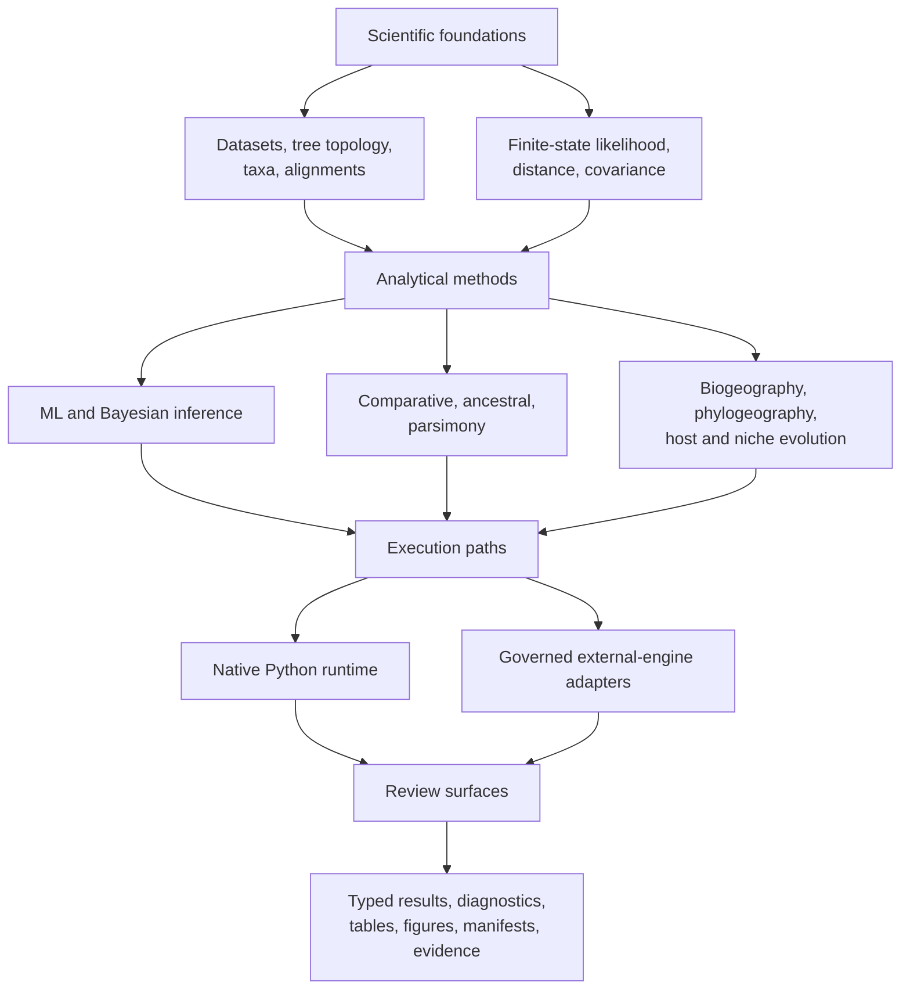
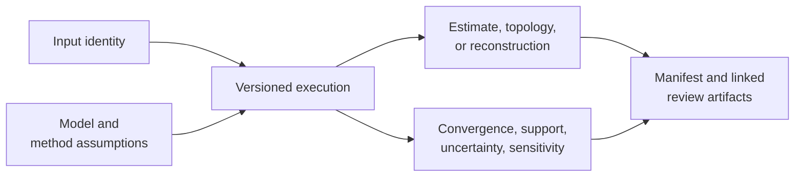

# Phylogenetics Product Handbook

`bijux-phylogenetics` is a Python runtime for building, running, and reviewing
phylogenetic analyses. Its public contract includes native analytical code,
explicit integrations with external engines, typed results, and durable output
bundles. The distinction between those surfaces is part of the product.

## Product Areas

| Area | Coverage |
| --- | --- |
| What belongs to the runtime, and how does data move through it? | [Architecture](architecture/index.md) |
| Should I use Python, the CLI, or an output bundle? | [Public interfaces](interfaces/index.md) |
| How do I install, execute, and review a workflow? | [Runtime operations](operations/index.md) |
| What does a passing check or evidence record establish? | [Quality and limits](quality/index.md) |

## Select An Analysis Route

| Starting material and question | Primary route | First review checkpoint |
| --- | --- | --- |
| a tree that needs structural or branch-length review | `inspect`, `validate`, `diagnose`, or the tree Python surface | rootedness, branch lengths, tip identity, support scale |
| sequences that need alignment, trimming, and tree inference | sequence-to-tree workflow or explicit alignment and engine commands | sequence type, retained sites, model, engine ownership |
| a tree plus continuous or categorical traits | comparative workflow and domain-specific model commands | taxon reconciliation, design matrix, covariance model |
| ancestral values or histories | ancestral and discrete-evolution surfaces | state space, transition model, node identity, uncertainty |
| character-cost or topology-search analysis | parsimony surfaces | coding, cost matrix, search coverage, equal-best trees |
| controlled recovery or stress analysis | simulation and dataset workflows | known truth, independence, seed policy, acceptance rule |
| packaged dataset or external study table | dataset catalog, loaders, exports, and study-input linkage | provenance, schema, taxon population, units, transformations, exclusions |
| region, coordinate, host, or niche history | biogeography, phylogeography, and ecology surfaces | state/spatial model, nodes, branches, constraints, uncertainty, event denominator |
| scientific result requiring tables, figures, or a review package | reports, rendering, and publication artifact surfaces | structured source, row/mark identity, manifest, inventory, audit and revalidation |
| a claim that must be cited or released | Evidence Book review path | claim identifier, source, inputs, checks, freshness, verdict |

The [scientific domain map](../02-bijux-phylogenetics-domains/index.md) defines
the assumptions behind these routes. The [surface selection guide](interfaces/surface-selection.md)
then distinguishes Python composition, repeatable CLI execution, and durable
artifact consumption.

## Move From Question To Citation

Use the route that matches the work:

- [sequence-to-tree study](operations/sequence-to-tree-study.md) for admitted
  FASTA through external alignment, trimming, inference, and support;
- [comparative and ancestral study](operations/comparative-and-ancestral-study.md)
  for a shared tree–trait population with separate model claims;
- [topology comparison study](operations/topology-comparison-study.md) for
  rooted or unrooted split correspondence under an explicit taxon denominator;
- [analysis report handoff](operations/analysis-report-handoff.md) for linked
  machine and human review artifacts;
- [result and refusal semantics](interfaces/result-and-refusal-semantics.md)
  when execution does not reach an accepted scientific state;
- [reading an evidence bundle](../03-bijux-phylogenetics-evidence-book/reading-an-evidence-bundle.md)
  when a result is used to support a public statement.

Evidence is not an automatic final stage for every analysis. Stop at the
structured result when no governed claim consumes it, and describe that scope
honestly. When a claim does consume the result, the bundle—not proximity to a
study guide—owns its verdict.

## Define Completion Before Running

An analysis route is ready only when its completion condition names both the
scientific result and the record needed to review that result. “The command
finished” is an execution observation, not a scientific completion rule.

| Route | Scientific completion condition | Review record that closes the route |
| --- | --- | --- |
| tree or alignment validation | every retained, excluded, and refused item has an explicit reason | structured result with the original input identity and complete denominator |
| likelihood or comparative fit | estimand, model, fitted population, objective convention, and diagnostics are resolved | typed result plus configuration, taxa/design identity, warnings, and persisted tables |
| topology search or ancestral reconstruction | selected solutions remain connected to search coverage or uncertainty | result plus candidates or samples, node/clade identity, and uncertainty diagnostics |
| external-engine workflow | engine execution and parsing both reach an accepted terminal state | engine command and version, native outputs, parser record, normalized result, and manifest |
| reference correspondence | the selected comparison case reaches a governed verdict | registry selection, raw observations, normalization, tolerance, and failure artifact when applicable |
| Evidence Book claim | every required claim dependency is present, current, and internally consistent | governed bundle with provenance, inputs, primary output, checks, freshness, and verdict |

A partial or refused result can be a complete record when the contract retains
why it stopped and what was not produced. It is not a completed scientific
analysis, and downstream consumers must preserve that distinction.

## Locate The Scientific Decision

The public interface starts a computation; the owning runtime module decides
its scientific meaning. Use the decision map to find assumptions and
diagnostics before treating a command name as a method description.

| Decision | Owning runtime surface | Identity that must accompany the result | First diagnostic boundary |
| --- | --- | --- | --- |
| tree structure and clade identity | `PhyloTree`, tree I/O, topology and validation modules | rooting, tip labels, branch lengths, support scale | duplicate taxa, invalid lengths, non-comparable tip sets |
| alignment and character interpretation | FASTA, coding, partition and alignment modules | alphabet, record order, genetic code, partitions, gap/missing policy | unequal length, invalid symbols, excluded coding records |
| finite-state likelihood | `phylo.likelihood` model and pruning surfaces | state space, rate model, frequencies, branch-length treatment | non-finite partials, invalid probabilities, objective failure |
| native maximum likelihood | nucleotide ML result and search surfaces | start tree, model, bounds, seed/search controls | convergence, evaluated candidates, boundary estimates |
| native Bayesian inference | `bayesian.run_bayesian_inference(...)` and typed posterior state | supported DNA model, priors, proposals, chain, seed, burn-in | acceptance, ESS, trace drift, retained samples |
| comparative regression | comparative PGLS and model-selection surfaces | taxa, response, design columns, covariance and likelihood convention | rank, residual behavior, covariance boundary, model identity |
| ancestral reconstruction | continuous/discrete ancestral modules | tree, node identity, trait/state space, transition model | uncertainty, infeasible states, sensitivity across trees/models |
| parsimony and topology search | parsimony scoring and search modules | character encoding, cost matrix, rooting, move set | equal-best solutions, search coverage, ambiguity handling |
| external engine execution | `engines` and Bayesian adapter surfaces | executable, version, command, native files, parser contract | unavailable engine, timeout, incomplete or stale bundle |

The [runtime system map](architecture/runtime-system-map.md) follows these
decisions through implementation layers. The [domain map](../02-bijux-phylogenetics-domains/index.md)
explains when each decision is scientifically appropriate.

## Make Four Decisions Before Execution

1. **Object identity:** decide which trees, taxa, alignments, traits, states,
   and partitions belong to the analysis.
2. **Scientific contract:** name the model family, transformation, costs,
   priors, search or sampler, and quantity to interpret.
3. **Computation owner:** choose an owned native implementation or a named
   external engine before selecting its interface.
4. **Review contract:** decide which diagnostics, omissions, tables,
   manifests, and visualizations must survive execution.

This order prevents an available command from silently deciding the model or
the evidence standard.

## Analytical Capability Map

This is not a maturity diagram: capability families have different validation
depth. Consult [validation lanes](quality/validation-lanes.md) before turning
runtime breadth into a scientific assurance claim.

## What Is Native

The repository owns the semantics and implementation of its tree runtime,
alignment diagnostics, finite-state likelihood foundations, supported native
maximum-likelihood and Bayesian paths, comparative models, ancestral methods,
parsimony families, simulations, datasets, and output contracts.

“Native” does not mean “universally preferred” or “validated for every
dataset.” It identifies implementation ownership. Suitability is a separate
question answered through model assumptions, diagnostics, benchmarks, and
study evidence.

## What Is Integrated

Adapters make established engines usable inside governed workflows. They own
input preparation, invocation, failure reporting, output parsing, and artifact
packaging. They do not own the scientific algorithms inside the external
executable. This boundary matters for installation, reproducibility, licensing,
and claim language.

## A Typical Analysis

1. Validate taxon identities, tree shape, alignment content, and model inputs.
2. Select an owned native method or an explicit external-engine adapter.
3. Execute through Python for composition or the CLI for repeatable operation.
4. Inspect typed diagnostics before interpreting parameter estimates.
5. Persist the report, manifest, tables, and figures needed for review.
6. Use evidence records only when making claims covered by those records.

The runtime is designed so that the scientific result is not the only output.
Inputs, configuration, diagnostics, and provenance remain available to a
reviewer.

## A Complete Result Is More Than An Estimate

An estimate without input identity cannot be reproduced. An estimate without
diagnostics cannot be interpreted safely. A report without structured results
cannot be consumed reliably. The workflow is complete when all three
relationships remain inspectable.

## Ownership Boundaries

| Surface | Owns | Does not imply |
| --- | --- | --- |
| runtime method | computation and result contract | evidence closure for every use |
| engine adapter | orchestration and normalized artifacts | native ownership of the engine |
| benchmark | behavior on a named corpus and configuration | universal performance ranking |
| evidence bundle | provenance and verdicts for named claims | validation beyond its study scope |
| published handbook | supported behavior, assumptions, and navigation | proof without executable checks |

## Locate The Owning Contract

| Disputed subject | Canonical record | Reader-facing interpretation |
| --- | --- | --- |
| function, signature, or default | curated public source and contract tests | Python and API guides |
| command, option, or exit behavior | command registry and CLI tests | generated CLI reference and workflow guides |
| service request or response | pinned OpenAPI schema and server tests | API surface guide |
| artifact field or omission | versioned result/manifest schema and producer tests | artifact contracts and consumption guide |
| numerical or topological behavior | named validation or benchmark record | quality and domain guides |
| parity case outcome | parity registry, observation rows, and failure artifacts | parity handbook |
| scientific claim verdict | governed Evidence Book bundle and indexes | study guide |

The public handbook explains these contracts but cannot override them. When a
guide and a structured record disagree, use the owning contract to identify the
stale projection and preserve the disagreement until it is corrected.

## Recommended Reading Paths

**Scientific capability:** [domain map](../02-bijux-phylogenetics-domains/index.md)
→ [trees, alignments, and taxa](../02-bijux-phylogenetics-domains/data-and-structure/trees-alignments-and-taxa.md)
→ [tree operations and identity](../02-bijux-phylogenetics-domains/data-and-structure/tree-operations-and-identity.md)
→ [likelihood and inference](../02-bijux-phylogenetics-domains/inference/likelihood-and-inference.md).

**Tree-set review:** [tree sets, consensus and support](../02-bijux-phylogenetics-domains/data-and-structure/tree-sets-consensus-and-support.md)
→ [tree uncertainty and sensitivity](../02-bijux-phylogenetics-domains/scientific-assurance/tree-uncertainty-and-sensitivity.md)
→ [diagnostics and sensitivity](../02-bijux-phylogenetics-domains/scientific-assurance/diagnostics-and-sensitivity.md).

**Selection and support:** [inference overview](../02-bijux-phylogenetics-domains/inference/index.md)
→ [search, model selection and support](../02-bijux-phylogenetics-domains/inference/search-model-selection-and-support.md)
→ [native benchmark evidence](quality/native-benchmark-evidence.md).

**Data and study inputs:** [datasets and study inputs](../02-bijux-phylogenetics-domains/data-and-structure/datasets-and-study-inputs.md)
→ [data interchange and identity](../02-bijux-phylogenetics-domains/data-and-structure/data-interchange-and-identity.md)
→ [simulation and datasets](../02-bijux-phylogenetics-domains/scientific-assurance/simulation-and-datasets.md).

**Simulation recovery:** [simulation and datasets](../02-bijux-phylogenetics-domains/scientific-assurance/simulation-and-datasets.md)
→ [simulation recovery and calibration](../02-bijux-phylogenetics-domains/scientific-assurance/simulation-recovery-and-calibration.md)
→ [validation, benchmarks and reporting](../02-bijux-phylogenetics-domains/scientific-assurance/validation-benchmarks-and-reporting.md).

**Discrete histories:** [comparative and ancestral methods](../02-bijux-phylogenetics-domains/evolutionary-analysis/comparative-and-ancestral-methods.md)
→ [discrete ancestral states and transitions](../02-bijux-phylogenetics-domains/evolutionary-analysis/discrete-ancestral-states-and-transitions.md)
→ [tree uncertainty and sensitivity](../02-bijux-phylogenetics-domains/scientific-assurance/tree-uncertainty-and-sensitivity.md).

**Spatial and ecological evolution:** [biogeography and migration](../02-bijux-phylogenetics-domains/evolutionary-analysis/biogeography-and-migration.md)
→ [continuous phylogeography and maps](../02-bijux-phylogenetics-domains/evolutionary-analysis/continuous-phylogeography-and-maps.md)
→ [host association and niche evolution](../02-bijux-phylogenetics-domains/evolutionary-analysis/host-association-and-niche-evolution.md).

**Publication review:** [reporting and rendering](../02-bijux-phylogenetics-domains/scientific-assurance/reporting-and-rendering.md)
→ [publication artifact review](../02-bijux-phylogenetics-domains/scientific-assurance/publication-artifact-review.md)
→ [artifact consumption](interfaces/artifact-consumption-guide.md).

**Reference correspondence:** [parities and correspondence](../04-bijux-phylogenetics-parities/index.md)
→ [R ecosystem](../04-bijux-phylogenetics-parities/r-ecosystem/index.md)
→ [interpreting correspondence](../04-bijux-phylogenetics-parities/correspondence/index.md).

**First analysis:** [installation](operations/installation-and-setup.md) →
[surface selection](interfaces/surface-selection.md) →
[common workflows](operations/common-workflows.md) →
[artifact consumption](interfaces/artifact-consumption-guide.md).

**Technical review:** [runtime system map](architecture/runtime-system-map.md) →
[Python surface](interfaces/python-surface.md) →
[artifact contracts](interfaces/artifact-contracts.md) →
[test strategy](quality/test-strategy.md).

**Scientific claim review:** [claim reading guide](foundation/claim-reading-guide.md)
→ [evidence boundary](foundation/evidence-boundary.md) →
[Evidence book](../03-bijux-phylogenetics-evidence-book/index.md).

## Product Limits

- The available command or function is not a recommendation to use its model.
- A deterministic bundle is reproducible only with its declared inputs and
  execution assumptions.
- Numerical agreement needs stated tolerances and comparable conventions.
- External engines remain separate software with their own support constraints.
- `mismatch_unexplained` and `not_comparable` verdicts are visible product
  information, not documentation defects to be worded away. Open or blocked
  resolution work remains a separate operational record.
