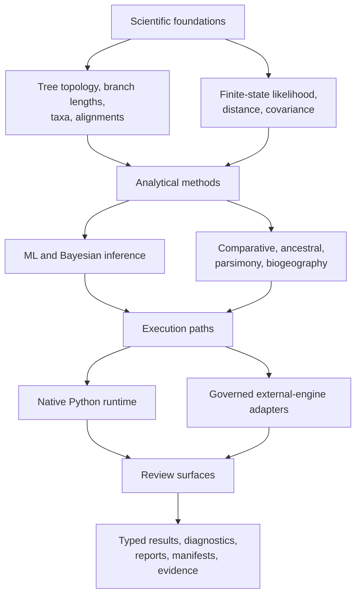

# Phylogenetics Product Handbook

`bijux-phylogenetics` is a Python runtime for building, running, and reviewing
phylogenetic analyses. Its public contract includes native analytical code,
explicit integrations with external engines, typed results, and durable output
bundles. The distinction between those surfaces is part of the product.

## Product Areas

| Area | Coverage |
| --- | --- |
| What belongs to the runtime, and how does data move through it? | [Architecture](architecture/index.md) |
| Should I use Python, the CLI, or an output bundle? | [Public interfaces](interfaces/index.md) |
| How do I install, execute, and review a workflow? | [Runtime operations](operations/index.md) |
| What does a passing check or evidence record establish? | [Quality and limits](quality/index.md) |

## Analytical Capability Map

This is not a maturity diagram: capability families have different validation
depth. Consult [validation lanes](quality/validation-lanes.md) before turning
runtime breadth into a scientific assurance claim.

## What Is Native

The repository owns the semantics and implementation of its tree runtime,
alignment diagnostics, finite-state likelihood foundations, supported native
maximum-likelihood and Bayesian paths, comparative models, ancestral methods,
parsimony families, simulations, datasets, and output contracts.

“Native” does not mean “universally preferred” or “validated for every
dataset.” It identifies implementation ownership. Suitability is a separate
question answered through model assumptions, diagnostics, benchmarks, and
study evidence.

## What Is Integrated

Adapters make established engines usable inside governed workflows. They own
input preparation, invocation, failure reporting, output parsing, and artifact
packaging. They do not own the scientific algorithms inside the external
executable. This boundary matters for installation, reproducibility, licensing,
and claim language.

## A Typical Analysis

1. Validate taxon identities, tree shape, alignment content, and model inputs.
2. Select an owned native method or an explicit external-engine adapter.
3. Execute through Python for composition or the CLI for repeatable operation.
4. Inspect typed diagnostics before interpreting parameter estimates.
5. Persist the report, manifest, tables, and figures needed for review.
6. Use evidence records only when making claims covered by those records.

The runtime is designed so that the scientific result is not the only output.
Inputs, configuration, diagnostics, and provenance remain available to a
reviewer.

## Ownership Boundaries

| Surface | Owns | Does not imply |
| --- | --- | --- |
| runtime method | computation and result contract | evidence closure for every use |
| engine adapter | orchestration and normalized artifacts | native ownership of the engine |
| benchmark | behavior on a named corpus and configuration | universal performance ranking |
| evidence bundle | provenance and verdicts for named claims | validation beyond its study scope |
| documentation | public contract and honest navigation | proof without executable checks |

## Recommended Reading Paths

**Scientific capability:** [domain map](../02-bijux-phylogenetics-domains/index.md)
→ [trees, alignments, and taxa](../02-bijux-phylogenetics-domains/trees-alignments-and-taxa.md)
→ [likelihood and inference](../02-bijux-phylogenetics-domains/likelihood-and-inference.md).

**First analysis:** [installation](operations/installation-and-setup.md) →
[surface selection](interfaces/surface-selection.md) →
[common workflows](operations/common-workflows.md) →
[artifact consumption](interfaces/artifact-consumption-guide.md).

**Technical review:** [runtime system map](architecture/runtime-system-map.md) →
[Python surface](interfaces/python-surface.md) →
[artifact contracts](interfaces/artifact-contracts.md) →
[test strategy](quality/test-strategy.md).

**Scientific claim review:** [claim reading guide](foundation/claim-reading-guide.md)
→ [evidence boundary](foundation/evidence-boundary.md) →
[Evidence book](../03-bijux-phylogenetics-evidence-book/index.md).

## Product Limits

- The available command or function is not a recommendation to use its model.
- A deterministic bundle is reproducible only with its declared inputs and
  execution assumptions.
- Numerical agreement needs stated tolerances and comparable conventions.
- External engines remain separate software with their own support constraints.
- Open evidence verdicts are visible product information, not documentation
  defects to be worded away.
