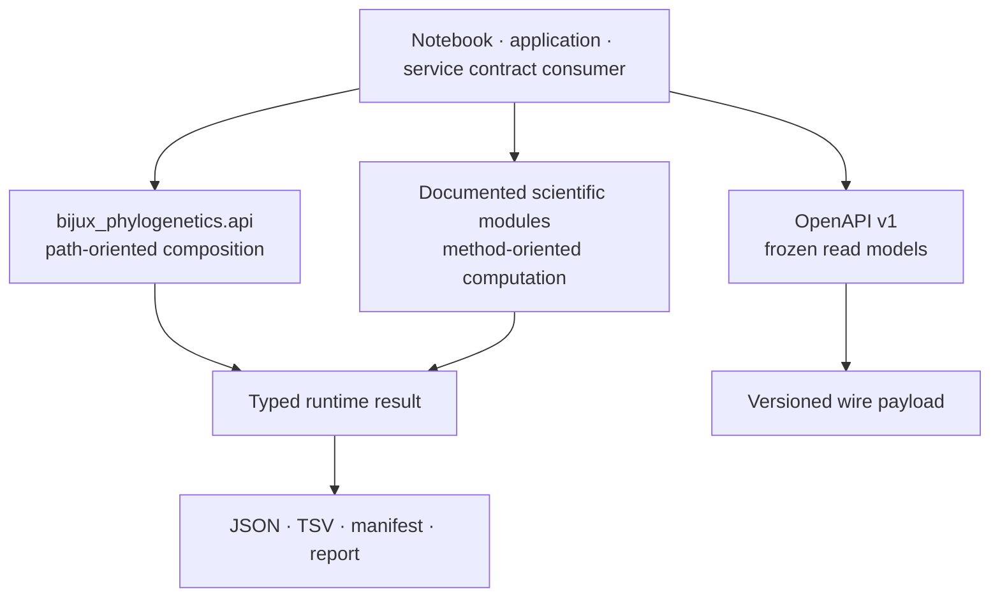
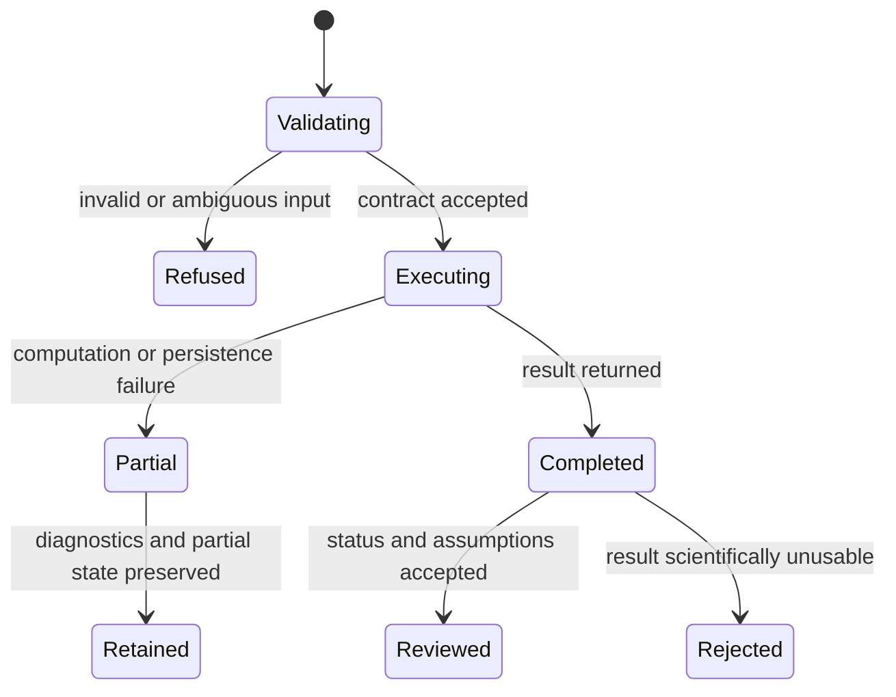

# Programmatic API Surface

Bijux Phylogenetics publishes three programmatic contracts: a curated Python
workflow API, named scientific modules for direct in-memory work, and a frozen
OpenAPI read-model schema. They serve different consumers and do not imply one
another. In particular, the checked-in OpenAPI description is not a promise of
a hosted HTTP service.



## Select The Contract From The Consumer

| Consumer need | Contract | What it guarantees |
| --- | --- | --- |
| compose common file-to-result workflows | `bijux_phylogenetics.api` | curated functions, result types, and serialization behavior |
| control a scientific method from validated in-memory state | documented domain module | method-specific parameters, diagnostics, and typed results |
| bind health, package-ownership, or evidence-study read models | OpenAPI v1 bundle | frozen field shapes and meanings for the declared schema version |
| execute from a scheduler or shell | command-line surface | installed arguments, exit behavior, structured output, and manifests |

Do not design against an implementation submodule merely because it can be
imported. Support begins at a curated export or an explicitly documented
scientific surface.

## Curated Workflow API

Import workflows and their result types from `bijux_phylogenetics.api`:

| Workflow | Result type | Computation owner |
| --- | --- | --- |
| `run_fasta_validation_workflow` | `FastaValidationResult` | Bijux runtime |
| `run_alignment_workflow` | `AlignmentWorkflowResult` | MAFFT through a Bijux adapter |
| `run_trimming_workflow` | `TrimmingWorkflowResult` | trimAl through a Bijux adapter |
| `run_tree_inference_workflow` | `InferenceWorkflowResult` | IQ-TREE2 through a Bijux adapter |
| `run_support_workflow` | `SupportWorkflowResult` | IQ-TREE2 through a Bijux adapter |
| `run_sequence_to_tree_workflow` | `SequenceToTreeWorkflowResult` | configured external engines through Bijux adapters |
| `run_tree_comparison_workflow` | `TreeComparisonWorkflowResult` | Bijux runtime |
| `run_comparative_model_workflow` | `ComparativeModelWorkflowResult` | Bijux runtime |
| `run_ancestral_reconstruction_workflow` | `AncestralReconstructionWorkflowResult` | Bijux runtime |
| `render_report_workflow` | `ReportWorkflowResult` | Bijux runtime; presentation is advisory |
| `run_configured_phylo_workflow` | `ConfiguredPhyloWorkflowResult` | owners declared by the workflow configuration |

The result wrapper preserves the underlying report as `.report` and forwards
public report attributes for convenient inspection. JSON serialization has a
stable envelope:

```json
{
  "result_type": "TreeComparisonWorkflowResult",
  "report": {}
}
```

`write_json(path)` creates parent directories and writes paths as strings,
dataclasses as objects, tuples as arrays, and sorted JSON keys. Results with a
defined row projection also expose `write_tsv(path)`; a `.csv` suffix selects
comma-separated output. `ConfiguredPhyloWorkflowResult` deliberately has no
generic table projection because a configured workflow can return different
record shapes.

## Compose And Persist A Native Workflow

```python
from pathlib import Path

from bijux_phylogenetics.api import run_comparative_model_workflow

result = run_comparative_model_workflow(
    Path("dataset/tree.nwk"),
    Path("dataset/traits.tsv"),
    formula="longevity ~ body_mass * habitat",
    lambda_value="estimate",
)

for coefficient in result.coefficients:
    print(coefficient.name, coefficient.estimate, coefficient.standard_error)

result.write_json(Path("artifacts/comparative/result.json"))
result.write_tsv(Path("artifacts/comparative/coefficients.tsv"))
```

The convenience forwarding in `result.coefficients` does not erase the
wrapper boundary: serialize the wrapper when preserving the public workflow
record. Review reconciled taxa, design encoding, covariance state, warnings,
exclusions, and fit diagnostics before interpreting coefficients.

## Compose And Persist An External Workflow

```python
from pathlib import Path

from bijux_phylogenetics.api import run_sequence_to_tree_workflow

result = run_sequence_to_tree_workflow(
    Path("dataset/sequences.fasta"),
    out_dir=Path("artifacts/sequence-to-tree"),
    mafft_executable="mafft",
    trimal_executable="trimal",
    iqtree_executable="iqtree2",
    bootstrap_replicates=1000,
    seed=17,
    threads=4,
    timeout_seconds=3600,
    incomplete_run_policy="reject",
)
result.write_json(Path("artifacts/sequence-to-tree/workflow-result.json"))
result.write_tsv(Path("artifacts/sequence-to-tree/workflow-summary.tsv"))
```

Python owns composition here, not the numerical algorithms in MAFFT, trimAl,
or IQ-TREE2. Preserve executable versions, full invocations, captured output,
native files, parser state, normalized records, and the workflow manifest.
`resume=True` is governed identity reuse; it is not permission to accept an
arbitrary pre-existing directory.

## Native-Only Enforcement

The API exports:

- `NATIVE_MAXIMUM_LIKELIHOOD_ONLY_ENV_VAR`;
- `native_maximum_likelihood_only_mode`;
- `is_native_maximum_likelihood_only_mode_enabled`.

Use the context manager when a test or application must fail if a
wrapper-backed maximum-likelihood route is reached:

```python
from pathlib import Path

from bijux_phylogenetics.api import (
    native_maximum_likelihood_only_mode,
    run_configured_phylo_workflow,
)

with native_maximum_likelihood_only_mode():
    result = run_configured_phylo_workflow(Path("native-inference.json"))
```

This proves that the guarded path did not invoke an external maximum-likelihood
engine. It does not prove convergence, correctness, parity, accuracy, or
fitness for a dataset.

## Direct Scientific Modules

Use named module exports when the workflow API is too broad or does not expose
the required scientific state:

| Module family | Representative owned state |
| --- | --- |
| `bijux_phylogenetics.phylo.likelihood` | finite-state likelihood, model parameters, topology search, native maximum-likelihood results, bootstrap support |
| `bijux_phylogenetics.bayesian` | priors, proposals, chains, checkpoints, posterior evaluation, convergence and effective sample size |
| `bijux_phylogenetics.comparative` | covariance, PGLS, signal, trait models, diagnostics, sensitivity and model comparison |
| `bijux_phylogenetics.ancestral` | continuous and discrete states, transition models, node mapping and uncertainty |
| `bijux_phylogenetics.parsimony` | character costs, reconstruction, tree search, equal-best trees and resampling |
| `bijux_phylogenetics.simulation` | generating parameters, random seeds, known histories and truth ledgers |
| `bijux_phylogenetics.benchmark` | governed timing, memory, recovery and correspondence measurements |

Direct use shifts more responsibility to the caller. The application must
retain object identity, validate preconditions, preserve warnings and failed
states, and choose an artifact representation that does not discard relevant
method state.

## Failure And Recovery Contract

Catch an exception only at a layer that can add information or perform a safe
recovery. Preserve the original exception, input identity, parameters, and any
partial external run directory. A retry with a different seed, executable,
model, tolerance, taxon set, or incomplete-run policy is a new execution
identity and must not overwrite the first record.



Serialization success means that a record was written. It does not convert a
partial, unconverged, unsupported, or assumption-violating result into a valid
scientific conclusion.

## Frozen OpenAPI Contract

The versioned bundle contains:

- `apis/bijux-phylogenetics/v1/schema.yaml` — authored OpenAPI 3.1 source;
- `apis/bijux-phylogenetics/v1/pinned_openapi.json` — normalized pinned form;
- `apis/bijux-phylogenetics/v1/schema.hash` — drift-detection identity.

The schema defines read models for health, runtime package ownership, evidence
study listing, and study detail. Its `EvidenceStudyId` enumeration covers the
PCM1 and PCM2 primate studies. It is not complete HTTP coverage of every
runtime capability or all five Evidence Book families.

This is a freeze-only schema promise. Transport implementation,
authentication, deployment, hosting, latency, and availability are outside
the contract. A schema hash mismatch is contract drift; updating the hash
without reviewing the semantic change defeats the freeze.

## Compatibility Decisions

- Python compatibility covers curated names, call signatures, result
  semantics, and documented serialization.
- OpenAPI compatibility covers the selected schema version, field presence,
  type, and meaning.
- Adding an optional field can be compatible when consumers tolerate it.
- Removing a required field, changing units or status meaning, or reusing a
  field for a different concept requires an explicit version decision.
- JSON object order, interactive prose, HTML structure, private attributes,
  and implementation module paths are not compatibility contracts.

Before upgrading a long-lived consumer, fixture successful, refused, partial,
and warning-bearing records. Compare meaning and failure behavior, not only
whether the new payload parses.

Continue with [Python surface](python-surface.md),
[command-line surface](cli-surface.md), and
[artifact contracts](artifact-contracts.md) for the matching execution and
persistence boundaries.
