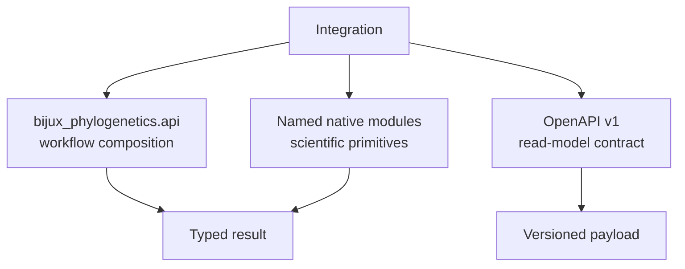

# Programmatic API Surface

Three programmatic contracts serve different integration boundaries: the
curated Python workflow API, named native scientific modules, and a checked-in
OpenAPI schema. The schema is a frozen compatibility contract; this repository
does not promise a hosted HTTP service.



## Python Workflow Contract

`bijux_phylogenetics.api` is the stable composition surface for notebooks,
applications, and pipelines.

| Workflow | Result |
| --- | --- |
| `run_fasta_validation_workflow` | `FastaValidationResult` |
| `run_alignment_workflow` | `AlignmentWorkflowResult` |
| `run_trimming_workflow` | `TrimmingWorkflowResult` |
| `run_tree_inference_workflow` | `InferenceWorkflowResult` |
| `run_support_workflow` | `SupportWorkflowResult` |
| `run_sequence_to_tree_workflow` | `SequenceToTreeWorkflowResult` |
| `run_tree_comparison_workflow` | `TreeComparisonWorkflowResult` |
| `run_comparative_model_workflow` | `ComparativeModelWorkflowResult` |
| `run_ancestral_reconstruction_workflow` | `AncestralReconstructionWorkflowResult` |
| `render_report_workflow` | `ReportWorkflowResult` |
| `run_configured_phylo_workflow` | `ConfiguredPhyloWorkflowResult` |

Results expose the underlying runtime report, support attribute access to its
public state, and provide stable JSON serialization. Workflows with a meaningful
tabular summary also provide TSV serialization.

```python
from pathlib import Path

from bijux_phylogenetics.api import run_tree_comparison_workflow

comparison = run_tree_comparison_workflow(
    Path("results/reference.nwk"),
    Path("results/candidate.nwk"),
)
comparison.write_json(Path("artifacts/tree-comparison.json"))
comparison.write_tsv(Path("artifacts/tree-comparison.tsv"))
```

## Native Scientific Modules

The public contract also includes named surfaces under:

- `bijux_phylogenetics.phylo.likelihood` for likelihood and native tree
  inference;
- `bijux_phylogenetics.bayesian` for supported native inference, priors,
  proposals, diagnostics, and posterior contracts;
- `bijux_phylogenetics.benchmark` for governed native inference measurements;
- documented comparative, ancestral, parsimony, tree, dataset, and reporting
  modules.

Importing a private helper from a nested module does not create a compatibility
promise. Prefer curated exports and documented result types.

## Native-Only Enforcement

`NATIVE_MAXIMUM_LIKELIHOOD_ONLY_ENV_VAR`,
`native_maximum_likelihood_only_mode`, and
`is_native_maximum_likelihood_only_mode_enabled` allow tests and applications
to reject fallback to wrapper-backed maximum-likelihood execution. This is an
execution-policy guard, not a model-quality assertion.

## Frozen OpenAPI Contract

The v1 bundle contains:

- `apis/bijux-phylogenetics/v1/schema.yaml` — authored OpenAPI 3.1 source;
- `apis/bijux-phylogenetics/v1/pinned_openapi.json` — normalized pinned form;
- `apis/bijux-phylogenetics/v1/schema.hash` — drift-detection identity.

The schema defines read models for health, runtime package ownership, evidence
study listing, and study detail. Its current `EvidenceStudyId` enumeration
covers the PCM1 and PCM2 primate studies. It must not be described as complete
HTTP coverage of all five Evidence Book families.

## Compatibility Rules

- Python compatibility follows curated names, signatures, result semantics,
  and documented serialization.
- OpenAPI compatibility follows schema version and field semantics.
- Additive payload fields may be compatible; changed meaning or removed
  required fields require an explicit version decision.
- A schema hash mismatch is drift, not an invitation to update the hash alone.
- HTTP transport, authentication, hosting, and availability are outside the
  freeze-only schema promise.

See [surface selection](surface-selection.md), [Python surface](python-surface.md),
and [artifact contracts](artifact-contracts.md) for consumer-specific guidance.
