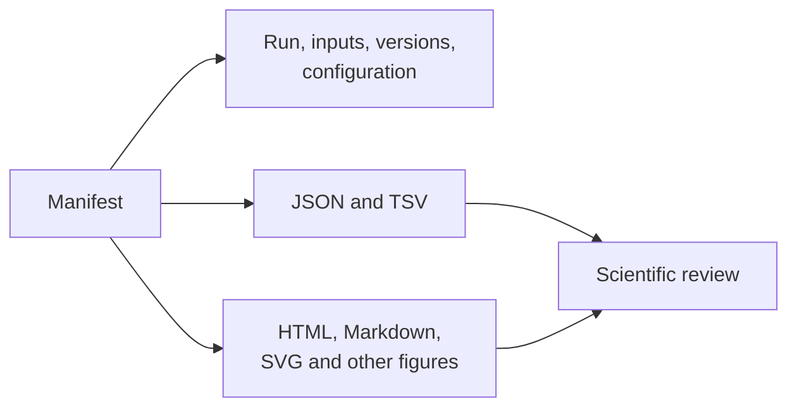
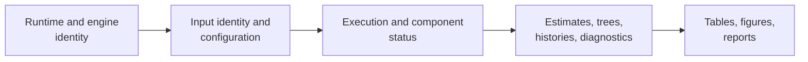

# Artifact Consumption Guide

Consume a workflow bundle from its manifest outward. The manifest identifies
the run and its declared files; structured results carry values and
diagnostics; tables and figures provide purpose-specific projections.

## Review Sequence

1. Open the manifest and verify workflow identity and schema version.
2. Confirm input identities, taxon scope, configuration, and engine/runtime
   versions match the analysis under review.
3. Check declared status, warnings, convergence, support, uncertainty, and
   excluded cases in the structured result.
4. Reconcile every table and figure with a declared output.
5. Verify integrity metadata when provided.
6. Follow evidence links only when a claim-level verdict is required.

## Establish Provenance Before Values

Reading in the reverse direction invites false confidence: a polished figure
can be generated from a partial result, and a plausible estimate can belong to
different taxa or parameterization than expected.

## Artifact Roles

| Artifact | Appropriate use | Unsafe shortcut |
| --- | --- | --- |
| manifest | identity, inventory, relationships, provenance | assuming every directory file belongs to the run |
| JSON result | typed nested state, diagnostics, automation | depending on undocumented incidental fields |
| TSV ledger | stable row-wise analysis and comparison | inferring context absent from the manifest |
| HTML/Markdown report | integrated human interpretation | scraping values when structured output exists |
| SVG or raster figure | visual topology, traits, support, uncertainty | treating pixels as the primary numerical record |
| captured engine output | external execution diagnosis and provenance | treating engine text as normalized schema |

## Linked Ledgers

Model-selection, branch, clade, event, support, trait, benchmark, and parity
ledgers usually represent different grains. Join them only through documented
identifiers. Row order, display labels, and filenames are not reliable foreign
keys unless the contract declares them.

## Status Before Estimates

A completed process can still produce a scientifically unusable result.
Inspect parser warnings, taxon exclusions, optimizer state, chain diagnostics,
effective sample size, topology support, uncertainty, and sensitivity before
reading headline estimates.

For external-engine runs, retain both the normalized result and original
captured output. The first supports stable consumption; the second explains
engine-specific failures and version behavior.

## Handle Incomplete Bundles

1. Preserve the bundle unchanged before attempting recovery.
2. Compare the declared inventory with present files and per-component status.
3. Classify whether the failure belongs to input validation, computation,
   external execution, parsing, or persistence.
4. Decide whether the documented contract permits a partial result.
5. Rerun only after retaining enough state to explain the original outcome.

Do not copy successful files into a new directory and present them as the
complete run. If partial outputs are scientifically usable, their manifest and
consumer statement must identify the missing components and reduced scope.

## Compatibility

Pin artifact schema versions in long-lived consumers. Accept documented
additive fields, reject unknown incompatible versions, and do not depend on
JSON object order, prose wording, HTML structure, or cosmetic filenames.

When migrating a consumer, compare representative old and new bundles and test
meaning—not merely parse success.

For automated consumers, fixture the failure and partial-status cases as well
as the happy path. A consumer that accepts every parseable bundle is not
enforcing the artifact contract.

## Evidence Bundles

Evidence bundles add source provenance, claim IDs, checks, tolerances, and
verdicts. Begin with `manifest.json`, `inputs.manifest.json`, `claims.json`, and
`checks.json`, then inspect machine-readable results before reviewer summaries.
A checksum proves byte identity; it does not prove scientific correctness.

See [artifact contracts](artifact-contracts.md) for producer guarantees and
the [Evidence Book](../../03-bijux-phylogenetics-evidence-book/index.md) for
claim adjudication.
