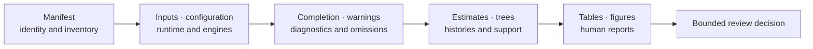

# Artifact Consumption Guide

Consume a workflow bundle from its manifest outward. The manifest establishes
which run the files belong to; structured results preserve values and status;
tables, figures, and reports project selected parts for a purpose. Opening the
most polished figure first reverses the trust order.



## Establish Provenance Before Values

Use this order for every retained run:

1. identify the bundle root and open its manifest;
2. verify workflow, run, schema, input, configuration, runtime, and engine
   identity;
3. reconcile the declared inventory with the files actually present;
4. inspect completion state, warnings, convergence, support, uncertainty,
   exclusions, and skipped components;
5. verify checksums and path containment where the contract provides them;
6. read machine-readable estimates and ledgers;
7. use figures and reports to interpret the same declared record;
8. follow claim links only when the decision requires Evidence Book support.

Stop at the first contradiction. A schema-valid result paired with the wrong
input checksum is not the run under review. A complete directory with a failed
manifest status is not successful. A favorable summary cannot override a
failed observation ledger.

## Resolve Contradictions At The Owning Record

Artifacts are projections with different owners, not a vote. When two files
disagree, resolve the contradiction at the record that owns the disputed fact
and retain the discrepancy.

| Contradiction | Owning record | Required response |
| --- | --- | --- |
| directory contains a file absent from the inventory | manifest and artifact producer | treat it as undeclared until lineage and role are established |
| checksum disagrees with retained bytes | checksum-bearing manifest | reject that identity; do not refresh the digest in place |
| report says complete while structured status says partial or failed | typed result and run manifest | preserve the terminal state and correct the report projection |
| figure label disagrees with a result value | machine-readable result | regenerate the figure from the identified source record |
| normalized result disagrees with an external native file | adapter mapping contract | preserve both, diagnose parsing or normalization, and withhold correspondence |
| Evidence Book prose exceeds a claim verdict | claim, check, and bundle manifests | narrow the prose and retain the governed verdict |

Never resolve a conflict by choosing the friendlier representation, editing an
archived producer record, or averaging incompatible values. A correction is a
new identified record with explicit lineage unless the governed publication
process defines a traceable replacement.

## Identify The Bundle

Record at least:

| Identity field | Review question |
| --- | --- |
| workflow or report kind | Which contract produced this bundle? |
| run or evidence identifier | Can every linked file be traced to the same record? |
| schema version | Does the consumer understand this structure and meaning? |
| runtime distribution and version | Which Bijux implementation produced the normalized result? |
| external executable and version | Which program owned external computation? |
| input paths and digests | Are these the intended tree, alignment, tables, and configuration? |
| seed and resource settings | Can stochastic and parallel behavior be interpreted? |
| expected and produced outputs | Are missing, failed, skipped, and optional files explicit? |

Paths help a human navigate; digests establish byte identity. Neither proves
that the chosen input or model answers the scientific question.

## Interpret Artifact Roles

| Artifact | Read it for | Do not use it as |
| --- | --- | --- |
| manifest | identity, inventory, relationships, configuration, provenance | proof that every declared operation succeeded |
| JSON result | typed nested state, diagnostics, automation, missing values | an invitation to depend on undocumented fields |
| TSV or CSV ledger | stable row-grain comparison and supplementary review | a context-free record joined by row order |
| HTML or Markdown report | integrated human interpretation | the only owner of a scientific value |
| SVG or raster figure | topology, traits, support, uncertainty, and presentation | primary numerical data extracted from pixels |
| external native file | engine-owned detail and diagnosis | a normalized cross-engine contract |
| captured standard output/error | command diagnosis and version behavior | a stable schema for scraping |

Retain both native engine files and normalized records. Normalization makes
consumption consistent; it does not transfer computational ownership or
guarantee that every native detail was represented.

## Reconstruct The Denominator

For a batch, parity registry, bootstrap, simulation, benchmark, or evidence
collection, the denominator is part of the result. Reconcile:

```text
selected = successful + failed + skipped + not_evaluable
```

Use the vocabulary declared by that record; the equation illustrates
accounting, not universal status names. Confirm case IDs and component IDs,
not only counts. A report of 95 successful cases is uninterpretable until the
five other selected cases are accounted for.

Missing records must remain visible. Do not calculate agreement only over
successful outputs unless the method explicitly defines that denominator and
reports the exclusions.

## Join Ledgers By Declared Identity

Model-selection, coefficient, branch, clade, support, ancestral-state,
transition, event, benchmark, parity, and claim ledgers have different grains.
Join only through documented identifiers such as run ID, case ID, model ID,
tree identity, node or split identity, taxon ID, and claim ID.

Unsafe joins include:

- assuming two row orders describe the same taxa;
- equating display labels with stable node or clade identity;
- joining models only by a shortened formula label;
- assuming matching filenames imply matching inputs;
- attaching a figure to the nearest manifest by directory proximity.

When no stable join exists, report the records separately. An invented join
creates stronger apparent evidence than either source supplies.

## Read Status Before Estimates

A process can exit successfully while returning a scientifically unusable
result. Review the status appropriate to the method:

- input acceptance, repaired or excluded records, and reconciled taxa;
- optimizer termination, boundary estimates, search coverage, and competing
  optima;
- chain convergence, effective sample size, drift, burn-in, and replicate
  agreement;
- bootstrap or posterior support and the number of contributing replicates;
- warning, partial, missing, skipped, and not-evaluable components;
- sensitivity to model, tree, pruning, coding, root prior, and parameterization.

Do not collapse these into one boolean. Completion, interpretability,
correspondence, and claim support are independent decisions.

## Handle Incomplete Bundles

1. Preserve the bundle unchanged before attempting recovery.
2. Compare expected inventory, produced files, component status, and checksum
   state.
3. Attribute failure to input validation, computation, external execution,
   parsing, normalization, or persistence.
4. Determine whether the contract permits a scientifically usable partial
   result and which claims it excludes.
5. Rerun only after retaining enough state to explain the original outcome.

Do not copy successful files into a new directory and present them as a
complete run. If partial outputs are used, their manifest, downstream report,
and decision record must identify missing components and reduced scope.

## Verify Integrity Without Overclaiming

For every checksum entry:

1. resolve the path beneath the declared bundle root;
2. reject absolute paths or traversal outside that root unless the contract
   explicitly governs external references;
3. recompute the digest from the retained bytes;
4. verify size and role where available;
5. reconcile the file with the expected inventory and status.

A matching checksum proves byte identity for a referenced file. It does not
prove provenance, schema understanding, method appropriateness, numerical
correctness, or claim support.

## Consume Compatible Versions

Pin schema versions in long-lived consumers. Accept documented additive
fields, reject unknown incompatible versions, and ignore JSON key order, prose
wording, HTML structure, and cosmetic filenames.

Migration tests should include:

- one complete successful bundle;
- one refused input;
- one partial or failed external run;
- one warning-bearing or boundary result;
- one bundle with unknown additive fields;
- one deliberately incompatible schema version;
- one checksum or inventory contradiction.

Parsing every case successfully is not the goal. The consumer must preserve or
reject each case according to its semantics.

## Record The Consumer Acceptance Decision

Integrity verification and schema parsing are inputs to acceptance, not the
acceptance decision itself. A downstream consumer should emit a small record
that binds the bundle it reviewed to the purpose for which it was admitted.

| Acceptance field | Meaning |
| --- | --- |
| consumer and contract version | which implementation made the decision |
| bundle, manifest, and checksum identity | which exact producer record was reviewed |
| intended use | the computation, comparison, report, or claim that will consume it |
| checks performed | schema, inventory, integrity, status, semantic, and freshness checks actually run |
| accepted scope | outputs and interpretations admitted for that use |
| exclusions and unresolved findings | present data deliberately kept outside the decision |
| decision and reason | accepted, accepted with a narrower scope, or rejected |
| selected downstream identity | the child run, analysis, or review record receiving the artifact |

Acceptance is purpose-specific. A complete tree bundle may be accepted for
visual review and rejected for a clock analysis because its branch-length
units are unresolved. A parsed external result may be accepted for parser
testing and rejected as proof of a current live execution.

Do not edit the producer manifest to record consumer acceptance. Retain a
child decision record so the original claim, later uses, and contradictory
consumer decisions remain independently inspectable.

## Read Evidence Bundles As Claim Records

Evidence bundles strengthen the contract with source provenance, claim IDs,
checks, tolerances, observation status, and bundle verdict. Begin with
`manifest.json`, `inputs.manifest.json`, `claims.json`, `checks.json`, and
`provenance.json`; then inspect machine-readable results before the reviewer
summary.

Keep runtime case status separate from bundle verdict. A skipped parity case
is an execution observation. `not_comparable` is a governed evidence verdict.
An open resolution item describes follow-through. None can silently replace
another.

## Produce A Review Handoff

A defensible handoff names:

- bundle and manifest path;
- runtime and external-engine identities;
- input and configuration identities;
- selected denominator and component-status counts;
- key diagnostics, warnings, exclusions, and sensitivity results;
- integrity verification performed;
- the precise conclusion supported and important conclusions not supported;
- claim and evidence IDs when a governed verdict is cited.

See [artifact contracts](artifact-contracts.md) for producer obligations and
the [Evidence Book](../../03-bijux-phylogenetics-evidence-book/index.md) for
claim adjudication.
