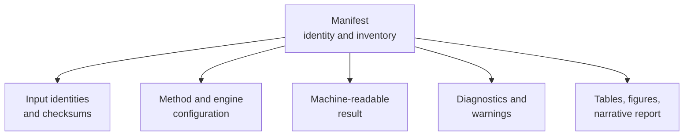
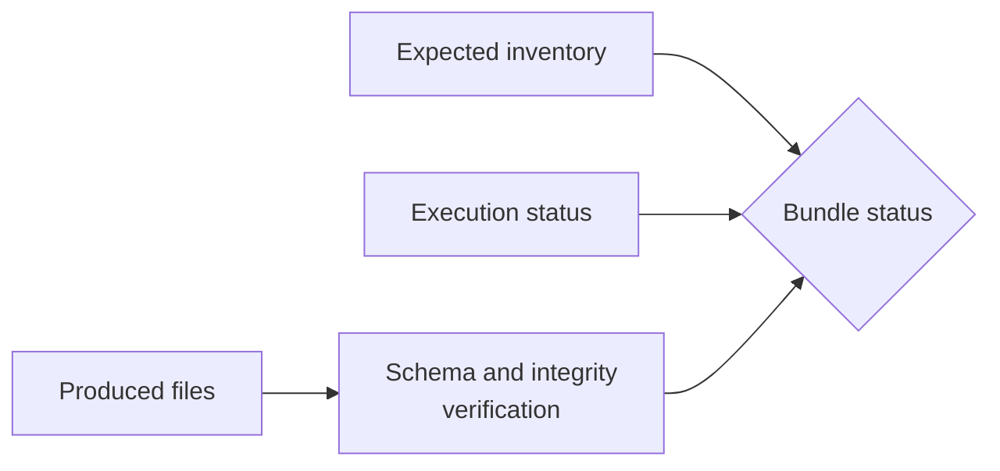

# Artifact Contracts

An artifact is useful when it remains interpretable after the producing
process is gone. The contract is therefore larger than a filename: identity,
provenance, schema, integrity, and relationships between files all matter.

## Contract Layers

| Layer | Required question |
| --- | --- |
| identity | What workflow, run, study, or claim does this belong to? |
| provenance | Which inputs, versions, configuration, and engine produced it? |
| structure | Which schema and field meanings apply? |
| integrity | Can truncation, substitution, or stale output be detected? |
| relationship | Which manifest, report, or evidence record references it? |

## Machine And Human Surfaces

JSON and TSV outputs are for stable parsing and comparison. Markdown, HTML,
and figures are for interpretation. A human report may summarize a structured
result, but it must not become the only location of a scientifically relevant
value. Conversely, a machine record is not a substitute for explaining model
assumptions and open limitations.

## Manifest Role

The manifest is the bundle's table of contents and provenance anchor. A
consumer should be able to find declared inputs, outputs, configuration,
versions, and integrity metadata without reverse-engineering directory names.
Absence from a manifest is meaningful: an undeclared file should not silently
participate in a verdict.

## Completeness And Status

A manifest must make the difference between expected, produced, missing,
failed, skipped, and optional outputs reviewable. Directory presence and
process completion are not completeness rules.

For batched workflows, completeness also includes case denominators. A bundle
with 95 passing cases and five unreported cases is not equivalent to a bundle
with 95 selected cases.

## Compatibility

Artifact compatibility is about meaning, not only valid JSON. Producers must
version breaking structural or semantic changes. Consumers should reject
unknown incompatible versions, tolerate documented additive fields, and avoid
depending on object-key order or presentation formatting.

Semantic changes require special care. Units, taxon ordering, state coding,
support meaning, likelihood sign, missing-value conventions, or status
vocabulary can break consumers even when JSON shape remains valid. Version or
reject those changes according to the published compatibility policy.

## Integrity Boundaries

Checksums establish byte identity for the referenced file. They do not prove
that the file came from the declared method, that the schema is understood, or
that the science is correct. Integrity review combines inventory, path
containment, schema validation, checksum verification, producer identity, and
status consistency.

Never allow an artifact path to escape its declared bundle root or overwrite
an input silently. External-engine native files should be retained under
unambiguous ownership rather than mixed with normalized outputs.

## Adapter Provenance

Artifacts from external-engine workflows must identify both layers: the Bijux
adapter/runtime version and the external executable version. Normalizing a
result does not make the external computation native or erase the original
captured output needed for diagnosis.

## Evidence Is A Stronger Contract

An evidence bundle adds governed claim IDs, checks, source provenance, and
verdicts. A normal workflow bundle can be complete and reproducible without
being evidence. Promotion requires the evidence-book registry and review
rules; copying output into an `evidence-*` directory is not promotion.

## Consumer Checklist

1. Resolve the manifest before individual outputs.
2. Verify declared identity and compatible schema version.
3. Confirm inputs and configuration match the question being reviewed.
4. Inspect diagnostics before headline estimates or figures.
5. Verify integrity metadata when the contract provides it.
6. Follow claim links only within the declared evidence scope.
7. Reconcile expected, produced, missing, skipped, and failed outputs.
8. Reject path, schema, checksum, or status contradictions.

## Invalid Assumptions

- A present file is not necessarily a successful result.
- A checksum proves byte identity, not scientific correctness.
- A reproducible run does not prove the model is appropriate.
- A figure is not a machine-readable result contract.
- An old bundle does not describe current code unless freshness checks say so.

Continue with the [artifact consumption guide](artifact-consumption-guide.md)
for a reviewer-oriented traversal and the
[Evidence book](../../03-bijux-phylogenetics-evidence-book/index.md) for
governed claim records.
