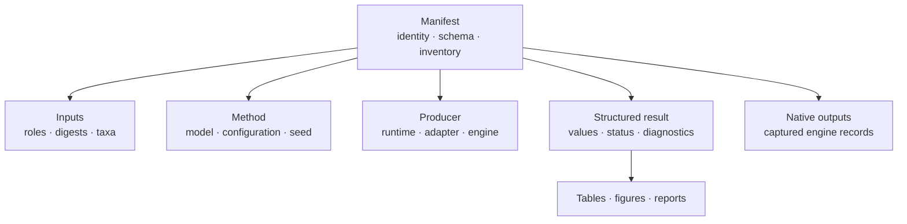
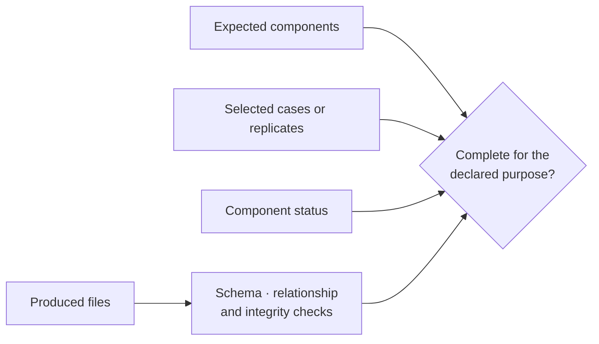

# Artifact Contracts

An artifact remains useful when it can be interpreted after the producing
process, machine, and working directory are gone. The contract is therefore
larger than a filename: it combines identity, provenance, structure, status,
integrity, inventory, and relationships between records.

## Contract Layers

| Layer | Required question | Typical failure |
| --- | --- | --- |
| identity | What workflow, run, study, case, or claim owns this file? | unrelated outputs appear connected by directory proximity |
| provenance | Which inputs, versions, configuration, seed, and engine produced it? | a result cannot be reconstructed or attributed |
| structure | Which schema and field meanings apply? | valid JSON is interpreted under the wrong contract |
| status | Which components succeeded, failed, skipped, or remain unevaluable? | only successful rows remain visible |
| inventory | Which files were expected, produced, omitted, or optional? | directory presence is mistaken for completeness |
| integrity | Can truncation, substitution, staleness, or path escape be detected? | the manifest references different bytes or unsafe paths |
| relationship | Which report, figure, ledger, or evidence claim derives from it? | projections outlive the values that support them |

Every layer is necessary. A checksum-valid file with ambiguous model identity
is not scientifically self-describing. A complete model record with an
unverifiable input is not reproducible.

## Manifest Contract

The manifest is the bundle's table of contents and provenance anchor. It
should make the following reviewable without reverse-engineering filenames:

- workflow or report kind and run identity;
- schema version and producer version;
- input roles, resolved identities, and digests;
- method, model, configuration, seed, and resource settings;
- external executable name, path, version, and adapter/runtime identity;
- expected and produced artifacts with roles, paths, sizes, and digests where
  governed;
- component completion, warnings, omissions, and failure state;
- relationships to tables, figures, reports, replay records, or evidence.

Absence from a manifest is meaningful. An undeclared file must not silently
participate in a result or verdict. A declared optional output must still have
an explicit status when its absence affects interpretation.

## Completeness And Status

Completeness is evaluated against the expected inventory and selected
denominator, not against a nonempty directory.

The status vocabulary belongs to the producing contract. Runtime readiness,
command completion, parity-case status, benchmark classification, bundle
verdict, and resolution state are different namespaces. A projection may
quote them, but it must not rename one into another.

For batch work, retain selected, successful, failed, skipped, and
not-evaluable case identities. A bundle with 95 passing cases and five absent
cases is not equivalent to one with 95 selected cases.

## Machine And Human Surfaces

JSON owns nested machine state; TSV or CSV owns row-grain ledgers; native files
own engine-specific detail; HTML, Markdown, SVG, and raster formats support
human interpretation. A human report may summarize a structured value, but it
must not become the only place that value exists. A machine record likewise
does not explain assumptions or limitations by itself.

Every projection should retain a route back to the owning manifest and
structured source. If a table transforms a value, the row grain, units,
rounding, missing-value convention, and source identifier must remain clear.

## Semantic Compatibility

Artifact compatibility is about meaning, not merely parseability. Producers
must version breaking structural or semantic changes. Consumers should reject
unknown incompatible versions, tolerate documented additive fields, and avoid
depending on key order or presentation formatting.

Changes that can break meaning without breaking JSON syntax include:

- units, coordinate systems, time direction, or trait transformations;
- taxon normalization and ordering;
- root treatment, node numbering, split identity, or state coding;
- likelihood sign, parameterization, or optimization status;
- support type, denominator, threshold, or replicate filtering;
- missing-value, exclusion, warning, or completion vocabulary;
- external-engine parser interpretation;
- evidence verdict and tolerance semantics.

Version or refuse these changes according to the published compatibility
policy. Do not preserve a field name while silently changing its scientific
meaning.

## Integrity Boundaries

Artifact paths must remain inside their declared bundle root unless a governed
external-reference contract says otherwise. Inputs must not be overwritten by
outputs. Native engine files belong under explicit engine/run ownership rather
than mixed indistinguishably with normalized results.

Checksum verification must bind a declared path and role to the retained
bytes. It detects substitution or damage; it does not establish that the file
came from the declared method, that the consumer understands its schema, or
that the scientific result is correct.

Integrity review combines:

1. path containment;
2. expected-versus-produced inventory;
3. schema validation;
4. digest and size verification;
5. producer and input identity;
6. status consistency;
7. relationship consistency across result, tables, figures, and reports.

## External-Engine Provenance

External workflows have at least two software owners: the Bijux
adapter/runtime and the external executable. Record both. The adapter owns
preflight, invocation governance, capture, path safety, normalization, and
manifest construction. MAFFT, trimAl, IQ-TREE2, FastTree, RAxML, MrBayes, or
BEAST owns the computation it performs.

Retain full invocation, executable path and version, environment-relevant
settings, exit state, standard output/error, native files, parser version,
normalized output, and timeout or interruption state. A normalized tree or
posterior summary alone cannot explain an engine failure or parser difference.

Resume is lineage-sensitive reuse. It is valid only when input, configuration,
producer, and declared-output identity satisfy the workflow's resume contract.
A file collision is not resumable state.

## Replay And Reproducibility

Replay asks whether a declared workflow can be executed again under recorded
conditions. Reproducibility conclusions must say what was compared:

| Comparison | Possible meaning |
| --- | --- |
| exact bytes | deterministic serialization or identical native output |
| normalized structure | equivalent content despite harmless formatting |
| topology or split set | same tree relationship under a declared rooting/taxon policy |
| numerical tolerance | same quantity within an explicit absolute or relative bound |
| scientific conclusion | same bounded interpretation despite permitted variation |

Do not label semantic equivalence as byte equality or treat a different but
equally supported stochastic sample as deterministic reproduction.

## Evidence Is A Stronger Contract

An ordinary workflow bundle may be complete, reproducible, and useful without
being evidence. An Evidence Book bundle adds governed claim IDs, source
provenance, checks, tolerances, observations, verdict, freshness, and registry
relationships.

Promotion requires the evidence registry and review rules. Copying normal
outputs into a directory named `evidence` does not create an evidence claim.
Likewise, a bundle verdict does not automatically validate every scalar,
figure, or neighboring claim; follow the explicit claim and check mapping.

## Producer Acceptance Criteria

A bundle is publishable for its declared purpose only when:

- identity, schema, inputs, method, producer, and outputs are explicit;
- paths are contained and inputs are not silently overwritten;
- expected, produced, failed, skipped, missing, and optional components
  reconcile;
- structured values retain units, identifiers, denominators, and diagnostics;
- human projections link to machine-readable owners;
- external computation retains dual provenance and native diagnostics;
- integrity checks pass for every governed entry;
- incompatible changes have an explicit version decision;
- partial state and limitations remain visible.

## Invalid Assumptions

- A present file is not necessarily a successful result.
- A zero exit code is not a scientific verdict.
- A checksum proves byte identity, not scientific correctness.
- A reproducible run does not prove the model is appropriate.
- A figure is not a machine-readable result contract.
- A normalized external result is not native computation.
- An old bundle does not describe current code unless freshness checks say so.
- A favorable aggregate does not erase failed or excluded observations.

Continue with the [artifact consumption guide](artifact-consumption-guide.md)
for the reviewer traversal and the
[Evidence Book](../../03-bijux-phylogenetics-evidence-book/index.md) for
governed claim records.
