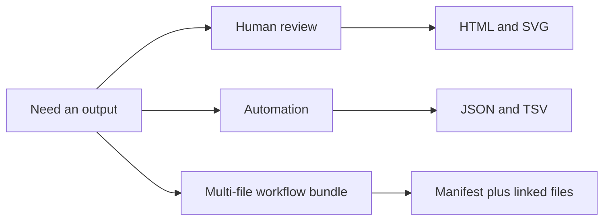

# Artifact Contracts

The runtime writes files that are meant to be read by people, automation, or
both. This page explains which output families are safe to depend on as public
artifacts.

If you only need day-to-day guidance, start with the
[artifact consumption guide](artifact-consumption-guide.md). This page is the
short reference for what counts as a durable public output family.

## Main Public Artifact Families

Common public output families include:

- SVG tree figures
- HTML reports
- JSON summaries
- bundle directories with manifests and supporting files
- reviewer-facing TSV ledgers

## Stable Families Worth Depending On

The most important schema-governed public families include:

- FASTA-to-tree model tables such as `prefix.model.tsv`
- FASTA-to-tree support tables such as `prefix.support.tsv`
- clade review tables such as `clade-table.tsv`
- branch review tables such as `host-switch-branches.tsv`
- derived comparative trait tables such as `comparative-traits.tsv`
- comparative model-output tables such as `comparative-summary.tsv`
- event ledgers such as `biogeography/event-table.tsv`
- workflow and report manifests such as `prefix.manifest.json` and
  `comparative-report.manifest.json`

When the documentation names one family here, downstream code should depend on
its stable headers or top-level keys instead of scraping one ad hoc example.

## How To Read These Outputs

- Use HTML and SVG outputs for human review.
- Use JSON and TSV outputs for downstream automation.
- Use manifests when one workflow emits multiple linked files.
- Use benchmark and parity summaries through their documented output surfaces
  rather than inferring structure from one fixture or screenshot.

## What This Page Does Not Promise

- It does not claim that every output file ever written by the repository is a
  stable public contract.
- It does not claim that every artifact is equally important for trust or
  publication review.
- It does not turn one output schema into proof that the underlying science is
  already closed.

These files matter because they let you inspect the result instead of relying
on a one-line success message.
