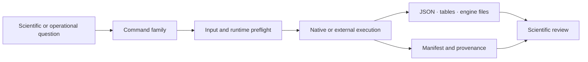
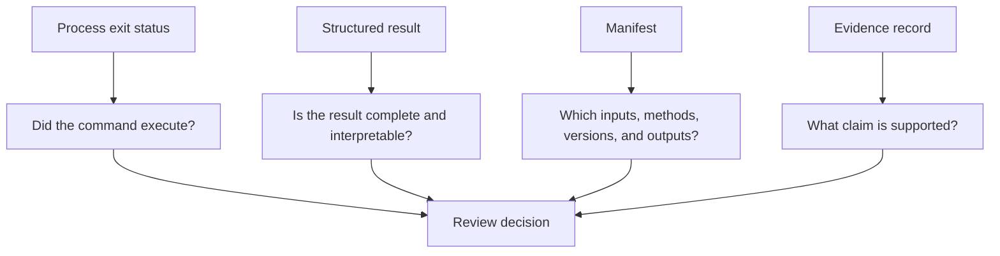

# Command-Line Surface

`bijux-phylogenetics` is the installed command-line interface for inspecting,
transforming, modeling, validating, and reporting phylogenetic data. Commands
are grouped by scientific responsibility. Select the family that owns the
decision, inspect its live help, and retain a manifest whenever the result must
survive beyond the terminal session.



The CLI is a public integration surface, but it is not a single assurance
level. A successful tree inspection, native likelihood fit, external-engine
run, parity case, benchmark, and Evidence Book verdict answer different
questions. Preserve the vocabulary of the record that owns the result.

## Start With Live Discovery

```bash
bijux-phylogenetics --version
bijux-phylogenetics --help
bijux-phylogenetics commands --format json
bijux-phylogenetics comparative --help
bijux-phylogenetics comparative pgls --help
```

The parser is the authority for command availability, positional arguments,
option spelling, defaults, and accepted choices in the installed version. This
guide defines how to select and interpret those commands. Pin the distribution
version in automation; do not infer an installed command contract from the
repository default branch.

The invocation grammar is:

```text
bijux-phylogenetics [global-options] FAMILY [SUBCOMMAND ...] [arguments]
```

`--native-maximum-likelihood-only` is a global execution-policy guard. It
forbids wrapper-backed maximum-likelihood execution for the selected command;
it does not claim that every operation in the process is native, nor does it
establish numerical accuracy.

## Choose The Owning Family

| Question | Primary family | Representative work |
| --- | --- | --- |
| Is the runtime and its optional tooling available? | `env`, `commands` | dependency inspection and machine-readable command discovery |
| Are trees, taxa, metadata, traits, alignments, or distances coherent? | `inspect`, `validate`, `diagnose`, `taxonomy`, `metadata`, `traits`, `alignment`, `distance` | identity, hygiene, linkage, diagnostics, and normalization |
| How should tree state be transformed or compared? | `normalize`, `normalize-taxa`, `topology`, `prune`, `compare`, `tree-set` | canonicalization, rooting, pruning, topology and uncertainty review |
| What comparative or historical model answers the question? | `comparative`, `ancestral`, `discrete-evolution`, `diversification` | signal, regression, trait models, ancestral state, and macroevolution |
| Is the question ecological or geographic? | `biogeography`, `host-association`, `ecological-niche`, `phylogeography` | transitions, host switching, niche evolution, and geographic reconstruction |
| Should data or known truth be generated? | `simulate` | trees, traits, alignments, and validation fixtures |
| Which implementation owns sequence alignment or external inference? | `phylo`, `adapter` | governed configuration, preflight, execution, replay, and bundle validation |
| Does a native numerical surface agree with a governed reference? | `parity`, `benchmark` | reference correspondence, scaling, resource use, and truth recovery |
| How should results be presented or promoted? | `render`, `report`, `evidence` | human reports, supplementary tables, evidence bundles, and review artifacts |
| What is the smallest connected demonstration? | `demo` | a capability bundle with a manifest and linked outputs |

Command families are not maturity labels. For example, `comparative pgls`
fits a model, `parity` compares a selected numerical contract, and `evidence`
packages governed claim records. One cannot substitute for the others.

## Establish Runtime Identity

Capture the installed version and runtime availability before recording a
scientific run:

```bash
mkdir -p artifacts/runtime
bijux-phylogenetics env inspect \
  --json \
  --manifest artifacts/runtime/environment-manifest.json \
  > artifacts/runtime/environment.json
```

For external execution, preflight the exact workflow rather than checking for
an executable name alone:

```bash
bijux-phylogenetics phylo preflight \
  --workflow fasta-to-tree \
  --json \
  --manifest artifacts/runtime/fasta-to-tree-preflight-manifest.json \
  > artifacts/runtime/fasta-to-tree-preflight.json
```

Read the workflow readiness, blocking engines, discovered executable paths,
versions, and compatibility findings. Installed does not necessarily mean
supported; supported does not necessarily mean the selected workflow is
runnable.

## Run A Native Comparative Model

The PGLS surface accepts either response and predictor options or a formula.
The manifest should travel with the model result and optional design artifacts:

```bash
mkdir -p artifacts/comparative
bijux-phylogenetics comparative pgls \
  dataset/tree.nwk \
  dataset/traits.tsv \
  --formula 'longevity ~ body_mass * habitat' \
  --lambda-value estimate \
  --model-matrix-out artifacts/comparative/model-matrix.tsv \
  --categorical-contrasts-out artifacts/comparative/contrasts.tsv \
  --lambda-profile-out artifacts/comparative/lambda-profile.tsv \
  --json \
  --manifest artifacts/comparative/manifest.json \
  > artifacts/comparative/result.json
```

Interpret coefficients only after confirming the reconciled taxon set,
formula encoding, categorical contrasts, covariance parameterization,
estimated lambda state, warnings, and exclusions. A parsable model result is
not proof that the design or covariance assumptions are appropriate.

## Reconstruct Ancestral State With Uncertainty

```bash
mkdir -p artifacts/ancestral
bijux-phylogenetics ancestral continuous \
  dataset/tree.nwk \
  dataset/traits.tsv \
  --trait longevity \
  --model brownian \
  --estimator generalized-least-squares \
  --table-out artifacts/ancestral/states.tsv \
  --uncertainty-out artifacts/ancestral/uncertainty.tsv \
  --exclusions-out artifacts/ancestral/exclusions.tsv \
  --json \
  --manifest artifacts/ancestral/manifest.json \
  > artifacts/ancestral/result.json
```

Node estimates are meaningful only with the tree identity, trait scale,
reconciliation record, model, estimator, node mapping, and uncertainty. A
rendered ancestral tree is a projection of those records, not their numerical
replacement.

## Run An External Engine Without Erasing Ownership

`adapter` commands govern external programs. MAFFT owns the alignment in this
example; Bijux owns preflight, invocation capture, path containment, resume
checks, normalization, and the manifest:

```bash
mkdir -p artifacts/alignment
bijux-phylogenetics adapter align \
  dataset/sequences.fasta \
  --out artifacts/alignment/aligned.fasta \
  --mode linsi \
  --timeout-seconds 1800 \
  --incomplete-run-policy reject \
  --json \
  --manifest artifacts/alignment/manifest.json \
  > artifacts/alignment/result.json
```

`--resume` means reuse only when the governed identity check accepts the
manifest, inputs, configuration, executable, and declared outputs. It is not a
request to trust whatever files already occupy the output directory. Keep the
default `reject` policy when an unexplained partial run needs investigation;
choose `clean` only when discarding that incomplete execution state is the
intended recovery action.

For multi-stage external workflows, persist the workflow definition and use
the configuration surface:

```bash
bijux-phylogenetics phylo run \
  workflow.yaml \
  --json \
  --manifest artifacts/phylo/workflow-manifest.json \
  > artifacts/phylo/workflow-result.json
```

The matching `phylo replay`, `phylo bundle`, and `phylo validate-bundle`
surfaces separate recomputation, portable packaging, and checksum/content
validation. Exact file equality, semantic equivalence, and scientific support
remain distinct conclusions.

## Read Output Channels Deliberately

Many analytical commands use the following pattern:

- ordinary text is for an interactive summary;
- `--json` makes standard output machine-readable;
- `--manifest PATH` writes run identity and provenance;
- named `--*-out PATH` options write purpose-specific tables, figures, or
  reports;
- external-engine workflows retain captured diagnostics and native files in
  their governed run directory.

Redirect JSON only when `--json` is selected. Treat standard error as an
operational diagnostic channel and the process exit code as execution status,
not as the scientific verdict. The structured result owns detailed warnings,
omissions, convergence state, comparison denominators, and scientific status.



## Treat Failure As Data

Classify a failed or partial command before rerunning it:

| Failure boundary | Inspect | Preserve |
| --- | --- | --- |
| parser or input validation | usage error, input path, schema, taxon and state diagnostics | original inputs and diagnostic output |
| runtime preflight | executable discovery, version policy, workflow readiness | environment report and requested executable identity |
| native computation | model settings, numerical warnings, search or chain state | structured partial result, seed, diagnostics, and configuration |
| external execution | command, exit code, standard output/error, timeout, native files | complete governed run directory |
| output normalization | parser version, native-file identity, missing fields | native outputs plus parsing failure |
| persistence | expected inventory, path containment, checksums, write errors | manifest and every file written before failure |

Do not hide a failed component by copying successful files into a fresh
directory. Do not change a tolerance, case denominator, seed, model, or
external executable without recording that the scientific identity changed.

## Keep Assurance Records Separate

`benchmark` measures governed dimensions such as runtime, peak memory,
topology recovery, likelihood recovery, support behavior, and wrapper
correspondence. Read each dimension independently; a fast run can be
scientifically wrong, and an accurate tiny fixture does not establish
production scaling.

`parity` has two execution modes:

- `checked-fixture` evaluates checked-in reference records;
- the APE, GEIGER, and phytools live sources run selected registries and
  require `RUN_LIVE_PARITY=1`.

The live harness records selected, passed, failed, and skipped cases. Those
are runtime case statuses, not Evidence Book verdicts. Preserve failure roots,
observation ledgers, parameterization records, and the exact selected
denominator.

`evidence` assembles records for governed claims. Packaging does not promote a
normal run into evidence by itself. Claim IDs, source provenance, checks,
tolerances, freshness, and a valid bundle verdict must all resolve through the
Evidence Book contract.

## Automation Contract

For long-lived shell or scheduler integration:

1. Pin the `bijux-phylogenetics` distribution version.
2. Use `commands --format json` for top-level discovery and explicit `--help`
   checks when adapting to a new version.
3. Select `--json`; never scrape the interactive summary.
4. Supply explicit paths, seeds, model choices, engine names, and resource
   limits when the command accepts them;
5. Write outputs beneath a run-specific root and retain its manifest;
6. Reject unknown incompatible schema versions and contradictory status or
   inventory records;
7. Preserve nonzero exits, partial artifacts, skips, warnings, and failed
   observations for diagnosis.

The CLI does not promise stable prose, whitespace, object-key order, or HTML
structure. Stable automation depends on documented arguments and versioned
machine-readable fields.

## Follow The Result Into Its Owning Guide

- [Common workflows](../operations/common-workflows.md) connects practical
  questions to executable command sequences.
- [Artifact contracts](artifact-contracts.md) defines identity, completeness,
  compatibility, and integrity.
- [Artifact consumption](artifact-consumption-guide.md) gives the reviewer
  traversal order.
- [Scientific domains](../../02-bijux-phylogenetics-domains/index.md) explains
  method assumptions and handoffs.
- [Parity and correspondence](../../04-bijux-phylogenetics-parities/index.md)
  distinguishes references, live harnesses, and external computation.
- [Evidence Book](../../03-bijux-phylogenetics-evidence-book/index.md) owns
  claim-level verdicts.
