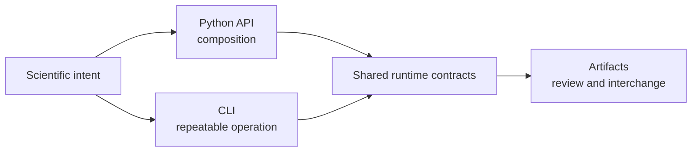
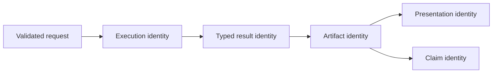
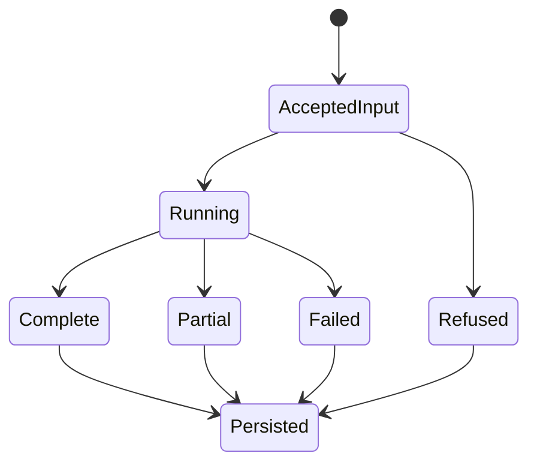
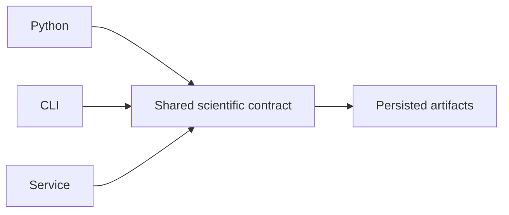

# Public Interfaces

The runtime exposes the same scientific ownership through interfaces designed
for different consumers. Python composes analysis in process. The CLI makes a
run explicit and automatable. Persisted artifacts let reviewers and other
systems inspect results without importing the runtime that created them.

## Choose The Contract Before The Syntax

Begin with the work product another person or system must accept. That choice
determines the stable boundary; syntax comes afterward.

| Needed work product | Contract to depend on | Do not substitute |
| --- | --- | --- |
| an in-process scientific value | curated Python import and typed result | a nested implementation import or rendered table |
| a repeatable shell operation | documented CLI command, exit behavior, and structured output | terminal wording or file existence alone |
| a durable analytical record | schema-versioned artifact, manifest, and checksums | an object representation remembered from one runtime version |
| a service exchange | pinned request and response schema plus scientific status | HTTP success as proof of analytical success |
| a citable scientific statement | governed claim and its exact evidence dependencies | a successful run, parity row, or nearby study page |

The same computation may legitimately produce all five work products. They
are linked views, not interchangeable proof. A notebook can inspect a rich
result while a scheduled job consumes its JSON projection and a reviewer reads
an HTML report; each consumer must retain the identity of the structured
result it actually accepted.

A new serialization, report, or claim does not retroactively change the
upstream computation. Conversely, changing an input, model, executable, or
acceptance policy creates a new run identity even when the output filename is
reused.

## Choose By Consumer

| Consumer | Primary surface | Why |
| --- | --- | --- |
| Python application or notebook | [Python surface](python-surface.md) | typed values, composition, direct diagnostic access |
| shell pipeline, CI, or scheduled run | [CLI surface](cli-surface.md) | explicit arguments, exit status, captured output |
| reviewer or downstream system | [Artifact contracts](artifact-contracts.md) | durable, language-independent inspection |
| service integrator | [API surface](api-surface.md) | versioned schema and transport contract |
| automation handling incomplete or refused work | [Result and refusal semantics](result-and-refusal-semantics.md) | stable failure meaning across interfaces |
| collaborator reconstructing a run | [Reproducibility records](reproducibility-records.md) | linked input, environment, execution and acceptance identity |

Use the [surface selection guide](surface-selection.md) when more than one
route seems plausible.

## Stability Is Layered

Public does not mean every nested module is an endorsed import. Prefer curated
imports and documented commands. Treat typed result fields and versioned
artifact schemas as contracts when the relevant page says so. Human-oriented
report prose and layout can evolve without being a machine interface.

## One Run, Several Views

A CLI command and a Python call may reach the same method, but they are not
identical interfaces. The CLI must translate strings and paths, define exit
behavior, and serialize output. Python can preserve rich objects and let the
caller choose persistence. An artifact is a frozen view of either path and
must carry enough provenance to stand alone.

## Preserve State Across Handoffs

Every interface handoff must preserve the state that determines whether a
result can be interpreted. Serialization may reduce representation richness;
it must not turn an unresolved or partial analysis into an apparently complete
one.

| Handoff | State that must survive | Evidence of preservation |
| --- | --- | --- |
| Python result to files | typed status, warnings, exclusions, units, ordering, and absent fields | manifest inventory and schema-valid structured artifacts |
| CLI process to automation | exit status, structured scientific status, stderr diagnostics, and paths written | captured channels plus the manifest named by the command |
| engine process to adapter result | executable identity, command, return state, native files, parser state, and omissions | engine record linked to—not replaced by—the normalized result |
| producer bundle to downstream consumer | schema version, input and run identity, expected inventory, checksums, and completeness | acceptance record created before values are imported |
| runtime or parity record to a public claim | exact claim identifier and evidence scope | governed Evidence Book dependency rather than an inferred link |

When a target surface cannot represent a required state, the handoff must
refuse, preserve an explicit unknown, or retain a link to the richer owning
record. Silent coercion is a contract violation.

## Interface Invariants

Across every supported surface, taxon ordering, model parameterization,
computation owner, status, warnings, denominators, and units must retain the
same meaning. Representation can change—typed object, command JSON, API
response, or TSV row—but scientific semantics cannot.

If two interfaces produce materially different defaults or omit different
diagnostics, document and test that difference as an interface contract. Do
not call the surfaces equivalent because their headline estimate matches.

## Contract Comparison

| Concern | Python | CLI | Persisted artifact | Service schema |
| --- | --- | --- | --- | --- |
| input identity | paths and typed objects | explicit arguments and files | manifest references and hashes | request fields and referenced objects |
| failure observation | exception and typed status | exit status, stderr, structured output | manifest/result status and missing inventory | transport status plus scientific result status |
| diagnostics | richest in-process objects | serialized projection | durable JSON/TSV and linked reports | schema-defined projection |
| compatibility owner | curated imports and result contracts | documented command taxonomy and options | schema/version contract | pinned OpenAPI contract |
| review lifetime | process or caller persistence | terminal plus written outputs | independent of producer process | client must retain response and job artifacts |

Transport success and scientific success remain separate. A service can return
a valid response containing a refused analysis; a CLI can exit after writing
diagnostic artifacts; Python can return a partial typed result when its public
contract permits it. Consumers must inspect both layers.

## Boundary Rules

- Do not scrape narrative reports when a JSON or TSV contract exists.
- Do not import command implementation modules as a substitute for the public
  Python API.
- Do not infer success from file existence; inspect status and diagnostics.
- Do not assume CLI defaults are appropriate scientific choices for every
  dataset.
- Do not discard engine identity when a normalized adapter result is produced.
- Do not convert warnings, exclusions, or incomplete components into success
  while crossing an interface boundary.
- Do not make HTML layout or console wording a machine dependency.

## Compatibility Questions

Before upgrading a producer or consumer, determine whether input semantics,
defaults, result fields, status vocabulary, artifact schemas, and external
engine expectations changed. Parse compatibility alone is insufficient when a
field retains its name but changes units, ordering, denominator, or scientific
meaning.

## Review Checklist

Before integrating a surface, identify its version owner, input validation,
failure behavior, result contract, artifact footprint, and compatibility
promise. If any of those are unclear, the integration is depending on an
accident rather than a public contract.

## Section Map

- [Python surface](python-surface.md): curated imports, rich results, and
  composition boundaries.
- [CLI surface](cli-surface.md): exhaustive generated command reference.
- [Surface selection](surface-selection.md): decision rules and mixed-mode use.
- [Artifact contracts](artifact-contracts.md): persisted identity, provenance,
  and compatibility.
- [Artifact consumption](artifact-consumption-guide.md): reviewer workflow.
- [Native inference and benchmarks](native-inference-and-benchmarks.md): owned
  inference result and benchmark interfaces.
- [Result and refusal semantics](result-and-refusal-semantics.md): scientific
  states, structured failures, and consumer acceptance.
- [Reproducibility records](reproducibility-records.md): manifests, replay
  meanings, attempt denominators, and durable handoffs.
