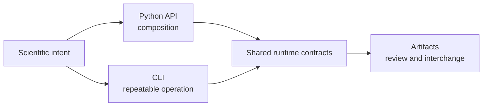

# Public Interfaces

The runtime exposes the same scientific ownership through interfaces designed
for different consumers. Python composes analysis in process. The CLI makes a
run explicit and automatable. Persisted artifacts let reviewers and other
systems inspect results without importing the runtime that created them.

## Choose By Consumer

| Consumer | Primary surface | Why |
| --- | --- | --- |
| Python application or notebook | [Python surface](python-surface.md) | typed values, composition, direct diagnostic access |
| shell pipeline, CI, or scheduled run | [CLI surface](cli-surface.md) | explicit arguments, exit status, captured output |
| reviewer or downstream system | [Artifact contracts](artifact-contracts.md) | durable, language-independent inspection |
| service integrator | [API surface](api-surface.md) | versioned schema and transport contract |

Use the [surface selection guide](surface-selection.md) when more than one
route seems plausible.

## Stability Is Layered

Public does not mean every nested module is an endorsed import. Prefer curated
imports and documented commands. Treat typed result fields and versioned
artifact schemas as contracts when the relevant page says so. Human-oriented
report prose and layout can evolve without being a machine interface.

## One Run, Several Views

A CLI command and a Python call may reach the same method, but they are not
identical interfaces. The CLI must translate strings and paths, define exit
behavior, and serialize output. Python can preserve rich objects and let the
caller choose persistence. An artifact is a frozen view of either path and
must carry enough provenance to stand alone.

## Boundary Rules

- Do not scrape narrative reports when a JSON or TSV contract exists.
- Do not import command implementation modules as a substitute for the public
  Python API.
- Do not infer success from file existence; inspect status and diagnostics.
- Do not assume CLI defaults are appropriate scientific choices for every
  dataset.
- Do not discard engine identity when a normalized adapter result is produced.

## Review Checklist

Before integrating a surface, identify its version owner, input validation,
failure behavior, result contract, artifact footprint, and compatibility
promise. If any of those are unclear, the integration is depending on an
accident rather than a public contract.

## Section Map

- [Python surface](python-surface.md): curated imports, rich results, and
  composition boundaries.
- [CLI surface](cli-surface.md): exhaustive generated command reference.
- [Surface selection](surface-selection.md): decision rules and mixed-mode use.
- [Artifact contracts](artifact-contracts.md): persisted identity, provenance,
  and compatibility.
- [Artifact consumption](artifact-consumption-guide.md): reviewer workflow.
- [Native inference and benchmarks](native-inference-and-benchmarks.md): owned
  inference result and benchmark interfaces.
