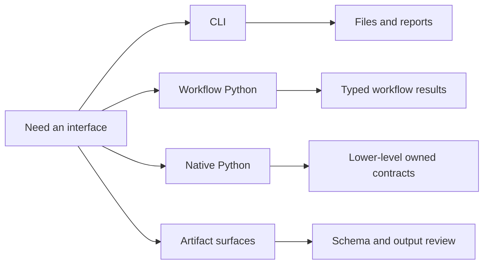

# Public Interfaces

This section describes the runtime contracts that readers are expected to use
directly.

It has to show more than a list of commands. The runtime exposes several
different entry surfaces because different readers need different depths of
control and different artifact guarantees.

## Interface Families

- CLI commands for end-to-end workflows and reviewer-facing files
- workflow Python surfaces under `bijux_phylogenetics.api`
- native Python contracts for runtime objects and inference results
- benchmark and evidence-adjacent runtime contracts
- emitted artifact and report families

## What Each Interface Unlocks

| Interface family | Best for | What the reader gets back |
| --- | --- | --- |
| CLI | governed command execution | files, reports, manifests, and reproducible output directories |
| Workflow Python | notebooks and pipelines | typed workflow results with stable writers |
| Native Python | lower-level scientific control | direct owned contracts for trees, likelihood, inference, and analysis |
| Artifact surfaces | review and downstream inspection | explicit schemas, output families, and consumption rules |

## Interface Selection Heuristic

| If you need | Start here | Why |
| --- | --- | --- |
| one governed workflow or report | CLI | easiest path to durable artifacts |
| notebook or pipeline composition | workflow Python | typed results and stable writers |
| lower-level runtime control | native Python | direct access to owned contracts |
| trust or schema review | artifact pages | explicit output families and boundaries |

## Why This Section Matters

The package looks smaller than it is when all interfaces are described as if
they were one generic API. They are not:

- the CLI is optimized for governed runs and durable outputs
- the workflow API is optimized for typed orchestration in Python
- the native runtime surface is optimized for readers who need owned
  lower-level scientific contracts
- the artifact pages are optimized for downstream consumers and reviewers

## Start Here

- If you need help choosing an entry point, use the
  [surface selection guide](surface-selection.md).
- If you already know the entry point, continue to the matching reference
  page below.

## Section Map

- [Surface selection guide](surface-selection.md)
- [CLI surface](cli-surface.md)
- [API surface](api-surface.md)
- [Python surface](python-surface.md)
- [Native inference and benchmarks](native-inference-and-benchmarks.md)
- [Artifact consumption guide](artifact-consumption-guide.md)
- [Artifact contracts](artifact-contracts.md)

The surface selection guide and artifact consumption guide are the two fastest
ways to orient a new reader before they drop into the larger CLI and Python
reference pages.
