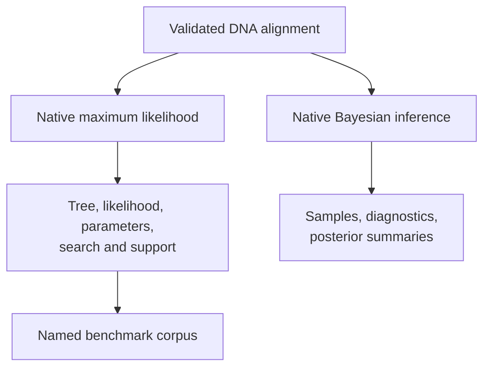
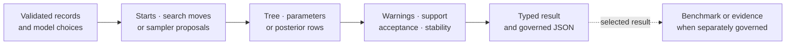

# Native Inference And Benchmark Contracts

The runtime owns nucleotide maximum-likelihood inference, supported Bayesian
DNA inference, and benchmark contracts that preserve search, support,
diagnostic, and comparison state. Native ownership identifies the computation
boundary; benchmark evidence identifies measured behavior on named corpora.

## Maximum-Likelihood Contract

Public entry points:

- `infer_nucleotide_maximum_likelihood_result(...)`;
- `infer_nucleotide_maximum_likelihood_result_from_alignment(...)`;
- `NucleotideMaximumLikelihoodResult`.

The result retains selected model and selection strategy, final Newick and
topology fingerprint, log likelihood, fitted parameters, multi-start summaries,
accepted search moves, optional bootstrap and SH-like support, warnings, and
optional wrapper-comparison metadata.

The stable result family is narrower than every helper in
`bijux_phylogenetics.phylo.likelihood`. Nucleotide tree inference is the
documented native inference boundary even though lower-level likelihood
foundations also cover protein, codon, and discrete Mk state spaces.

## Stable Native Boundary At A Glance

| Surface | Stable entry or result | Owned depth | Explicit boundary |
| --- | --- | --- | --- |
| nucleotide ML | `infer_nucleotide_maximum_likelihood_result(...)` | JC69, K80, F81, HKY85 and GTR selection/fitting; NNI, SPR or TBR search; multi-start state | documented unified inference result is nucleotide-focused |
| ML from FASTA | `infer_nucleotide_maximum_likelihood_result_from_alignment(...)` | alignment intake plus the same model/search/support result | biological alignment quality remains a caller decision |
| ML persistence | `NucleotideMaximumLikelihoodResult.write_json(...)` and `load_json(...)` | typed round trip for inference, traces, support, warnings and optional benchmark metadata | loading does not rerun or refresh a result |
| native Bayesian DNA | `run_bayesian_inference(...)` | fixed- or joint-topology DNA posterior under matched model/proposal definitions | K80, HKY85 and GTR builder boundary; unsupported pairings refuse |
| ML benchmark suite | `benchmark_native_maximum_likelihood_suite(...)` | scalability, accuracy/recovery, support and wrapper-correspondence dimensions | corpus conclusions remain corpus-specific |

Lower-level protein, codon, discrete-state, clock, prior, proposal, posterior,
and search modules are meaningful runtime foundations. Their existence does
not silently expand the stable unified entry points listed here.

## A Native Result Preserves The Decision Path

Native ownership covers the computation through persistence. Assurance still
depends on an independent fixture, benchmark corpus, parity case, or study
bundle with its own acceptance rule.

## Bayesian Contract

`bijux_phylogenetics.bayesian.run_bayesian_inference(...)` dispatches supported
model definitions only when paired with a compatible proposal schedule.
Documented public paths include fixed-topology and joint-topology DNA
inference. Unsupported pairings fail explicitly.

The native Bayesian package also owns priors, proposal construction,
checkpoints, tuning, burn-in policy, independent-chain diagnostics, posterior
summaries, and clock-related model contracts. A caller must still establish
chain adequacy before interpreting posterior values.

BEAST and MrBayes adapters are separate external-engine paths. They are not
used behind the native dispatcher to create the appearance of native execution.

## Benchmark Contract

Named benchmark entry points include:

- `benchmark_native_maximum_likelihood_speed(...)`;
- `benchmark_native_maximum_likelihood_memory(...)`;
- `benchmark_native_maximum_likelihood_accuracy(...)`;
- `benchmark_native_maximum_likelihood_suite(...)`;
- `benchmark_maximum_likelihood_wrapper_comparison(...)`.

The unified suite connects scalability, accuracy or truth recovery,
wrapper-comparison, and support evidence without collapsing them into one
score.

| Status | Interpretation |
| --- | --- |
| `native-advantage` | declared native metric is favorable under the comparison contract |
| `native-bug` | behavior violates the benchmark's correctness expectation |
| `expected-assumption-difference` | difference follows a documented model or convention mismatch |
| `unsupported-case` | the implementation or comparison contract does not cover the case |

These statuses require recorded corpus, versions, configuration, environment,
metric, and threshold. They are not package-wide labels.

## Keep Benchmark Dimensions Independent

Speed, memory, truth recovery, topology correspondence, support calibration,
and completion rate are different observations. A benchmark suite may connect
them through one corpus identity, but it must not reduce them to an unnamed
overall score.

| Dimension | Required denominator | Result it cannot establish |
| --- | --- | --- |
| speed | completed eligible cases under a named environment and timing policy | correctness, memory safety, or performance on failed cases |
| memory | measured executions, measurement method, process boundary and peak policy | runtime speed or scientific accuracy |
| recovery | generated truth, comparable cases, loss metric, failures and exclusions | correspondence with an external implementation |
| wrapper correspondence | aligned native/wrapper estimands, cases, observations and rules | either implementation is scientifically adequate |
| support calibration | replicate population, nominal levels, clade keys and coverage rule | exact topology recovery or search completeness |
| completion | every requested case and terminal state | quality of the successful results |

Publish the joint case key so dimensions can be related without hiding their
own denominators. A native speed advantage beside a recovery failure remains
two results, not a favorable average; an unsupported case remains in coverage
even when it is excluded from elapsed-time summaries.

## Result Selection

Use native result objects when composing methods or inspecting rich state. Use
workflow results when orchestration and artifact writing are the main concern.
Use benchmark reports when evaluating a named implementation question. Use an
Evidence Book bundle only for claims registered by that study record.

## Choose The Narrowest Honest Claim

| Available record | Supported wording | Unsupported leap |
| --- | --- | --- |
| completed native result | the named implementation returned this estimate under the retained model and controls | the estimate is biologically correct |
| repeated starts or chains | the selected summaries were stable under those repeated executions | all search/sampling uncertainty is resolved |
| known-answer or recovery benchmark | the method met the rule on the named corpus | equivalent performance on untested data |
| wrapper correspondence row | the aligned native and wrapper observations met that row’s rule | the implementations are interchangeable |
| Evidence Book verdict | the identified scientific claim has the recorded current status | neighboring claims inherit the verdict |

Operational examples are in
[native maximum-likelihood workflows](../operations/native-maximum-likelihood-workflows.md),
[native Bayesian workflows](../operations/native-bayesian-workflows.md), and
[native benchmark review](../operations/native-benchmark-review.md).
