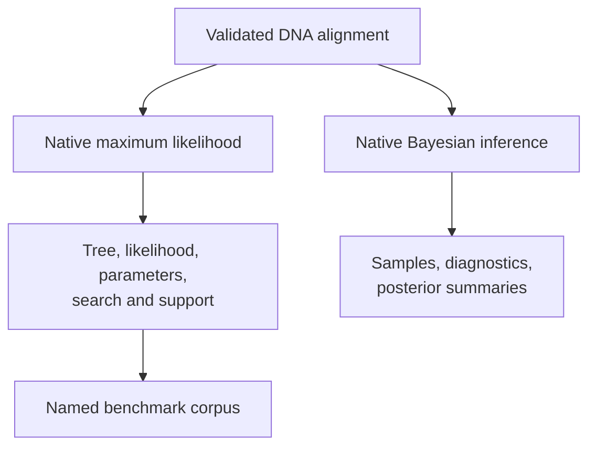

# Native Inference And Benchmark Contracts

The runtime owns nucleotide maximum-likelihood inference, supported Bayesian
DNA inference, and benchmark contracts that preserve search, support,
diagnostic, and comparison state. Native ownership identifies the computation
boundary; benchmark evidence identifies measured behavior on named corpora.

## Maximum-Likelihood Contract

Public entry points:

- `infer_nucleotide_maximum_likelihood_result(...)`;
- `infer_nucleotide_maximum_likelihood_result_from_alignment(...)`;
- `NucleotideMaximumLikelihoodResult`.

The result retains selected model and selection strategy, final Newick and
topology fingerprint, log likelihood, fitted parameters, multi-start summaries,
accepted search moves, optional bootstrap and SH-like support, warnings, and
optional wrapper-comparison metadata.

The stable result family is narrower than every helper in
`bijux_phylogenetics.phylo.likelihood`. Nucleotide tree inference is the
documented native inference boundary even though lower-level likelihood
foundations also cover protein, codon, and discrete Mk state spaces.

## Bayesian Contract

`bijux_phylogenetics.bayesian.run_bayesian_inference(...)` dispatches supported
model definitions only when paired with a compatible proposal schedule.
Documented public paths include fixed-topology and joint-topology DNA
inference. Unsupported pairings fail explicitly.

The native Bayesian package also owns priors, proposal construction,
checkpoints, tuning, burn-in policy, independent-chain diagnostics, posterior
summaries, and clock-related model contracts. A caller must still establish
chain adequacy before interpreting posterior values.

BEAST and MrBayes adapters are separate external-engine paths. They are not
used behind the native dispatcher to create the appearance of native execution.

## Benchmark Contract

Named benchmark entry points include:

- `benchmark_native_maximum_likelihood_speed(...)`;
- `benchmark_native_maximum_likelihood_memory(...)`;
- `benchmark_native_maximum_likelihood_accuracy(...)`;
- `benchmark_native_maximum_likelihood_suite(...)`;
- `benchmark_maximum_likelihood_wrapper_comparison(...)`.

The unified suite connects scalability, accuracy or truth recovery,
wrapper-comparison, and support evidence without collapsing them into one
score.

| Status | Interpretation |
| --- | --- |
| `native-advantage` | declared native metric is favorable under the comparison contract |
| `native-bug` | behavior violates the benchmark's correctness expectation |
| `expected-assumption-difference` | difference follows a documented model or convention mismatch |
| `unsupported-case` | the implementation or comparison contract does not cover the case |

These statuses require recorded corpus, versions, configuration, environment,
metric, and threshold. They are not package-wide labels.

## Result Selection

Use native result objects when composing methods or inspecting rich state. Use
workflow results when orchestration and artifact writing are the main concern.
Use benchmark reports when evaluating a named implementation question. Use an
Evidence Book bundle only for claims registered by that study record.

Operational examples are in
[native maximum-likelihood workflows](../operations/native-maximum-likelihood-workflows.md),
[native Bayesian workflows](../operations/native-bayesian-workflows.md), and
[native benchmark review](../operations/native-benchmark-review.md).
