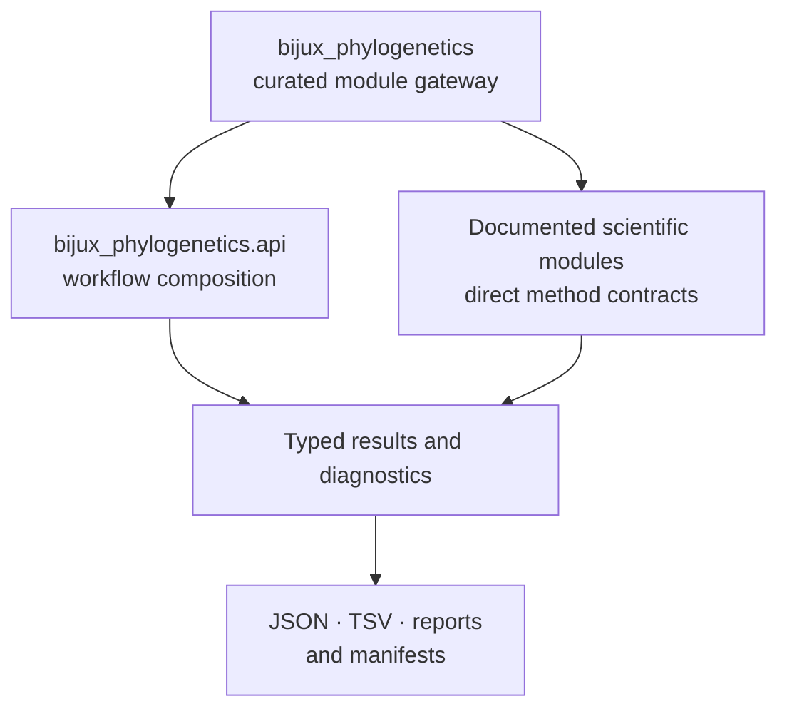
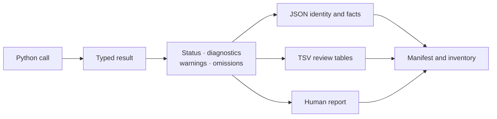

# Python Surface

The canonical import namespace is `bijux_phylogenetics`. Its public Python
surface has three layers: a small package gateway, workflow-shaped functions
under `bijux_phylogenetics.api`, and documented scientific modules for direct
method use.



Use the [surface selection guide](surface-selection.md) first when the main
consumer is a shell scheduler, service, reviewer, or archival system.

## Supported Import Layers

| Layer | Use it for | Stability rule |
| --- | --- | --- |
| `bijux_phylogenetics` | discover versioned public module families | only names in the package's curated `__all__` gateway |
| `bijux_phylogenetics.api` | notebook, pipeline, and application workflows | exported workflow functions and result types |
| documented domain modules | direct trees, inference, comparative, ancestral, parsimony, simulation, or reporting contracts | named exports documented for that scientific surface |
| implementation submodules | repository internals | no public compatibility promise unless explicitly documented |

The package gateway exports module families rather than thousands of symbols:
`ancestral`, `api`, `bayesian`, `biogeography`, `comparative`, `datasets`,
`distance`, `evidence`, `parsimony`, `parity`, `phylo`, and `trees`. Do not
assume a class is a top-level import merely because it exists in one of those
families.

## Workflow API

`bijux_phylogenetics.api` is the narrowest composition surface for common
path-oriented work.

| Function | Primary contract | Computation owner |
| --- | --- | --- |
| `run_fasta_validation_workflow` | validate FASTA shape and content | Bijux runtime |
| `run_tree_comparison_workflow` | compare two tree files under an explicit overlap policy | Bijux runtime |
| `run_comparative_model_workflow` | reconcile a tree and trait table and fit the selected comparative regression | Bijux runtime |
| `run_ancestral_reconstruction_workflow` | reconstruct a named trait under an explicit state model | Bijux runtime |
| `render_report_workflow` | render linked tree, alignment, trait, and metadata inputs | Bijux runtime; advisory presentation |
| `run_alignment_workflow` | align sequences and retain execution artifacts | MAFFT through a Bijux adapter |
| `run_trimming_workflow` | trim an alignment and retain execution artifacts | trimAl through a Bijux adapter |
| `run_tree_inference_workflow` | run configured tree inference and normalize the result | IQ-TREE2 through a Bijux adapter |
| `run_support_workflow` | run configured support estimation | IQ-TREE2 through a Bijux adapter |
| `run_sequence_to_tree_workflow` | compose alignment, trimming, inference, and support | named external engines through Bijux adapters |
| `run_configured_phylo_workflow` | execute a persisted workflow configuration | depends on the configured stages |

Function return types are serializable workflow results. They preserve richer
state in process and provide `write_json(...)`; workflow results with tabular
summaries also provide `write_tsv(...)`.

## Compose A Native Workflow

```python
from pathlib import Path

from bijux_phylogenetics.api import (
    run_comparative_model_workflow,
    run_tree_comparison_workflow,
)

comparison = run_tree_comparison_workflow(
    Path("dataset/tree-a.nwk"),
    Path("dataset/tree-b.nwk"),
    rf_mode="rooted",
    taxon_overlap_policy="prune-to-shared",
)
comparison.write_json(Path("artifacts/tree-comparison.json"))
comparison.write_tsv(Path("artifacts/tree-comparison.tsv"))

model = run_comparative_model_workflow(
    Path("dataset/tree.nwk"),
    Path("dataset/traits.tsv"),
    response="response",
    predictors=["body_mass", "habitat"],
    lambda_value="estimate",
)
model.write_json(Path("artifacts/comparative-model.json"))
model.write_tsv(Path("artifacts/comparative-model.tsv"))
```

The call site owns the destination and persistence policy. Before interpreting
either result, inspect its status, reconciled taxa, method configuration,
warnings, and diagnostic fields rather than treating serialization as proof of
scientific adequacy.

## Compose An External-Engine Workflow

```python
from pathlib import Path

from bijux_phylogenetics.api import run_sequence_to_tree_workflow

result = run_sequence_to_tree_workflow(
    Path("dataset/sequences.fasta"),
    out_dir=Path("artifacts/sequence-to-tree"),
    sequence_type="dna",
    mafft_executable="mafft",
    trimal_executable="trimal",
    iqtree_executable="iqtree2",
    bootstrap_replicates=1000,
    seed=17,
    threads=4,
)
result.write_json(Path("artifacts/sequence-to-tree/workflow.json"))
```

This is Python composition, but MAFFT, trimAl, and IQ-TREE2 still own their
scientific computation. Preserve executable versions, invocation, captured
diagnostics, native output files, parser state, and normalized result identity.
The Python package does not install those executables.

## Direct Scientific Modules

Use a domain module when the caller already owns validated in-memory state or
needs a method contract more specific than a workflow.

| Family | Representative responsibility | Review before use |
| --- | --- | --- |
| `bijux_phylogenetics.trees` | tree-set summaries, consensus, support, instability, branch and topology review | taxon-set policy, rooting, split identity, malformed records |
| `bijux_phylogenetics.phylo.likelihood` | finite-state likelihood and native maximum-likelihood result contracts | model, parameters, search state, convergence, support |
| `bijux_phylogenetics.bayesian` | supported native posterior models, priors, proposals, checkpoints, and diagnostics | model family, chain identity, convergence, effective sample size, resume lineage |
| `bijux_phylogenetics.comparative` | PGLS, covariance, signal, trait evolution, regression, and model comparison | reconciliation, design matrix, covariance model, assumptions, exclusions |
| `bijux_phylogenetics.ancestral` | continuous and discrete reconstruction and uncertainty summaries | state space, node identity, transition model, root prior, uncertainty |
| `bijux_phylogenetics.parsimony` | Fitch, Wagner, Sankoff, Dollo, Camin–Sokal, search, and resampling | coding, costs, ordering, search coverage, equal-best trees |
| `bijux_phylogenetics.simulation` | trees, alignments, continuous traits, discrete traits, and known histories | generating parameters, seed, truth ledger, replicate denominator |

Representative owned inference locators are
`bijux_phylogenetics.phylo.likelihood.infer_nucleotide_maximum_likelihood_result`
and `bijux_phylogenetics.bayesian.run_bayesian_inference`. Their direct result
contracts are appropriate when an application needs search or sampler state
that a broader workflow would only serialize.

## Result Handling Contract



- Catch documented exceptions at the layer that can recover from them.
- Inspect typed completion and diagnostic state before reading estimates.
- Preserve absent, failed, and skipped components in the output denominator.
- Serialize before the in-memory state is discarded when independent review is
  required.
- Treat HTML and figures as projections; retain the structured records that
  own their values.
- Record the runtime version and any external executable identities with the
  artifacts.

## Alias Imports

The `phylogenetic` distribution provides a compatibility facade over the
canonical runtime dependency. It forwards curated top-level attributes and
compatible submodules, including `phylogenetic.api`. It is not a separate
scientific implementation.

For governed work through the alias, retain both distribution versions:

```python
from importlib.metadata import version

print(version("phylogenetic"))
print(version("bijux-phylogenetics"))
```

The first identifies the facade artifact; the second identifies the runtime
that owns the computation.

## Discover Without Guessing

```python
import bijux_phylogenetics
from bijux_phylogenetics import api

print(bijux_phylogenetics.__all__)
print(api.__all__)
```

Use curated discovery, this handbook, and generated API references. Avoid
copying imports from implementation files or tests: importability alone does
not establish support, and a repository-relative fixture is not an
installed-package resource.

## Matching Practical Guides

- [Native maximum-likelihood workflows](../operations/native-maximum-likelihood-workflows.md)
- [Native Bayesian workflows](../operations/native-bayesian-workflows.md)
- [Common workflows](../operations/common-workflows.md)
- [Artifact contracts](artifact-contracts.md)
- [Native inference and benchmarks](native-inference-and-benchmarks.md)
