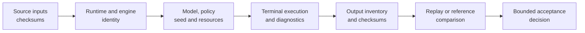
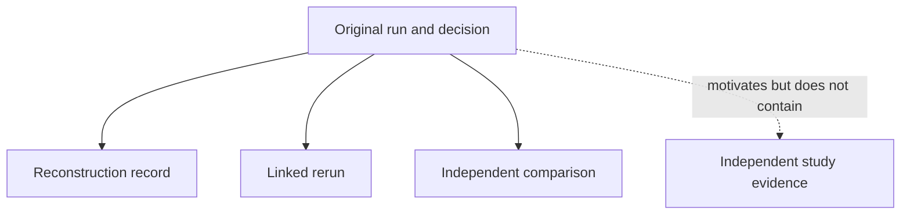

# Reproducibility Records

Reproducibility is a chain of identified records. A command line in prose is
useful, but it is not enough to prove which inputs, runtime, engines,
configuration, outputs, and acceptance decision produced a scientific claim.

## The Reproduction Chain

Each edge answers a different question. Checksums establish byte identity, not
biological suitability. A replay establishes correspondence under its replay
contract, not external correctness. A reference comparison supports only its
registered observation and tolerance.

## Name The Assurance Operation Precisely

“Reproducible” is too broad when the operation and comparator are omitted.
These records distinguish four different acts:

| Operation | What changes | Question answered | Evidence retained |
| --- | --- | --- | --- |
| reconstruction | no computation is required | Can a reviewer identify how this exact result and decision were produced? | source, environment, configuration, execution, inventory, and decision lineage |
| rerun | execution is repeated under the declared contract | Does the workflow execute again with the identified inputs and configuration? | a new run manifest, terminal state, outputs, and link to the original |
| reproduction | an independently executed comparison follows a registered method and observation contract | Do the declared scientific observations correspond under the chosen comparator? | both result identities, normalization, observations, tolerance, and verdict |
| replication | data, sampling, or study execution supplies an independent scientific test | Does the scientific finding persist beyond the original analytical record? | a separately governed study design, evidence, and interpretation |

A rerun is never allowed to overwrite its parent. A reproduction can disagree
without invalidating its own execution record. Replication is not manufactured
by adding more software metadata to the original study.

## Minimum Run Manifest

The runtime manifest contract records command, arguments, input and output
paths, available checksums, package version, Python version, dependency
versions, UTC timestamp, and host platform. External-engine workflows add the
resolved executable, engine version, native command, working directory,
captured streams, timing, timeout state, exit code, warnings, and native output
paths.

Paths locate objects; checksums identify their bytes. Preserve both. A checksum
without its role and path is difficult to use, while a path without a checksum
can silently resolve to changed content.

## Record Scientific Configuration Separately

Environment identity does not fully describe the analysis. Retain:

- input population and reconciliation rules;
- model, parameterization, partitions, priors, costs, and transforms;
- starting state, random seed, thread or process count, and stopping rule;
- missing-data, identifier-normalization, trimming, and incomplete-run policy;
- required outputs, diagnostic thresholds, and acceptance criteria.

Defaults must be materialized in the retained record. A future default change
must not alter the meaning of a historical invocation that omitted an option.

## Distinguish Replay Outcomes

| Outcome | Meaning |
| --- | --- |
| exact byte replay | declared outputs are byte-identical under the replay environment |
| semantic replay | normalized scientific observations agree under an explicit comparator |
| stochastic correspondence | distributions or summaries satisfy registered budgets across seeded or independent runs |
| structural correspondence | taxa, splits, nodes, rows, or artifact inventories agree by stable identity |
| different | the registered comparator observed a material difference |
| not evaluable | required input, output, capability, or identity is unavailable |

Do not demand byte equality from intentionally stochastic or environment-
sensitive outputs when the scientific contract is semantic. Conversely, do
not downgrade a promised deterministic byte replay to visual similarity after
observing drift.

## Preserve Attempts And Selection

Retries and sensitivity runs are siblings, not replacements. Give each an
independent manifest and output root. A selection record must name every
eligible candidate, failures and exclusions, the predeclared decision rule,
the selected result, and the claim scope.

Deleting failed attempts biases operational reliability and can hide
scientific sensitivity. Retention does not require publishing every temporary
file, but the terminal state and denominator must remain reconstructable.

## Package A Handoff

A durable handoff contains identified inputs, manifest, structured result,
diagnostics, native engine files where applicable, output inventory and
checksums, human review views, and the acceptance record. Validate the bundle
after copying it; packaging can introduce missing files, stale manifests, or
path assumptions even when the original run was sound.

Do not reconstruct machine state from HTML, screenshots, shell history, or a
paper methods paragraph when governed structured records exist. Those are
explanatory projections, not replacements for the execution contract.

## Know What Reproduction Does Not Prove

Reproducing a defect proves that the defect is repeatable. Reproducing an
estimate does not establish model adequacy, unbiased sampling, correct taxon
identity, or biological causality. State the level achieved—execution replay,
semantic correspondence, reference parity, or claim-level evidence—and keep
the conclusion inside that boundary.
