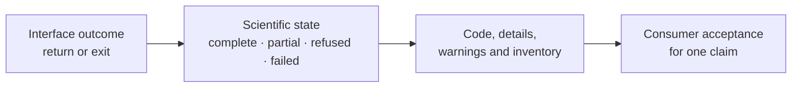

# Result And Refusal Semantics

Bijux distinguishes a completed scientific result, a partial record, an input
refusal, and an execution failure. Consumers must preserve that distinction
across Python, CLI, JSON, TSV, manifests, and reports.

## Read Two Layers Of State

The interface layer answers whether the call or command was handled. The
scientific layer answers whether the requested analysis produced an
interpretable result. A valid JSON response can describe a refused analysis;
an exception can preserve useful preflight or partial-run evidence.

## Stable Python Failures

Runtime failures derive from `PhylogeneticsError` and carry three parts:

| Field | Meaning | Consumer action |
| --- | --- | --- |
| exception type | broad failure family, such as tree parsing, metadata joining, comparative analysis, or engine execution | choose the recovery owner |
| `code` | stable machine-readable reason | branch automation on the code, not prose |
| `details` | structured paths, engines, missing outputs, evidence, or blocking facts | retain with the failed run |

The message is for people and may become clearer over time. Do not parse it as
a compatibility contract when `code` and `details` carry the same fact.

Representative families include invalid tree or alignment input, duplicate or
unnamed taxa, metadata joins, non-ultrametric or unrooted trees, unavailable
external engines, blocked engine workflows, comparative or ancestral model
errors, evidence-contract violations, and workflow-budget refusals.

## Classify Before Recovery

| State | Defining observation | Legitimate next action |
| --- | --- | --- |
| refused before execution | input, policy, capability, or preflight contract was not met | correct the owning input or configuration and create a new run identity |
| failed during execution | computation or infrastructure stopped before the required terminal record | preserve partial files and diagnostics; retry only under a declared rule |
| partial | valid components exist but the declared inventory or diagnostic threshold is incomplete | restrict the claim or execute the missing component |
| complete | all declared components and terminal diagnostics exist | apply the scientific acceptance rule |
| accepted for a claim | a consumer approved one bounded interpretation | retain claim scope and decision provenance |

“Complete” is not synonymous with “accepted.” A numerically complete result
can be unsuitable because its taxon population, convergence, support,
sensitivity, or model assumptions do not satisfy the intended claim.

## External-Engine Incomplete Runs

Engine workflows retain executable, workflow, working directory, command,
streams, timestamps, timeout state, exit code, declared outputs, missing output
names, and observed-file checks. The default `incomplete_run_policy="reject"`
prevents a partial native artifact from silently becoming a normal result.

Changing that policy affects scientific state. Preserve why an incomplete
artifact was admitted, which fields remain unavailable, and which conclusions
are forbidden. Never convert an engine exit code into a success merely because
a tree-like file exists.

## Preserve Unknown And Inapplicable Values

An absent value can mean not requested, not applicable, not observed, failed
to compute, excluded, or not comparable. These meanings require different
states. Do not serialize all of them as zero, an empty string, or a dropped
row.

TSV is useful for review but may be less expressive than the typed result and
JSON record. Keep the richer owner whenever null reason, warning identity,
nested diagnostics, or missing-output state affects interpretation.

## Consumer Acceptance Record

A downstream consumer should record the source result identity, observed
scientific state, codes and warnings reviewed, required inventory, acceptance
rule, accepted claim scope, excluded interpretations, and reviewer or process
identity. That record is new provenance; it must not rewrite the producer's
state.

If an interface cannot carry a material refusal or diagnostic, stop at that
boundary or retain a link to the richer record. Silent loss of failure state is
more dangerous than an explicit refusal to serialize.
