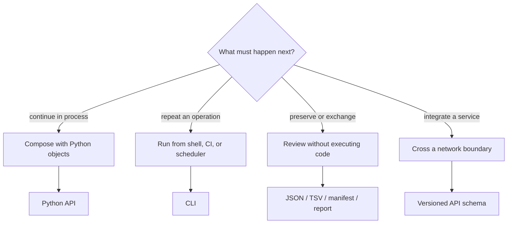
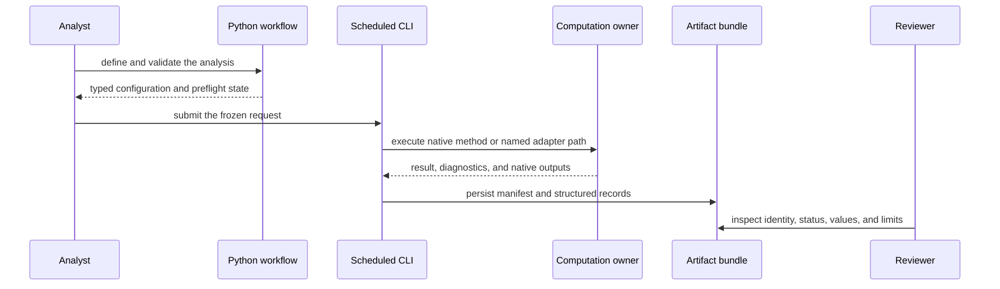

# Surface Selection

Choose an interface by who must consume the result and how long the result must
remain inspectable. Method availability alone is not a sufficient criterion.

## Decision Matrix

| Requirement | Python | CLI | Artifacts | API |
| --- | :---: | :---: | :---: | :---: |
| compose methods in memory | best | limited | no | remote |
| shell automation and exit codes | indirect | best | output | client |
| rich typed diagnostics | best | serialized | persisted subset | schema-bound |
| long-lived review | create them | create them | best | capture needed |
| language-independent exchange | serialize | serialize | best | best |

## Choose By Failure And Recovery

| Requirement | Preferred surface | Reason |
| --- | --- | --- |
| caller must catch and recover from domain-specific failures | Python | exceptions and typed diagnostic state remain in process |
| scheduler must classify success, refusal, and infrastructure failure | CLI plus structured output | exit status and result status can be retained separately |
| reviewer must inspect a completed or failed run later | artifact bundle | input, configuration, diagnostics, and output inventory survive execution |
| remote consumer must poll long work or cross security boundaries | service API | transport, job lifecycle, and scientific state can be modelled explicitly |

Do not choose a surface only because it can start the computation. Choose the
surface that can preserve the failure modes and recovery decisions the
consumer must own.

## Recommended Mixed Mode

The strongest workflows commonly use more than one surface:

1. Prototype and inspect rich results through Python.
2. Freeze repeatable parameters in a CLI invocation or application workflow.
3. Persist machine-readable results, a manifest, and reviewer-facing outputs.
4. Review the artifacts without requiring the original process state.

That sequence is not mandatory. It illustrates that interfaces solve different
parts of the lifecycle rather than competing to be the single universal entry
point.

## Worked Selections

| Situation | Selection | Handoff record |
| --- | --- | --- |
| explore alternative comparative formulas in a notebook | workflow or comparative Python API | serialize chosen formula, reconciled taxa, result, and diagnostics |
| execute the same configured inference on a scheduler | CLI or configured workflow entry point | command/config, exit state, engine identity, manifest, and native outputs |
| review a completed posterior without recreating its environment | artifacts | chain identity, diagnostics, summaries, tree samples, model and seed provenance |
| expose validation to another language | versioned service API | pinned schema, request identity, transport state, scientific result state |
| publish a figure and supporting table | structured artifact plus renderer | source result, table schema, rendering parameters, and manifest linkage |

The surface follows the consumer and failure-recovery contract. It does not
change who owns the scientific computation.

## One Analysis Can Cross Surfaces Without Transferring Ownership

Every arrow needs a durable handoff, but the arrows do not create new
scientific owners. Python owns its object and validation contract; the CLI owns
argument translation and exit behavior; the native method or external engine
owns the computation; the bundle owns retained identity and inventory; the
reviewer owns the downstream acceptance decision.

If a handoff drops taxa, defaults, units, warnings, method identity, or result
state, the workflow is not equivalent merely because its headline estimate is
unchanged.

## Cross-Surface Equivalence Requires Preserved Semantics

Moving a request between Python, CLI, service, and artifact surfaces changes
representation and lifecycle. It must not silently change the scientific
contract.

| Semantic field | Cross-surface invariant | Typical loss to detect |
| --- | --- | --- |
| input identity | same source objects, content identities, admitted population and order | path-based lookup resolves different bytes or row order |
| defaults | every material default resolves to the same explicit value | CLI or service default differs from Python construction |
| method identity | native or external owner, model, parameterization and controls match | normalized result hides a different engine or model |
| absence and failure | null reasons, refusal codes, partial state and missing inventory survive | TSV empty cell or exit code collapses distinct states |
| uncertainty | support, intervals, chains, diagnostics and denominator remain linked | summary serialization drops samples or warnings |
| persistence | schema, manifest, checksums and producer identity bind the output | copied report becomes detached from the owning result |

An equivalence check compares these fields before numerical output. If a
surface cannot represent a material state, retain a link to the richer owner
or refuse the migration; do not compensate with explanatory prose around a
lossy payload.

## Python Is The Right Choice When

You need custom composition, iterative model construction, in-memory tree or
alignment reuse, programmatic access to typed diagnostics, or integration into
another Python system. Use documented imports; internal module paths are not a
stability shortcut.

## CLI Is The Right Choice When

You need a reviewable command, predictable exit semantics, filesystem inputs,
scheduled execution, or shell-level orchestration. Record the command,
installed versions, environment assumptions, and output directory together.

## Artifacts Are The Right Choice When

The consumer should not execute the analysis: reviewers, archival systems,
publication pipelines, dashboards, and cross-language tools. Prefer manifest
and structured outputs over scraping prose or filenames.

Artifacts are also the required handoff when the producing environment will
not remain available. Retain enough runtime and engine identity to distinguish
a reproducible bundle from an orphaned output directory.

## API Is The Right Choice When

A process boundary is part of the system design. Pin the schema version and
plan for transport errors, authentication, quotas, and asynchronous execution
separately from scientific diagnostics.

## Anti-Patterns

- calling the CLI through Python when a supported Python function exists;
- treating stdout text as a durable schema;
- loading private modules because the curated API feels less convenient;
- persisting only a figure and losing configuration or diagnostics;
- exposing an internal result object directly as an unversioned service payload;
- assuming normalized adapter output removes the need to record engine version.

## Selection Test

A defensible choice answers all of these: Who invokes it? Who reviews it? How
are failures observed? Which compatibility promise applies? What survives
after execution? Which versions and inputs can reconstruct the result?

## Migration Test

When changing surfaces—for example, moving a notebook workflow into scheduled
CLI execution—compare the validated inputs, explicit defaults, method
configuration, status handling, structured results, and artifact inventory.
Matching headline estimates is insufficient if warnings, taxa, support,
uncertainty, or ownership changed during translation.
