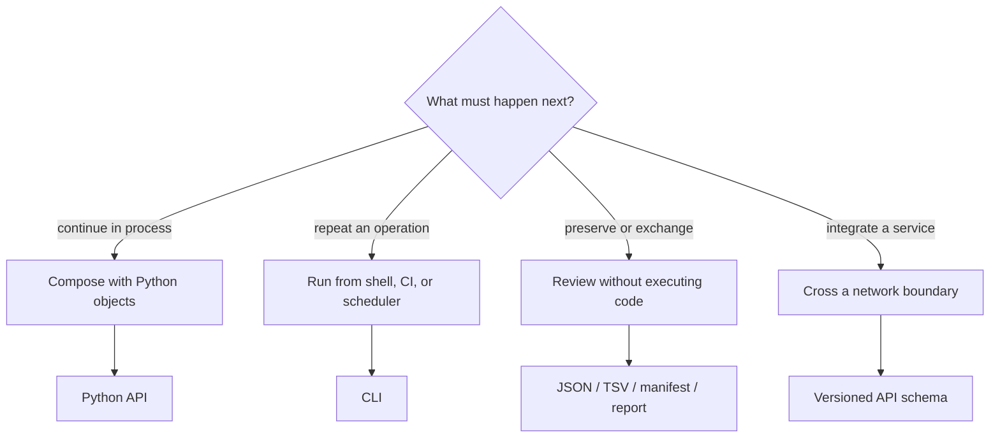

# Surface Selection

Choose an interface by who must consume the result and how long the result must
remain inspectable. Method availability alone is not a sufficient criterion.

## Decision Matrix

| Requirement | Python | CLI | Artifacts | API |
| --- | :---: | :---: | :---: | :---: |
| compose methods in memory | best | limited | no | remote |
| shell automation and exit codes | indirect | best | output | client |
| rich typed diagnostics | best | serialized | persisted subset | schema-bound |
| long-lived review | create them | create them | best | capture needed |
| language-independent exchange | serialize | serialize | best | best |

## Recommended Mixed Mode

The strongest workflows commonly use more than one surface:

1. Prototype and inspect rich results through Python.
2. Freeze repeatable parameters in a CLI invocation or application workflow.
3. Persist machine-readable results, a manifest, and reviewer-facing outputs.
4. Review the artifacts without requiring the original process state.

That sequence is not mandatory. It illustrates that interfaces solve different
parts of the lifecycle rather than competing to be the single universal entry
point.

## Python Is The Right Choice When

You need custom composition, iterative model construction, in-memory tree or
alignment reuse, programmatic access to typed diagnostics, or integration into
another Python system. Use documented imports; internal module paths are not a
stability shortcut.

## CLI Is The Right Choice When

You need a reviewable command, predictable exit semantics, filesystem inputs,
scheduled execution, or shell-level orchestration. Record the command,
installed versions, environment assumptions, and output directory together.

## Artifacts Are The Right Choice When

The consumer should not execute the analysis: reviewers, archival systems,
publication pipelines, dashboards, and cross-language tools. Prefer manifest
and structured outputs over scraping prose or filenames.

## API Is The Right Choice When

A process boundary is part of the system design. Pin the schema version and
plan for transport errors, authentication, quotas, and asynchronous execution
separately from scientific diagnostics.

## Anti-Patterns

- calling the CLI through Python when a supported Python function exists;
- treating stdout text as a durable schema;
- loading private modules because the curated API feels less convenient;
- persisting only a figure and losing configuration or diagnostics;
- exposing an internal result object directly as an unversioned service payload;
- assuming normalized adapter output removes the need to record engine version.

## Selection Test

A defensible choice answers all of these: Who invokes it? Who reviews it? How
are failures observed? Which compatibility promise applies? What survives
after execution? Which versions and inputs can reconstruct the result?
