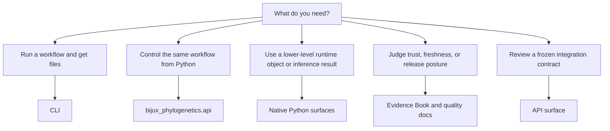

# Surface Selection Guide

Use this page when you know what you want to do, but you are not sure which
public entry point to start with.

The project exposes several public routes on purpose. They answer different
questions: some help you run a full workflow, some help you control that
workflow from Python, and some help you decide how much confidence to place in
the outcome.

## Quick Choice Table

| Goal | Start here | Why |
| --- | --- | --- |
| Run a documented workflow and get files | [CLI surface](cli-surface.md) | Best for governed outputs, reports, and shell use |
| Run the same workflow from Python | [API surface](api-surface.md) | Best for typed workflow control |
| Work with one owned runtime object directly | [Python surface](python-surface.md) and [native inference and benchmarks](native-inference-and-benchmarks.md) | Best for lower-level or library use |
| Judge trust, parity, or release posture | [Evidence Book](../../02-bijux-phylogenetics-evidence-book/index.md) and [quality docs](../quality/index.md) | Best for bounded claims and review surfaces |
| Review a frozen integration contract | [API surface](api-surface.md) | Best for schema and interface review |

I want one governed end-user workflow or report artifact.
I want to judge trust, parity, freshness, or evidence closure.

## Practical Rules

- If the result should be a file bundle you can review or share, prefer the
  CLI.
- If the result should stay in Python as one typed workflow object, prefer
  `bijux_phylogenetics.api`.
- If the result should be one lower-level runtime contract rather than one full
  workflow wrapper, prefer the named native Python surfaces.
- If the question is whether the repository has proved something, leave the
  runtime handbook and read the evidence or quality surfaces directly.

## What Not To Do

- Do not assume every helper below the documented entry points is a public
  contract.
- Do not treat wrapper-backed workflows as native implementation claims.
- Do not use the evidence book as a substitute for runtime usage docs.
- Do not use one runtime page as proof of scientific closure.
