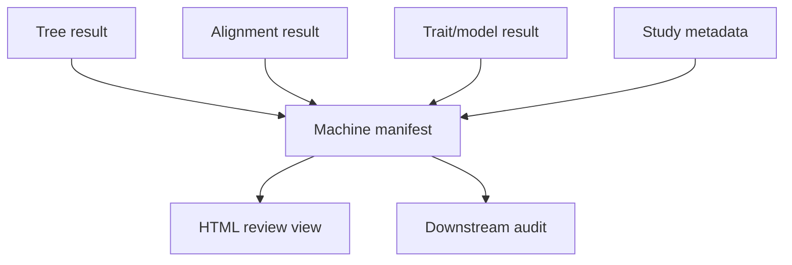

# Analysis Report Handoff

A report is a review view over identified scientific objects. It does not
become the owner of the tree, alignment, trait model, or claim merely because
it presents them together.

Use this workflow when structured results already exist and the next consumer
needs a navigable human review surface. Do not use report rendering as the
analysis step or as a recovery mechanism for missing machine output.

## Build A Linked Review Surface

```python
from pathlib import Path

from bijux_phylogenetics.api import render_report_workflow

report = render_report_workflow(
    tree_path=Path("artifacts/sequence-to-tree/study-tree.treefile"),
    alignment_path=Path("artifacts/sequence-to-tree/study-tree.trimmed.fasta"),
    traits_path=Path("study/traits.tsv"),
    metadata_path=Path("study/metadata.tsv"),
    out_path=Path("artifacts/review/phylogenetics-report.html"),
)

report.write_json(Path("artifacts/review/report-build.json"))
report.write_tsv(Path("artifacts/review/report-summary.tsv"))
```

The result identifies the HTML output and machine manifest and carries tree,
alignment, trait, and metadata inspection state. Optional inputs remain
optional; their absence must not be rendered as a successful validation.

## Preserve Ownership Through Projection



The manifest is the inventory edge between inputs and presentation. It does
not replace the structured results that own estimates, diagnostics, warnings,
or execution identity. Preserve those records beside the report.

## Review Backward From Every Claim

For each table cell, caption value, tree mark, or narrative conclusion:

1. identify the structured row or typed field that owns the value;
2. resolve its input, model, taxon population, units, and status;
3. confirm that the visual encoding preserves missingness and exclusions;
4. verify that the manifest identifies the exact projection;
5. stop if a displayed value exists only in HTML or prose.

Rounding may change presentation, not the underlying acceptance decision.
Sorting may change display order, not row identity. A report must never turn a
warning, unavailable component, or partial execution into an affirmative
symbol.

## Define The Handoff Package

| Component | Role |
| --- | --- |
| structured scientific results | own values, units, status and diagnostics |
| input and run identities | reconstruct data, software and configuration |
| machine manifest | inventories accepted projections and their paths |
| HTML report | supports human review and navigation |
| acceptance record | states which result and claim scope were approved |

A consumer should be able to ignore the HTML and still reconstruct the result
contract. Conversely, opening the HTML should make unresolved warnings and
missing components visible rather than requiring access to terminal history.

The handoff is accepted only if all four traversals succeed:

| Traversal | Acceptance condition |
| --- | --- |
| report to value | every displayed analytical value resolves to one structured owner and field |
| value to computation | the result resolves to inputs, population, method, configuration, and status |
| manifest to file | every declared path exists in the accepted package and has the expected role |
| warning to presentation | partial, missing, excluded, or uncertain state remains visible at the point of interpretation |

Presentation-only text may explain a structured result; it cannot be the sole
location of a coefficient, support value, ancestral state, model verdict, or
scientific limitation. If a reviewer must scrape HTML to recover one of those
facts, return the package to its analytical owner.

When a source result changes, create a newly identified report package and
revalidate every dependent view. Do not overwrite the older package and imply
that its prior review applied to the new computation.
