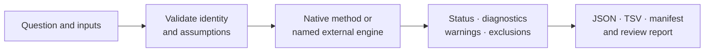

# Common Workflows

Begin with the scientific question, then choose the computation owner and the
records needed for review. These recipes show stable workflow shapes; use
`--help` for the exhaustive option reference and the domain guides for model
assumptions.



## Choose A Workflow

| Goal | Primary command family | First artifact to inspect |
| --- | --- | --- |
| prove the installed package can load its resources and build reports | `demo run` | manifest |
| inspect and validate a tree | `inspect`, `validate`, `diagnose` | structured result and validation warnings |
| validate an alignment | `alignment validate-input` | alphabet, sequence count, length, and invalid-state report |
| compare two trees | `compare` | taxon-overlap policy, shared denominator, and split ledger |
| fit comparative regression | `comparative pgls` | reconciliation, model matrix, lambda profile, coefficients, diagnostics |
| reconstruct continuous ancestral values | `ancestral continuous` | node identity, estimates, uncertainty, and exclusions |
| prepare a reviewer-facing tree package | `report tree-package` | manifest and structured tables before HTML or figures |
| run an external-engine pipeline | `phylo preflight`, then `phylo run` | executable identity, stage status, native files, and bundle inventory |
| evaluate registered reference cases | `parity` | selected, passed, failed, and skipped denominators |
| run owned native inference directly | documented Python result contract | model/search or sampler state and typed diagnostics |

## Put An Acceptance Gate Between Stages

For a composed analysis, define each gate before execution. A stage advances
only when its own result and output contract are accepted; downstream success
cannot repair an upstream contradiction.

| Gate | Accept only when | Stop and retain |
| --- | --- | --- |
| environment → input validation | required runtime and engines are admitted for the named workflow | version, executable, platform, and compatibility blockers |
| input validation → computation | identities, formats, state spaces, partitions, and method preconditions resolve | every refused or excluded record and its reason |
| computation → normalization | native or external execution reaches an allowed terminal state and required native outputs exist | partial search/chain state, streams, diagnostics, and missing outputs |
| normalization → interpretation | parser, schema, units, ordering, denominator, warnings, and omissions are understood | native files and parsing or semantic contradiction |
| interpretation → publication | result scope matches the statement and any required parity or Evidence Book dependency is current | narrower supported conclusion plus unresolved dependency |

Record the accepted artifact role and checksum at every advancing gate. This
makes retries and alternate models separate branches with explicit parents,
instead of allowing files from different attempts to accumulate into one
apparently linear workflow.

## Verify The Installed Environment

```bash
bijux-phylogenetics --version
bijux-phylogenetics env inspect \
  --manifest artifacts/environment/manifest.json \
  --json > artifacts/environment/result.json
```

The environment report distinguishes Python dependency availability from
external executable readiness. It does not prove that a particular dataset or
model will run.

For the broadest self-contained smoke path:

```bash
bijux-phylogenetics demo run \
  --out artifacts/capability-demo \
  --manifest artifacts/capability-demo/manifest.json \
  --json > artifacts/capability-demo/result.json
```

Read the manifest before the rendered reports. The demo establishes packaging,
input coherence, comparison, reporting, and artifact linkage on small packaged
data; it is not an inference-accuracy benchmark.

## Inspect And Validate A Tree

```bash
bijux-phylogenetics inspect dataset/tree.nwk \
  --manifest artifacts/tree-inspection/manifest.json \
  --json > artifacts/tree-inspection/result.json

bijux-phylogenetics validate dataset/tree.nwk \
  --require-rooted \
  --strict \
  --manifest artifacts/tree-validation/manifest.json \
  --json > artifacts/tree-validation/result.json
```

Choose `--require-ultrametric` only when the downstream method requires time
consistency. Do not turn `--allow-duplicates` or
`--allow-negative-branches` into routine bypasses; they change the acceptance
contract and must be justified by the consumer.

Review tip uniqueness, rootedness, branch-length validity, support conventions,
and any method-specific requirement before continuing.

## Validate An Alignment

```bash
bijux-phylogenetics alignment validate-input dataset/alignment.fasta \
  --sequence-type dna \
  --manifest artifacts/alignment-validation/manifest.json \
  --json > artifacts/alignment-validation/result.json
```

The declared sequence type controls valid states and downstream model
selection. Preserve ambiguity, gaps, missing symbols, coding frame, partition,
and exclusion decisions; a rectangular FASTA file is not automatically a
valid input for every analysis.

## Compare Two Trees

```bash
bijux-phylogenetics compare \
  dataset/tree-a.nwk \
  dataset/tree-b.nwk \
  --rf-mode rooted \
  --taxon-overlap-policy require-identical \
  --split-table-out artifacts/tree-comparison/splits.tsv \
  --manifest artifacts/tree-comparison/manifest.json \
  --json > artifacts/tree-comparison/result.json
```

Use `prune-to-shared` only when a shared-taxon comparison answers the intended
question. Record original and shared taxon counts so pruning does not disappear
from the denominator. Rooted clades and unrooted splits are different
contracts; choose `--rf-mode` deliberately.

## Fit Comparative Regression

```bash
bijux-phylogenetics comparative pgls \
  dataset/tree.nwk \
  dataset/traits.tsv \
  --formula 'response ~ body_mass * habitat' \
  --taxon-column taxon \
  --lambda-value estimate \
  --model-matrix-out artifacts/pgls/model-matrix.tsv \
  --categorical-contrasts-out artifacts/pgls/contrasts.tsv \
  --interaction-coefficients-out artifacts/pgls/interactions.tsv \
  --lambda-profile-out artifacts/pgls/lambda-profile.tsv \
  --manifest artifacts/pgls/manifest.json \
  --json > artifacts/pgls/result.json
```

Review taxon reconciliation before coefficients. Then inspect formula and
contrast coding, estimated lambda and its profile, covariance assumptions,
residual diagnostics, exclusions, and coefficient uncertainty. A successful
optimizer does not make the model biologically adequate.

## Reconstruct Continuous Ancestral Values

```bash
bijux-phylogenetics ancestral continuous \
  dataset/tree.nwk \
  dataset/traits.tsv \
  --trait body_mass \
  --taxon-column taxon \
  --model brownian \
  --table-out artifacts/ancestral/node-estimates.tsv \
  --summary-out artifacts/ancestral/summary.tsv \
  --uncertainty-out artifacts/ancestral/uncertainty.tsv \
  --exclusions-out artifacts/ancestral/exclusions.tsv \
  --manifest artifacts/ancestral/manifest.json \
  --json > artifacts/ancestral/result.json
```

Node values are inseparable from topology, rooting, branch lengths, model, and
node identity. Preserve uncertainty and exclusions beside estimates. For
discrete traits, use the named `ancestral discrete` family and record the
state space, transition model, and root-prior contract.

## Build A Tree Review Package

```bash
bijux-phylogenetics report tree-package dataset/tree.nwk \
  --out-dir artifacts/tree-package \
  --manifest artifacts/tree-package/manifest.json \
  --json > artifacts/tree-package/result.json
```

Open the manifest and structured tables before interpreting the figure or HTML
report. Verify that every presented value resolves to a structured source and
that warnings, missing outputs, and incomplete components remain visible.

## Run An External-Engine Workflow

Preflight the exact workflow rather than asking only whether any executable is
installed:

```bash
bijux-phylogenetics phylo preflight \
  --workflow fasta-to-tree \
  --manifest artifacts/phylo-preflight/manifest.json \
  --json > artifacts/phylo-preflight/result.json
```

Then execute a persisted YAML or JSON configuration:

```bash
bijux-phylogenetics phylo run analysis/workflow.yml \
  --manifest artifacts/phylo-run/manifest.json \
  --json > artifacts/phylo-run/result.json
```

For a FASTA-to-tree configuration, MAFFT, trimAl, and IQ-TREE2 remain the
computational owners of their stages. Retain each executable version, resolved
command, captured output, native result files, parser state, normalized
result, stage denominator, and bundle inventory.

## Run Native Inference Through Python

Use the direct owned result contracts when external executables are not part of
the intended method:

- `bijux_phylogenetics.phylo.likelihood.infer_nucleotide_maximum_likelihood_result(...)`
- `bijux_phylogenetics.bayesian.run_bayesian_inference(...)`

The [native maximum-likelihood guide](native-maximum-likelihood-workflows.md)
defines model/search state, multi-start evidence, support, and result
serialization. The [native Bayesian guide](native-bayesian-workflows.md)
defines supported DNA model families, priors, proposal schedules, checkpoint
identity, resume behavior, and posterior diagnostics.

Native means that Bijux owns the algorithm and result contract. It does not
mean every model or dataset has study-level evidence.

## Review Reference Correspondence

Checked reference fixtures:

```bash
bijux-phylogenetics parity \
  --summary-out artifacts/parity/summary.tsv \
  --observations-out artifacts/parity/observations.tsv \
  --manifest artifacts/parity/manifest.json \
  --json > artifacts/parity/result.json
```

Live APE, GEIGER, and phytools runs require `RUN_LIVE_PARITY=1` and an
available R environment. Select `--reference-source`, case or shard filters,
and failure roots explicitly. A live case reports `passed`, `failed`, or
`skipped`; those are runtime case states, not Evidence Book verdicts.

Review the selected denominator, tool and version, input fixture, conventions,
tolerance rationale, observed difference, mismatch reason, and raw reference
artifact. A matching case does not imply package-wide interchangeability.

## Partitioned Multi-Locus Inference

Represent locus boundaries in the persisted workflow configuration and retain
the generated partition scheme with the concatenated alignment. Review taxon
occupancy, missing locus blocks, sequence type per partition, parameter-linkage
policy, model selection, and engine-native files. Do not infer partition
identity from filename order after execution.

## Coding DNA Alignment

Validate nucleotide symbols, reading frame, stop-codon policy, genetic code,
ambiguous codons, and partition boundaries before fitting a codon or
partitioned nucleotide model. Preserve translated diagnostics and excluded
records. Truncating an incomplete codon or changing a genetic code is a method
decision, not cosmetic preprocessing.

## Raw FASTA To Tree

The external-engine route is a configured `phylo run` after
`phylo preflight --workflow fasta-to-tree`. The Python equivalent is
`run_sequence_to_tree_workflow(...)`. Both routes must preserve stage-specific
ownership and failure: alignment, trimming, inference, support, parsing, and
artifact packaging may complete independently.

For owned nucleotide inference without MAFFT, trimAl, or IQ-TREE2, start from a
validated alignment and use the native maximum-likelihood or Bayesian guide.
Do not describe the two routes as the same algorithm because they accept a
similar input file.

## Read Status Before Values

For every workflow, answer these questions in order:

1. Which input records were admitted and excluded?
2. Which native method or external executable owned each computation?
3. Which stages were selected, executed, successful, failed, skipped, or
   missing?
4. Which diagnostics qualify the estimate, tree, history, or comparison?
5. Which structured artifacts own the values shown in reports and figures?
6. Which benchmark, parity, or Evidence Book record—if any—supports a broader
   claim?

If the first five cannot be reconstructed, the run is not a complete handoff.
The sixth is required only when making a claim covered by that evidence.

## Continue By Method

- [Surface selection](../interfaces/surface-selection.md)
- [Artifact consumption](../interfaces/artifact-consumption-guide.md)
- [Native maximum-likelihood workflows](native-maximum-likelihood-workflows.md)
- [Native Bayesian workflows](native-bayesian-workflows.md)
- [Native benchmark review](native-benchmark-review.md)
- [Scientific domains](../../02-bijux-phylogenetics-domains/index.md)
- [Parities and correspondence](../../04-bijux-phylogenetics-parities/index.md)
