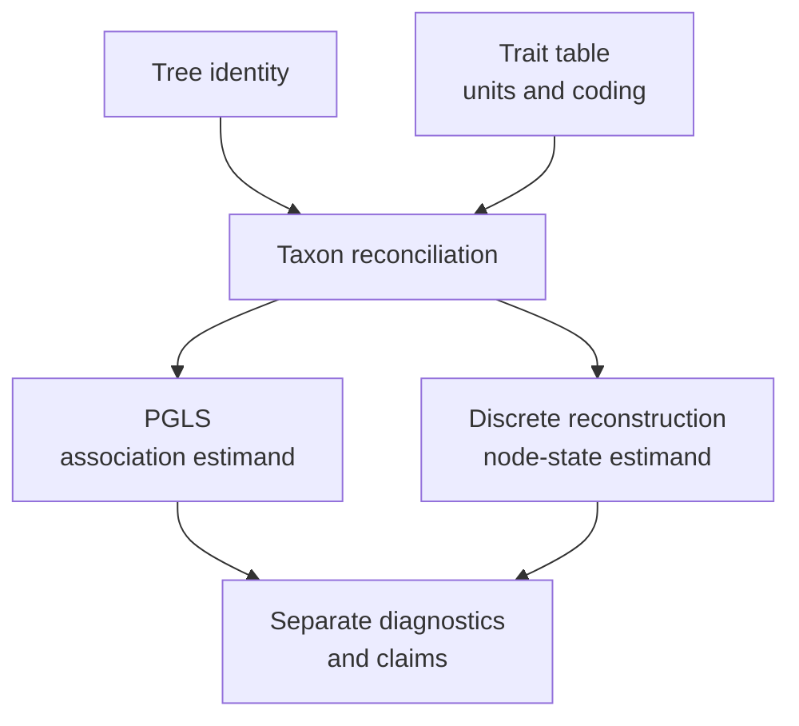

# Comparative And Ancestral Study

Comparative regression and ancestral reconstruction can share a tree and trait
table without sharing an estimand. Admit their common population once, then
preserve a separate model, result, and acceptance decision for each analysis.



## Admit The Shared Population

Before fitting either model, record the tree revision, rooting and branch
length meaning; trait-table checksum; taxon column; units; factor reference
levels; missing-value policy; and every taxon excluded from the join. Row order
must not become an implicit taxon identifier.

The curated Python workflows expose both analyses:

```python
from pathlib import Path

from bijux_phylogenetics.api import (
    run_ancestral_reconstruction_workflow,
    run_comparative_model_workflow,
)

tree = Path("study/tree.nwk")
traits = Path("study/traits.tsv")

regression = run_comparative_model_workflow(
    tree,
    traits,
    response="longevity",
    predictors=["body_mass", "activity_period"],
    taxon_column="taxon",
    lambda_value="estimate",
)
regression.write_json(Path("artifacts/comparative/pgls.json"))
regression.write_tsv(Path("artifacts/comparative/pgls-coefficients.tsv"))

ancestral = run_ancestral_reconstruction_workflow(
    tree,
    traits,
    trait="activity_period",
    taxon_column="taxon",
    model="equal-rates",
    root_prior_mode="equal",
)
ancestral.write_json(Path("artifacts/ancestral/activity-period.json"))
ancestral.write_tsv(Path("artifacts/ancestral/activity-period-nodes.tsv"))
```

Use either `response` plus `predictors` or the documented formula route for
PGLS, and retain the exact choice. Changing a factor reference, interaction,
transform, λ policy, ancestral model, state ordering, transition constraint,
or root prior creates a different scientific result.

## Read The PGLS Result

The coefficient table records estimate, standard error, test statistic,
p-value, confidence interval, λ, log likelihood, AIC, and admitted taxon count.
Interpret coefficients only with the design matrix, units, factor coding,
covariance model, residual diagnostics, and reconciled population. A small
p-value does not validate those upstream choices.

Estimated λ is part of the fitted model. A fixed `lambda_value=1.0` asks a
different question and must not be presented as a retry of estimation.

## Read The Ancestral Result

Node estimates require stable node identity and the exact tree. A state label
without node/clade identity, ambiguity, model, and root treatment is not a
portable ancestral observation. Ordered states and allowed transition pairs
encode scientific assumptions; preserve them even when the preferred state at
a named node is unchanged.

## Keep Claims Separate

PGLS estimates association conditional on the admitted covariance and design.
Ancestral reconstruction estimates internal states conditional on the tree and
transition model. Neither result validates the other. A shared input checksum
establishes lineage, not independent evidence.

For publication, retain a common admission record plus separate JSON and TSV
results, configurations, diagnostics, exclusions, and claim identifiers. If
the two analyses use different taxon populations after filtering, record two
derived dataset identities rather than implying one common denominator.
